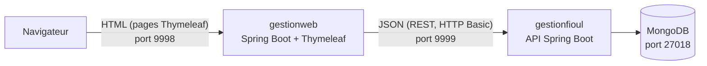
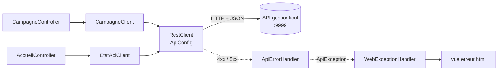
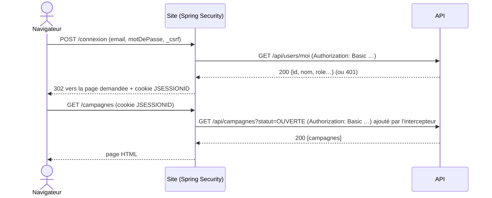
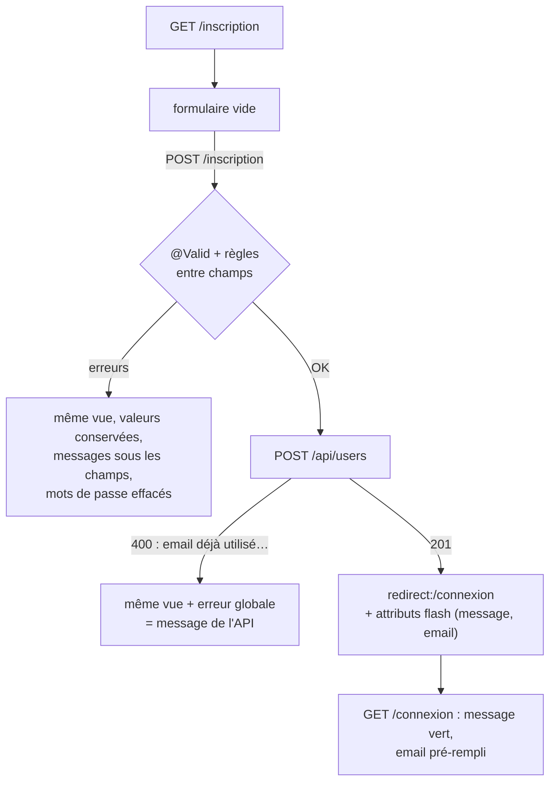
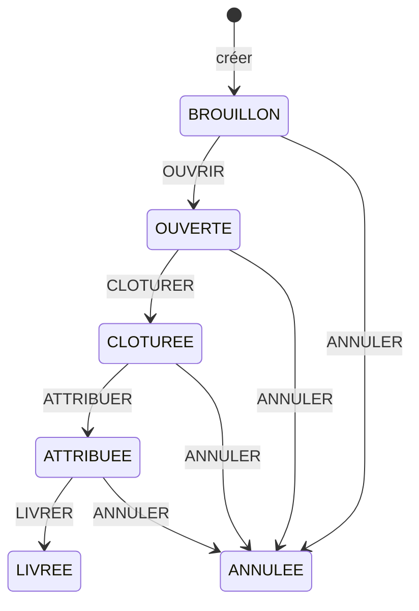
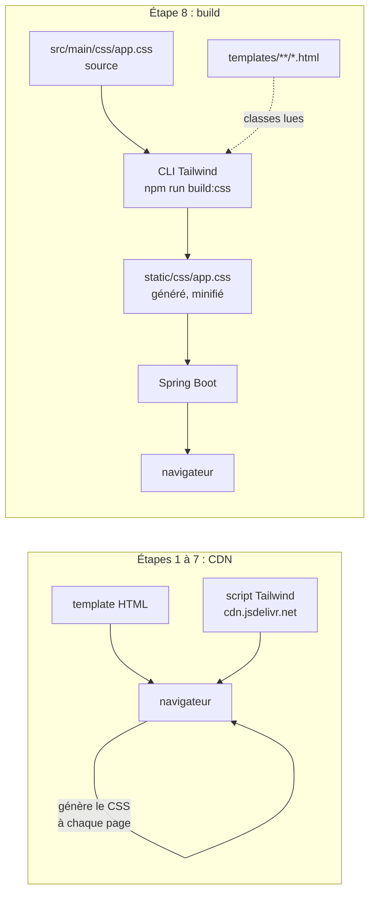
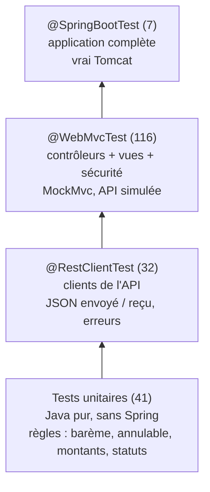
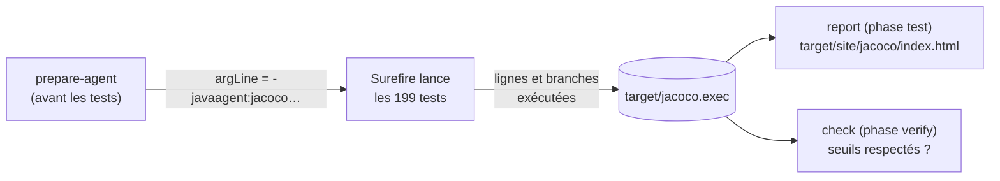
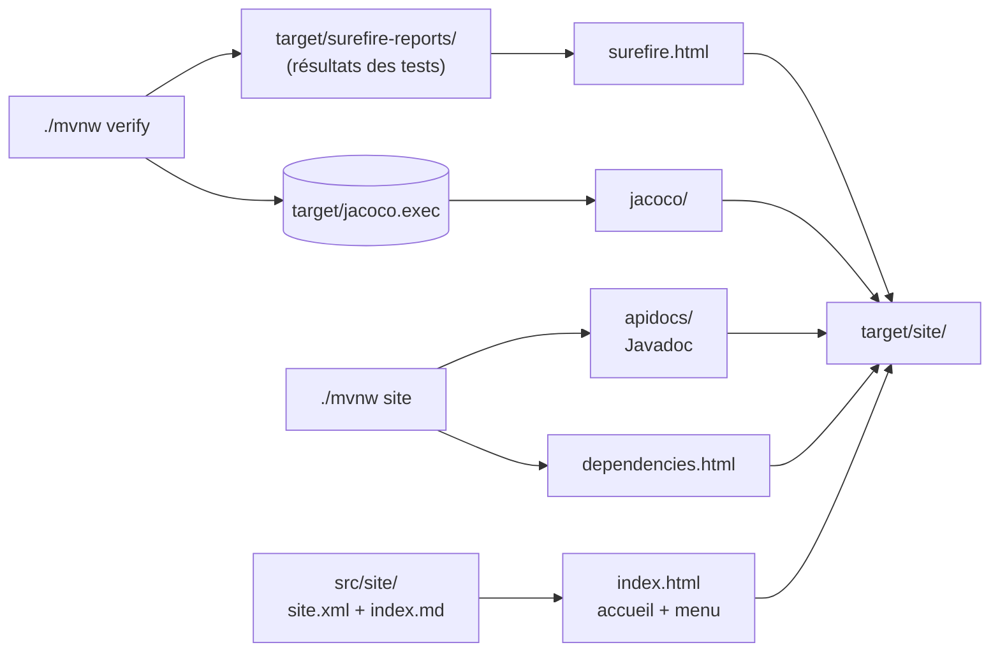

# Gestion Fioul — partie web : journal de développement

Ce document retrace, étape par étape, la construction de l'interface web de l'API **gestionfioul**.
Chaque étape indique son objectif, les notions abordées, les fichiers créés ou modifiés, le code expliqué,
les pièges rencontrés et la façon de vérifier le résultat. Il sert de base à la rédaction des fiches de cours.

---

## Sommaire

- [Vue d'ensemble](#vue-densemble)
- [Dépannage](#dépannage)
- [Étape 1 — Mise en place du projet : Thymeleaf, Tailwind CSS et première page](#étape-1--mise-en-place-du-projet--thymeleaf-tailwind-css-et-première-page)
- [Étape 2 — Appeler l'API avec RestClient et gérer ses erreurs](#étape-2--appeler-lapi-avec-restclient-et-gérer-ses-erreurs)
- [Étape 3 — Connexion et déconnexion : Spring Security côté site, identifiants vérifiés par l'API](#étape-3--connexion-et-déconnexion--spring-security-côté-site-identifiants-vérifiés-par-lapi)
- [Étape 4 — Inscription : formulaire, Bean Validation et erreurs de l'API](#étape-4--inscription--formulaire-bean-validation-et-erreurs-de-lapi)
- [Étape 5 — Espace client : participer, mes participations, annuler](#étape-5--espace-client--participer-mes-participations-annuler)
- [Étape 6 — Espace fournisseur : barème à paliers dynamiques, mes propositions](#étape-6--espace-fournisseur--barème-à-paliers-dynamiques-mes-propositions)
- [Étape 7 — Espace administrateur : créer, piloter le cycle de vie, consulter](#étape-7--espace-administrateur--créer-piloter-le-cycle-de-vie-consulter)
- [Étape 8 — Tailwind CSS compilé avec le CLI (npm) à la place du CDN](#étape-8--tailwind-css-compilé-avec-le-cli-npm-à-la-place-du-cdn)
- [Étape 9 — Bilan des tests : matrice des droits et test d'intégration sur un vrai serveur](#étape-9--bilan-des-tests--matrice-des-droits-et-test-dintégration-sur-un-vrai-serveur)
- [Étape 10 — Couverture de code avec JaCoCo](#étape-10--couverture-de-code-avec-jacoco)
- [Étape 11 — Documentation technique : Javadoc, résultats des tests et couverture dans un site Maven](#étape-11--documentation-technique--javadoc-résultats-des-tests-et-couverture-dans-un-site-maven)

---

## Vue d'ensemble

### Architecture : deux applications



| Application | Rôle | Port |
|---|---|---|
| `gestionfioul` (API) | règles métier, sécurité, accès à MongoDB ; répond en JSON | 9999 |
| `gestionweb` (site) | affiche des pages HTML, appelle l'API ; **n'accède jamais à la base** | 9998 |

Choix pédagogique : le site est un **client** de l'API, comme le serait une application mobile.
Toutes les règles (droits par rôle, statuts des campagnes, validation des paliers…) restent dans l'API ;
le site se contente de présenter les données et de transmettre les actions de l'utilisateur.

### Stack technique

| Élément | Choix |
|---|---|
| Langage | Java 27 |
| Framework | Spring Boot 4.1.2 (Spring MVC) |
| Vues | **Thymeleaf** (rendu HTML côté serveur) |
| Style | **Tailwind CSS** v4.1.11 (CDN aux étapes 1 à 7, puis CSS compilé par le CLI Tailwind avec npm à l'étape 8) |
| Outillage front | Node.js + npm (étape 8, uniquement pour compiler le CSS) |
| Appels à l'API | `RestClient` de Spring (à partir de l'étape 2) |
| Sécurité | Spring Security : formulaire de connexion + session, identifiants vérifiés par l'API |
| Tests | JUnit 5, Mockito, AssertJ, `@RestClientTest`, `@WebMvcTest` + MockMvc, `@SpringBootTest` ; couverture **JaCoCo** 0.8.16 |
| Documentation | **Javadoc** + site Maven (`maven-site-plugin` 3.22.0, skin Fluido) : Javadoc, résultats des tests, couverture (étape 11) |

### Plan prévu

1. Mise en place du projet : Thymeleaf, Tailwind (CDN), gabarit commun, page d'accueil.
2. Client de l'API (`RestClient`), gestion des erreurs `ProblemDetail`, état de l'API sur l'accueil, première
   liste de campagnes (refusée par l'API tant que l'authentification n'existe pas).
3. Ajout de `GET /api/users/moi` dans l'API, puis connexion / déconnexion côté web (Spring Security),
   identifiants transmis automatiquement à l'API à chaque appel.
4. Inscription (formulaire, validation, affichage des erreurs).
5. Espace client : campagnes ouvertes, participer, mes participations, annuler.
6. Espace fournisseur : soumettre un barème à paliers, mes propositions.
7. Espace admin : créer une campagne, cycle de vie, participations et propositions, attribution.
8. Tailwind CSS en build (CLI + npm) à la place du CDN.
9. Tests des contrôleurs web.
10. Couverture de code avec JaCoCo (ajoutée à la demande après l'étape 9).
11. Documentation technique : Javadoc et site Maven regroupant tests et couverture (ajoutée à la demande).

### Organisation du code

Comme l'API, le site est organisé **par fonctionnalités** : un package par sujet (`accueil`, `campagne`,
`participation`…) contenant son contrôleur, ses formulaires et ses vues, plutôt que des packages techniques
`controller/`, `service/`…

---

## Dépannage

### « Port already in use » : le port est déjà pris

```
***************************
APPLICATION FAILED TO START
***************************
Description:
Web server failed to start. Port 9998 was already in use.
```

Un port ne peut être écouté que par **un seul programme à la fois**. Causes fréquentes :

| Cause | Comment le voir | Solution |
|---|---|---|
| le site est **déjà lancé** (deuxième clic sur *Run* dans l'IDE, ou un `mvnw spring-boot:run` oublié dans un terminal) | l'IDE affiche deux consoles d'exécution | arrêter l'ancienne instance (bouton *Stop*) avant de relancer |
| un **autre programme** utilise ce port (conteneur Docker, autre projet…) | commande ci-dessous | choisir un autre port dans `application.properties` (`server.port`) |
| l'API et le site ont reçu le **même port** | les deux `server.port` sont identiques | site et API sur deux ports différents (ici 9998 et 9999) |

Trouver qui occupe un port sous Windows :

```powershell
netstat -ano | findstr :9998                 # dernière colonne : le PID du processus
tasklist /FI "PID eq 12345"                  # nom du programme correspondant
Stop-Process -Id 12345                       # l'arrêter (PowerShell), si c'est bien une instance oubliée
```

### Le piège de DevTools : une instance oubliée qui « suit » les modifications

**Spring Boot DevTools** surveille les fichiers du projet et **redémarre automatiquement** l'application à chaque
modification, y compris d'`application.properties`. Conséquence observée pendant le développement :

1. une instance du site, lancée en arrière-plan puis oubliée, occupait le port 8090 ;
2. le lancement depuis l'IDE échouait : « port déjà pris » ;
3. on change `server.port` en 9998… DevTools redémarre **l'instance oubliée**, qui s'installe sur 9998 ;
4. le lancement depuis l'IDE échoue à nouveau, cette fois sur 9998.

> **À retenir** : changer de port ne règle rien si la cause est une instance en trop, DevTools la fait suivre.
> Il faut **arrêter l'instance fantôme**. Une seule instance du site et une seule de l'API à la fois.

### Autres problèmes fréquents

| Symptôme | Cause probable | Solution |
|---|---|---|
| `ClassNotFoundException: …DemoApplication` au lancement | ancienne configuration d'exécution de l'IDE (avant le renommage) | supprimer la configuration et lancer `GestionwebApplication` |
| classes ou dépendances introuvables après une modification du `pom.xml` | projet Maven non rechargé dans l'IDE | *Reload Maven project* (IntelliJ) / *Update project* (Eclipse) |
| badge rouge « L'API est injoignable » sur l'accueil | API arrêtée ou mauvaise adresse | démarrer l'API (`gestionfioul`, port 9999), vérifier `gestionfioul.api.url` |
| erreur **404** à la connexion alors que les identifiants sont bons | l'API lancée est une **ancienne version** sans `GET /api/users/moi` | redémarrer l'API pour qu'elle prenne en compte le nouveau code |
| déconnecté après chaque modification du code | DevTools redémarre l'application : les sessions (en mémoire) sont perdues | comportement normal en développement, se reconnecter |
| **403** en soumettant un formulaire | jeton CSRF absent : `action="…"` au lieu de `th:action="@{…}"` | toujours utiliser `th:action` dans les formulaires |
| page d'erreur du site (403, 404…) reçue en **JSON** (`{"status":403,"error":"Forbidden"…}`) avec `curl` ou Postman | le contrôleur d'erreur de Spring Boot choisit le format selon l'en-tête `Accept` : HTML seulement si le client demande `text/html` (ce que fait un navigateur) | normal ; pour voir la page avec `curl` : `-H "Accept: text/html"` |
| **400** sans message en postant un formulaire avec des accents **depuis `curl` sous Windows** | `curl` convertit ses arguments dans l'encodage Windows (CP1252) : `É` part en `%C9`, octet UTF-8 invalide, rejeté par le pare-feu de Spring Security (`StrictHttpFirewall`) | pas de problème dans un navigateur (il envoie de l'UTF-8) ; avec `curl`, encoder à la main : `prenom=%C3%89tape` |
| page « **Whitelabel Error Page** » en anglais (adresse inconnue, erreur 500…) | aucune vue d'erreur pour ce code : Spring Boot cherche `error/404.html`, puis `error/4xx.html`, puis `error.html` | pages `error/403.html`, `error/404.html` et `error.html` ajoutées (étape 9) |
| *(étape 8)* page **sans aucun style** (texte brut, liens bleus) | `src/main/resources/static/css/app.css` absent (jamais compilé), ou `/css/**` non autorisé dans `SecurityConfig` (le navigateur reçoit la page de connexion à la place du CSS) | `npm install` puis `npm run build:css` ; vérifier `.requestMatchers("/css/**").permitAll()` ; ouvrir `http://localhost:9998/css/app.css` |
| *(étape 8)* une **nouvelle classe** Tailwind n'a aucun effet | le CSS n'a pas été recompilé, ou la classe est **construite par concaténation** (`'bg-' + couleur`) : le CLI ne la voit pas | laisser tourner `npm run watch:css` ; écrire les classes **en entier** dans les templates ; rechargement forcé du navigateur (Ctrl+F5) |
| *(étape 8)* `npm run watch:css` **s'arrête aussitôt** après « Done » | lancé sans terminal interactif (tâche d'arrière-plan, certains lanceurs) : le CLI Tailwind v4 s'arrête quand son entrée standard se ferme | le lancer dans un vrai terminal, ou utiliser `--watch=always` |
| *(étape 11)* un commentaire Javadoc corrigé **n'apparaît pas** dans `target/site/apidocs` | le plugin Javadoc n'a pas détecté la modification (il ne regarde que la date du dossier `src/main/java`) | `./mvnw clean verify site` |
| *(étape 11)* `./mvnw site` échoue : `error: unknown tag`, `malformed HTML`, `@param name not found`, `reference not found` | commentaire Javadoc incorrect (ligne qui commence par `@Annotation`, `<` non échappé, paramètre renommé, `{@link}` vers une classe inconnue) : `failOnWarnings` arrête la génération | corriger le commentaire indiqué (fichier et ligne dans le message) ; `{@code …}` pour le code |
| *(étape 11)* des dizaines de tests en erreur (`Unable to find a @SpringBootConfiguration`, `.class cannot be opened`) juste après une modification du `pom.xml` | l'IDE recompile `target/classes` **en même temps** que Maven exécute les tests | attendre la fin du rechargement Maven de l'IDE, puis relancer |
| *(étape 8)* `npm warn allow-scripts … @tailwindcss/oxide … @parcel/watcher` à l'installation | npm 11 n'exécute plus les scripts d'installation des paquets sans autorisation | sans conséquence ici : les binaires Windows sont fournis par des paquets séparés (`…-win32-x64`) ; la compilation fonctionne |

---

## Étape 1 — Mise en place du projet : Thymeleaf, Tailwind CSS et première page

### Objectif

Partir du squelette généré par Spring Initializr et obtenir une page d'accueil HTML, stylée avec Tailwind,
construite sur un **gabarit commun** (en-tête, contenu, pied de page) réutilisable par toutes les pages.

### Notions abordées

- Différence entre `@Controller` (renvoie une **vue**) et `@RestController` (renvoie des **données**).
- Le `Model` : transmettre des données du contrôleur à la vue.
- Résolution des vues Thymeleaf (`templates/…/*.html`).
- Expressions Thymeleaf : `${…}` (variable), `@{…}` (URL), `~{…}` (fragment).
- **Fragments paramétrés** pour un gabarit commun, sans bibliothèque supplémentaire.
- Tailwind CSS : classes utilitaires, intégration par CDN.
- Spring Boot DevTools et désactivation du cache Thymeleaf.
- Premier test de contrôleur avec `@WebMvcTest` et MockMvc.

### 1.1 Renommage du projet

Le squelette généré s'appelait `demo`, avec le package `fr.limoges.valadon.gestionfioul.web.demo`.

| Avant | Après |
|---|---|
| `artifactId` : `demo` | `gestionweb` |
| `groupId` : `fr.limoges.valadon.gestionfioul.web` | `fr.limoges.valadon.gestionfioul` |
| package `…gestionfioul.web.demo` | `fr.limoges.valadon.gestionfioul.web` |
| `DemoApplication` | `GestionwebApplication` |

> **Pourquoi c'est important** : `@SpringBootApplication` scanne son package **et ses sous-packages**.
> La classe principale doit donc être à la racine (`…web`) pour que les contrôleurs placés dans
> `…web.accueil`, `…web.campagne`… soient détectés.

### 1.2 Dépendances (`pom.xml`)

```xml
<!-- Spring MVC : contrôleurs, Tomcat embarqué, et RestClient pour appeler l'API -->
<dependency>
    <groupId>org.springframework.boot</groupId>
    <artifactId>spring-boot-starter-webmvc</artifactId>
</dependency>
<!-- Thymeleaf : moteur de templates HTML côté serveur -->
<dependency>
    <groupId>org.springframework.boot</groupId>
    <artifactId>spring-boot-starter-thymeleaf</artifactId>
</dependency>
<!-- DevTools : redémarrage automatique en développement -->
<dependency>
    <groupId>org.springframework.boot</groupId>
    <artifactId>spring-boot-devtools</artifactId>
    <scope>runtime</scope>
    <optional>true</optional>
</dependency>
```

- Le starter **Thymeleaf** suffit : Spring Boot configure automatiquement le moteur, qui cherche les vues
  dans `src/main/resources/templates/` avec l'extension `.html`.
- **DevTools** redémarre l'application quand une classe change. `optional` + `runtime` : il n'est jamais
  embarqué dans le jar de production.
- Pas encore de Spring Security : il sera ajouté à l'étape 3. (Dès qu'il est présent, **toutes** les pages
  deviennent protégées par défaut ; l'ajouter maintenant compliquerait inutilement cette première étape.)

### 1.3 Configuration (`application.properties`)

```properties
spring.application.name=gestionweb

# port du site web (8080 est déjà occupé sur le poste de développement, l'API est sur 9999)
server.port=9998

# adresse de l'API REST gestionfioul, utilisée par le site à partir de l'étape 2
gestionfioul.api.url=${GESTIONFIOUL_API_URL:http://localhost:9999}

# Thymeleaf : pas de cache en développement pour voir les modifications des templates sans redémarrer
spring.thymeleaf.cache=false
```

- Le site et l'API sont **deux serveurs** : ils doivent avoir des ports différents.
- `${GESTIONFIOUL_API_URL:http://localhost:9999}` : valeur lue dans une variable d'environnement, avec une
  valeur par défaut après `:`. Même principe que dans l'API (`${ADMIN_PASSWORD:…}`).
- `gestionfioul.api.url` est une propriété **personnalisée** : Spring ne la connaît pas, c'est notre code qui
  la lira (étape 2).

### 1.4 Classe principale

```java
package fr.limoges.valadon.gestionfioul.web;

@SpringBootApplication
public class GestionwebApplication {
    public static void main(String[] args) {
        SpringApplication.run(GestionwebApplication.class, args);
    }
}
```

### 1.5 Premier contrôleur : `accueil/AccueilController`

```java
@Controller
public class AccueilController {

    @GetMapping("/")
    public String accueil(Model model) {
        // le Model transporte des données du contrôleur vers la vue
        model.addAttribute("titre", "Commandes groupées de fioul");
        return "accueil/index";
    }
}
```

| | `@RestController` (API) | `@Controller` (site web) |
|---|---|---|
| La méthode renvoie | l'objet à convertir en JSON | le **nom d'une vue** |
| Réponse au navigateur | `{"id": "…", "libelle": "…"}` | une page HTML complète |
| Données pour l'affichage | dans le corps de la réponse | dans le `Model` |

Le nom `"accueil/index"` est résolu en `src/main/resources/templates/accueil/index.html`
(préfixe `templates/` + nom + suffixe `.html`).

### 1.6 Le gabarit commun : `templates/layout.html`

Problème : toutes les pages partagent le même `<head>` (Tailwind), le même en-tête et le même pied de page.
Les recopier dans chaque page rendrait toute modification pénible.

Solution sans dépendance supplémentaire : un **fragment paramétré**. Le fichier `layout.html` déclare
un fragment `page` qui reçoit deux morceaux de HTML venant de la page qui l'appelle :

```html
<html lang="fr" xmlns:th="http://www.thymeleaf.org"
      th:fragment="page(blocTitre, blocContenu)">
<head>
    <meta charset="UTF-8">
    <meta name="viewport" content="width=device-width, initial-scale=1">
    <title th:replace="${blocTitre}">Gestion Fioul</title>
    <script src="https://cdn.jsdelivr.net/npm/@tailwindcss/browser@4.1.11"></script>
</head>
<body class="min-h-screen flex flex-col bg-slate-50 text-slate-800">

<header class="bg-amber-600 text-white shadow">
    <nav class="max-w-6xl mx-auto px-4 py-3 flex items-center justify-between">
        <a th:href="@{/}" class="text-xl font-bold tracking-tight">⛽ Gestion Fioul</a>
        <ul class="flex gap-4 text-sm">
            <li><a th:href="@{/}" class="hover:underline">Accueil</a></li>
        </ul>
    </nav>
</header>

<main th:replace="${blocContenu}">
    Contenu de la page
</main>

<footer class="mt-auto bg-slate-800 text-slate-300 text-sm">…</footer>
</body>
</html>
```

- `th:fragment="page(blocTitre, blocContenu)"` : déclare un fragment réutilisable avec deux paramètres.
- `th:replace="${blocTitre}"` : la balise est **remplacée** par le morceau de HTML reçu.
- `th:href="@{/}"` : syntaxe d'URL Thymeleaf. Elle ajoute automatiquement le *context path* de
  l'application si elle n'est pas déployée à la racine (à préférer à `href="/"` écrit en dur).
- Le texte entre les balises (`Contenu de la page`) n'est visible que si on ouvre le fichier directement
  dans un navigateur, sans serveur : c'est le principe des **templates naturels** de Thymeleaf.

### 1.7 La page d'accueil : `templates/accueil/index.html`

```html
<html lang="fr" xmlns:th="http://www.thymeleaf.org"
      th:replace="~{layout :: page(~{::title}, ~{::main})}">
<head>
    <title>Accueil — Gestion Fioul</title>
</head>
<body>
<main class="max-w-6xl mx-auto px-4 py-10">
    <h1 class="text-3xl md:text-4xl font-bold text-slate-900" th:text="${titre}">Titre</h1>
    …
</main>
</body>
</html>
```

Lecture de `~{layout :: page(~{::title}, ~{::main})}` :

| Morceau | Signification |
|---|---|
| `~{ … }` | expression de **fragment** |
| `layout :: page` | le fragment `page` du fichier `templates/layout.html` |
| `~{::title}` | la balise `<title>` **de la page courante** |
| `~{::main}` | la balise `<main>` **de la page courante** |

Toute la page est donc remplacée par le gabarit, dans lequel on a injecté notre titre et notre contenu.
`th:text="${titre}"` affiche la variable `titre` placée dans le `Model` par le contrôleur
(le texte est **échappé** : un `<script>` dans la donnée serait affiché, pas exécuté).

### 1.8 Tailwind CSS par CDN

```html
<script src="https://cdn.jsdelivr.net/npm/@tailwindcss/browser@4.1.11"></script>
```

- Tailwind est un framework CSS **utilitaire** : on ne nomme pas des composants (`.carte`, `.bouton`), on
  combine de petites classes qui font chacune une chose : `bg-white` (fond), `rounded-xl` (arrondi),
  `shadow` (ombre), `p-6` (marge intérieure), `md:grid-cols-3` (3 colonnes **à partir** des écrans moyens).
- La version CDN analyse la page **dans le navigateur** et génère le CSS à la volée : idéal pour démarrer,
  **déconseillé en production** (script lourd, CSS calculé à chaque chargement). On passera à un vrai build à
  l'étape 8.
- La version est **figée** (`@4.1.11`) : une URL sans version pourrait changer de comportement du jour au
  lendemain.

Quelques classes utilisées :

| Classe | Effet |
|---|---|
| `max-w-6xl mx-auto px-4` | contenu centré, largeur maximale, marges latérales |
| `min-h-screen flex flex-col` + `mt-auto` sur le footer | pied de page collé en bas même si la page est courte |
| `grid gap-6 md:grid-cols-3` | une colonne sur mobile, trois à partir de 768 px |
| `hover:underline` | soulignement au survol |
| `text-amber-700`, `bg-slate-50` | couleurs de la palette Tailwind (nuances 50 à 950) |

### 1.9 Premier test : `AccueilControllerTest`

```java
@WebMvcTest(AccueilController.class)
class AccueilControllerTest {

    @Autowired
    private MockMvc mockMvc;

    @Test
    void accueil_affiche_la_vue_avec_le_titre() throws Exception {
        mockMvc.perform(get("/"))
                .andExpect(status().isOk())
                .andExpect(view().name("accueil/index"))
                .andExpect(model().attribute("titre", "Commandes groupées de fioul"))
                .andExpect(content().string(containsString("Gestion Fioul")))
                .andExpect(content().string(containsString("Commandes groupées de fioul")));
    }
}
```

- `@WebMvcTest` charge uniquement la couche web (le contrôleur, Thymeleaf), sans démarrer de vrai serveur.
- On vérifie le **nom de la vue**, le **contenu du modèle** et le **HTML produit** (le gabarit a bien été appliqué).
- Import Spring Boot 4 : `org.springframework.boot.webmvc.test.autoconfigure.WebMvcTest`.

### ⚠️ Piège rencontré : un paramètre de fragment masque une variable du modèle

Première version du gabarit : `th:fragment="page(titre, contenu)"`. Le test a échoué ; le `<h1>` affichait :

```html
<h1>&lt;title&gt;Accueil — Gestion Fioul&lt;/title&gt;</h1>
```

**Cause** : le contenu de la page (`<main>`) est évalué **à l'intérieur** du fragment `page`. Dans ce contexte,
le paramètre de fragment `titre` (qui contient la balise `<title>`) **masque** la variable `titre` du `Model`.
`${titre}` désignait donc le fragment, et non le texte voulu.

**Correction** : donner aux paramètres du gabarit des noms qui ne peuvent pas entrer en collision avec des
données métier : `page(blocTitre, blocContenu)`.

> À retenir : dans un fragment paramétré, les paramètres sont des variables locales qui prennent le pas sur
> les attributs du modèle portant le même nom. C'est aussi un bon exemple de l'utilité d'un test : le bug ne
> provoquait aucune erreur, seulement un affichage faux.

### Arborescence à la fin de l'étape

```
gestionweb/
├─ pom.xml
├─ DEVELOPPEMENT.md
└─ src/
   ├─ main/
   │  ├─ java/fr/limoges/valadon/gestionfioul/web/
   │  │  ├─ GestionwebApplication.java
   │  │  └─ accueil/
   │  │     └─ AccueilController.java
   │  └─ resources/
   │     ├─ application.properties
   │     ├─ static/                    (fichiers statiques : CSS, images… — vide pour l'instant)
   │     └─ templates/
   │        ├─ layout.html             gabarit commun
   │        └─ accueil/
   │           └─ index.html           page d'accueil
   └─ test/java/fr/limoges/valadon/gestionfioul/web/
      └─ accueil/
         └─ AccueilControllerTest.java
```

### Vérification

```bash
./mvnw test                 # 1 test, vert
./mvnw spring-boot:run      # ou lancer GestionwebApplication depuis l'IDE
```

Ouvrir http://localhost:9998 : la page d'accueil s'affiche avec l'en-tête orange, le titre, les trois cartes
explicatives et le pied de page. À ce stade, l'API n'a pas besoin d'être démarrée.

### Exercices possibles pour les étudiants

1. Ajouter une page « À propos » (`/a-propos`) utilisant le même gabarit, et son lien dans l'en-tête.
2. Passer une liste de trois étapes depuis le contrôleur et l'afficher avec `th:each` au lieu de l'écrire en dur.
3. Reproduire volontairement le piège du paramètre `titre` et expliquer le résultat obtenu.

---

## Étape 2 — Appeler l'API avec RestClient et gérer ses erreurs

### Objectif

Donner au site le moyen de **dialoguer avec l'API** : envoyer une requête HTTP, convertir la réponse JSON en
objets Java, et transformer les erreurs de l'API en messages compréhensibles par l'utilisateur.

Deux premiers usages concrets :
- la page d'accueil affiche si l'API est **joignable** (et sa version) ;
- une page `/campagnes` liste les campagnes ouvertes… et montre que l'API **refuse** tant que l'utilisateur
  n'est pas authentifié (ce qui justifie l'étape 3).

### Notions abordées

- `RestClient` : client HTTP de Spring (API fluide `get().uri().retrieve().body()`).
- Spring Boot 4 : le client HTTP est un **module séparé** (`spring-boot-starter-restclient`).
- `RestClient.Builder` préconfiguré par Spring Boot, `baseUrl`, propriété personnalisée lue par `@Value`.
- Désérialisation JSON → **records** Java avec Jackson 3 ; `ParameterizedTypeReference` pour une `List<…>`.
- Erreurs HTTP : `defaultStatusHandler`, lecture du **ProblemDetail** (RFC 9457) renvoyé par l'API.
- Deux familles d'échecs : l'API **répond par une erreur** (4xx/5xx) ou l'API **ne répond pas** (`ResourceAccessException`).
- `@ControllerAdvice` + `@ExceptionHandler` côté MVC : afficher une **page d'erreur** au lieu de la page Whitelabel.
- Thymeleaf : `th:each`, `th:if` / `th:unless`, opérateur Elvis `?:`, `#lists`, `#temporals`.
- Tests : `@RestClientTest` + `MockRestServiceServer` (simuler l'API), `@MockitoBean` dans un `@WebMvcTest`.

### Vue d'ensemble de l'étape



| Package | Classe | Rôle |
|---|---|---|
| `api` | `ApiConfig` | déclare **le** `RestClient` du site (adresse de l'API, gestion d'erreur) |
| `api` | `ApiErrorHandler` | transforme une réponse 4xx/5xx en `ApiException` avec un message lisible |
| `api` | `ApiException` | erreur renvoyée par l'API : code HTTP + message |
| `api` | `ProblemeApi` | record recevant le JSON `ProblemDetail` de l'API |
| `common` | `WebExceptionHandler` | `@ControllerAdvice` : erreur non traitée → page `erreur.html` |
| `accueil` | `EtatApiClient`, `EtatApi` | l'API est-elle joignable ? nom, version |
| `campagne` | `Campagne`, `StatutCampagne` | DTO reçus de l'API |
| `campagne` | `CampagneClient` | appels HTTP concernant les campagnes |
| `campagne` | `CampagneController` | page `/campagnes` |

> **Parallèle avec l'API** : côté API, `Controller → Service → Repository → MongoDB`.
> Côté web : `Controller → Client → RestClient → API`. Le `XxxClient` joue le rôle du `Repository` : c'est la
> seule classe qui sait **comment** obtenir les données.

### 2.1 Dépendances

```xml
<!-- RestClient préconfiguré par Spring Boot (RestClient.Builder) pour appeler l'API -->
<dependency>
    <groupId>org.springframework.boot</groupId>
    <artifactId>spring-boot-starter-restclient</artifactId>
</dependency>

<!-- @RestClientTest et MockRestServiceServer : simuler l'API dans les tests -->
<dependency>
    <groupId>org.springframework.boot</groupId>
    <artifactId>spring-boot-starter-restclient-test</artifactId>
    <scope>test</scope>
</dependency>
```

> **Nouveauté Spring Boot 4** : Spring Boot est découpé en modules plus fins. La classe `RestClient` elle-même
> est dans `spring-web` (déjà présent), mais le **`RestClient.Builder` préconfiguré** (convertisseurs JSON de
> Spring Boot, personnalisations, support des tests) est dans `spring-boot-restclient`. Sans ce starter,
> aucun bean `RestClient.Builder` n'existe et l'injection échoue au démarrage.

Jackson (JSON) est déjà apporté par `spring-boot-starter-webmvc`. Spring Boot 4 utilise **Jackson 3** :
ses classes sont dans le package `tools.jackson…` (et non plus `com.fasterxml.jackson…`), l'objet principal
s'appelle `JsonMapper`.

### 2.2 Le RestClient du site : `api/ApiConfig`

```java
@Configuration
public class ApiConfig {

    @Bean
    public RestClient apiRestClient(RestClient.Builder builder,
                                    @Value("${gestionfioul.api.url}") String apiUrl,
                                    JsonMapper jsonMapper) {
        return builder
                .baseUrl(apiUrl)
                .defaultStatusHandler(HttpStatusCode::isError, new ApiErrorHandler(jsonMapper))
                .build();
    }
}
```

- `@Configuration` + `@Bean` : la méthode fabrique un objet que Spring garde et **injecte** partout où un
  `RestClient` est demandé dans un constructeur.
- Les paramètres de la méthode `@Bean` sont eux-mêmes injectés : le `Builder` et le `JsonMapper` de Spring
  Boot, et la propriété `gestionfioul.api.url` (étape 1) grâce à `@Value("${…}")`.
- `baseUrl` : chaque appel n'écrira que la fin de l'URL (`/api/campagnes`). Changer de serveur d'API ne
  demande qu'une modification de propriété (ou de la variable d'environnement `GESTIONFIOUL_API_URL`).
- `defaultStatusHandler(HttpStatusCode::isError, …)` : pour **toute** réponse 4xx ou 5xx, notre
  `ApiErrorHandler` est appelé. Sans lui, `RestClient` lèverait des `HttpClientErrorException` dont le message
  brut (« 409 Conflict: [{"type":"about:blank"…] ») n'est pas présentable à un utilisateur.

### 2.3 Les erreurs de l'API : `ProblemeApi`, `ApiException`, `ApiErrorHandler`

Rappel : l'API renvoie ses erreurs métier au format **ProblemDetail** :

```json
{ "type": "about:blank", "title": "Conflict", "status": 409,
  "detail": "Ce client participe déjà à la campagne : annulez sa participation pour la refaire",
  "instance": "/api/campagnes/c1/participations" }
```

On reçoit ce JSON dans un record qui ne garde que l'utile (Jackson 3 ignore par défaut les champs inconnus) :

```java
public record ProblemeApi(String title, int status, String detail) { }
```

Puis on le transforme en exception métier du site :

```java
public class ApiException extends RuntimeException {
    private final HttpStatusCode statut;
    public ApiException(HttpStatusCode statut, String message) { super(message); this.statut = statut; }
    public HttpStatusCode getStatut() { return statut; }
}
```

Le traducteur :

```java
public class ApiErrorHandler implements RestClient.ResponseSpec.ErrorHandler {

    @Override
    public void handle(HttpRequest request, ClientHttpResponse response) throws IOException {
        HttpStatusCode statut = response.getStatusCode();
        String detail = lireDetail(response);
        throw new ApiException(statut, detail != null ? detail : messageParDefaut(statut));
    }

    private String lireDetail(ClientHttpResponse response) {
        try {
            byte[] corps = response.getBody().readAllBytes();
            if (corps.length == 0) return null;
            ProblemeApi probleme = jsonMapper.readValue(corps, ProblemeApi.class);
            return probleme.detail() == null || probleme.detail().isBlank() ? null : probleme.detail();
        } catch (IOException | RuntimeException e) {
            return null;   // corps absent ou qui n'est pas du JSON
        }
    }
    // messageParDefaut : 401, 403, 404, puis "L'API a renvoyé une erreur (code X)."
}
```

Pourquoi un **message par défaut** ? Toutes les erreurs n'ont pas de ProblemDetail :

| Code | Produit par | Corps | Message affiché |
|---|---|---|---|
| 400, 404, 409 | `GestionExceptionHandler` de l'API | ProblemDetail | le `detail` de l'API |
| 401 | Spring Security (pas d'identifiants) | **vide** | « Authentification refusée par l'API… » |
| 403 | Spring Security (`@PreAuthorize`) | vide ou générique | « Vous n'avez pas les droits… » |
| 502, 503… | proxy, serveur en panne | souvent du HTML | « L'API a renvoyé une erreur (code X). » |

> Le traducteur ne doit **jamais** lever d'autre exception que `ApiException` : d'où le `try/catch` autour de
> la lecture du JSON. Une erreur pendant le traitement d'une erreur serait incompréhensible.

### 2.4 Un premier client : `campagne/CampagneClient`

Les DTO reçus de l'API sont des **records**, dont les noms de composants correspondent aux champs JSON :

```java
public record Campagne(String id, String libelle, LocalDateTime dateOuverture, LocalDateTime dateCloture,
                       StatutCampagne statut, int volumeTotal, String zoneLivraison,
                       String propositionRetenueId) { }
```

`StatutCampagne` est une **copie** de l'enum de l'API (mêmes noms de constantes, sinon la conversion de
`"OUVERTE"` échoue). Les deux applications sont indépendantes : elles ne partagent pas de code, seulement un
**contrat** (le format JSON).

```java
@Component
public class CampagneClient {

    private final RestClient restClient;

    public CampagneClient(RestClient restClient) { this.restClient = restClient; }

    // GET /api/campagnes?statut=OUVERTE
    public List<Campagne> listerParStatut(StatutCampagne statut) {
        return restClient.get()
                .uri("/api/campagnes?statut={statut}", statut)
                .retrieve()
                .body(new ParameterizedTypeReference<List<Campagne>>() {});
    }

    // GET /api/campagnes/{id}
    public Campagne trouver(String id) {
        return restClient.get()
                .uri("/api/campagnes/{id}", id)
                .retrieve()
                .body(Campagne.class);
    }
}
```

| Étape | Rôle |
|---|---|
| `get()` | méthode HTTP (`post()`, `put()`, `delete()`… existent aussi) |
| `uri("/api/campagnes/{id}", id)` | URL relative à `baseUrl`, avec **variables** remplacées et encodées (jamais de concaténation de chaînes) |
| `retrieve()` | envoie la requête ; les erreurs passent par le `defaultStatusHandler` |
| `body(Campagne.class)` | convertit le JSON reçu en objet Java |

> **Pourquoi `ParameterizedTypeReference` ?** `List<Campagne>.class` n'existe pas en Java : à l'exécution, les
> types génériques sont effacés (une `List<Campagne>` est une simple `List`). La classe anonyme
> `new ParameterizedTypeReference<List<Campagne>>() {}` conserve le type complet pour que Jackson sache qu'il
> doit fabriquer des `Campagne`, et non des `Map`.

### 2.5 Le contrôleur et la vue `/campagnes`

```java
@Controller
@RequestMapping("/campagnes")
public class CampagneController {

    @GetMapping
    public String lister(Model model) {
        model.addAttribute("campagnes", campagneClient.listerParStatut(StatutCampagne.OUVERTE));
        return "campagne/liste";
    }
}
```

Aucun `try/catch` : en cas d'erreur, l'exception remonte jusqu'au `WebExceptionHandler` (§2.6).

Extrait de `templates/campagne/liste.html` :

```html
<p th:if="${#lists.isEmpty(campagnes)}">Aucune campagne n'est ouverte pour le moment.</p>

<table th:unless="${#lists.isEmpty(campagnes)}">
  <tr th:each="campagne : ${campagnes}">
    <td th:text="${campagne.libelle}">Commande groupée janvier</td>
    <td th:text="${campagne.zoneLivraison} ?: '—'">87</td>
    <td th:text="${#temporals.format(campagne.dateCloture, 'dd/MM/yyyy HH:mm')}">31/01/2027 23:59</td>
  </tr>
</table>
```

| Syntaxe | Rôle |
|---|---|
| `th:each="campagne : ${campagnes}"` | répète la balise pour chaque élément (comme un `for` Java) |
| `th:if` / `th:unless` | affiche la balise si la condition est vraie / fausse |
| `${campagne.libelle}` | appelle l'accesseur `libelle()` du record (ou `getLibelle()` d'une classe) |
| `${x} ?: '—'` | opérateur **Elvis** : valeur par défaut si `x` est `null` |
| `#lists`, `#temporals` | objets utilitaires de Thymeleaf (listes, dates `java.time`) |

### 2.6 La page d'erreur : `common/WebExceptionHandler` et `erreur.html`

```java
@ControllerAdvice
public class WebExceptionHandler {

    @ExceptionHandler(ApiException.class)
    public ModelAndView erreurApi(ApiException e) {
        HttpStatus statut = HttpStatus.valueOf(e.getStatut().value());
        return new ModelAndView("erreur",
                Map.of("statut", statut.value(), "message", e.getMessage()), statut);
    }

    @ExceptionHandler(ResourceAccessException.class)
    public ModelAndView apiInjoignable(ResourceAccessException e) {
        return new ModelAndView("erreur",
                Map.of("statut", 503, "message", "Le service est momentanément indisponible : l'API ne répond pas."),
                HttpStatus.SERVICE_UNAVAILABLE);
    }
}
```

| | API (`GestionExceptionHandler`) | Site (`WebExceptionHandler`) |
|---|---|---|
| Annotation | `@RestControllerAdvice` | `@ControllerAdvice` |
| Renvoie | un `ProblemDetail` (JSON) | un `ModelAndView` : **nom de vue + modèle + code HTTP** |
| Destinataire | un programme | un humain dans un navigateur |

- `ModelAndView` regroupe en un seul objet ce que fait un contrôleur classique (`Model` + nom de vue) et
  permet en plus de fixer le **code HTTP** de la réponse (401, 503…), ce qui reste correct pour les outils.
- `ResourceAccessException` est levée par `RestClient` quand **aucune réponse** n'arrive (API arrêtée,
  mauvaise adresse, délai dépassé). Elle ne passe pas par `ApiErrorHandler`, qui ne traite que les réponses.
- Ce gestionnaire est un **filet de sécurité**. Pour un formulaire (étapes suivantes), on préférera attraper
  l'`ApiException` dans le contrôleur pour réafficher le formulaire avec le message, plutôt que de quitter la page.

### 2.7 L'état de l'API sur l'accueil : `accueil/EtatApiClient`

Seules l'inscription et la documentation Swagger sont publiques dans l'API. On s'appuie sur la description
OpenAPI (`GET /v3/api-docs`), dont on ne lit que `info.title` et `info.version` :

```java
public EtatApi consulter() {
    try {
        DocumentationApi documentation = restClient.get().uri("/v3/api-docs").retrieve()
                .body(DocumentationApi.class);
        return EtatApi.disponible(documentation.info().title(), documentation.info().version());
    } catch (ResourceAccessException | ApiException e) {
        return EtatApi.indisponible();
    }
}

// structure minimale du JSON : {"openapi":"3.1.0","info":{"title":"...","version":"..."},"paths":{...}}
record DocumentationApi(Info info) {
    record Info(String title, String version) { }
}
```

- Des **records imbriqués** suffisent à décrire la partie utile d'un gros JSON ; le reste est ignoré.
- Ici l'erreur est **attrapée sur place** : l'indisponibilité de l'API ne doit pas empêcher d'afficher
  l'accueil. Comparer avec `/campagnes`, où l'erreur remonte vers la page d'erreur : les deux stratégies
  existent, le choix dépend de ce que l'utilisateur doit voir.
- `EtatApi` est un record avec deux **méthodes de fabrique** statiques (`disponible(…)`, `indisponible()`) qui
  rendent le code appelant plus lisible qu'un `new EtatApi(false, null, null)`.

> Limite : en production, Swagger est souvent désactivé (voir le README de l'API, §15). Une API réelle
> exposerait plutôt une route de santé dédiée (Spring Boot Actuator : `/actuator/health`).

### 2.8 Les tests

**14 tests**, tous verts.

| Classe | Type | Ce qui est vérifié |
|---|---|---|
| `CampagneClientTest` (4) | `@RestClientTest` | URL et méthode appelées, JSON → records (dates, enum), ProblemDetail → `ApiException` avec le `detail`, 401 sans corps et 502 en HTML → message par défaut |
| `EtatApiClientTest` (3) | `@RestClientTest` | API joignable (nom + version), connexion refusée et 404 → `indisponible` sans exception |
| `CampagneControllerTest` (4) | `@WebMvcTest` | liste affichée, liste vide, `ApiException` 401 → page d'erreur **avec le code 401**, API injoignable → 503 |
| `AccueilControllerTest` (3) | `@WebMvcTest` | titre, badge « connecté », badge « injoignable » |

Tester un client HTTP **sans lancer l'API** :

```java
@RestClientTest(CampagneClient.class)
@Import(ApiConfig.class)
class CampagneClientTest {

    @Autowired private CampagneClient campagneClient;
    @Autowired private MockRestServiceServer api;

    @Test
    void erreur_avec_problem_detail_reprend_le_message_de_l_api() {
        api.expect(requestTo("http://localhost:9999/api/campagnes/c1"))
                .andRespond(withStatus(HttpStatus.NOT_FOUND)
                        .contentType(MediaType.APPLICATION_PROBLEM_JSON)
                        .body("""
                              {"title":"Not Found","status":404,"detail":"Campagne introuvable : c1"}
                              """));

        assertThatThrownBy(() -> campagneClient.trouver("c1"))
                .isInstanceOf(ApiException.class)
                .hasMessage("Campagne introuvable : c1");
    }
}
```

- `@RestClientTest` démarre un contexte réduit : le client testé, le `RestClient.Builder` de Spring Boot et
  Jackson. `MockRestServiceServer` **intercepte** les requêtes : on déclare la requête attendue et la réponse à
  rendre, aucune connexion réseau n'est ouverte.
- `@Import(ApiConfig.class)` : indispensable, sinon on testerait un `RestClient` sans notre `baseUrl` ni notre
  gestion d'erreurs.
- `withException(new ConnectException(…))` simule une API arrêtée.
- Dans les `@WebMvcTest`, le client est remplacé par `@MockitoBean` : on teste la couche web seule.
  Les `@ControllerAdvice` sont chargés automatiquement par `@WebMvcTest`.

### ⚠️ Piège rencontré : l'échappement HTML ne concerne que les données

Les premières assertions cherchaient `L&#39;API est injoignable` et ont échoué. Thymeleaf **échappe** ce
qu'insère `th:text` (`Commande d'hiver` venant de l'API devient `Commande d&#39;hiver`, protection contre
l'injection de HTML/JavaScript, XSS), mais le **texte écrit en dur** dans le template est recopié tel quel.

| Origine du texte | Dans le HTML produit |
|---|---|
| `th:text="${campagne.libelle}"` avec `Commande d'hiver` | `Commande d&#39;hiver` |
| texte statique `Aucune campagne n'est ouverte` | `Aucune campagne n'est ouverte` |

### Vérification avec la vraie API

API démarrée (`gestionfioul`, port 9999), puis `./mvnw spring-boot:run` dans `gestionweb` :

| Action | Résultat attendu |
|---|---|
| http://localhost:9998 | badge vert « Connecté à l'API **Gestion Fioul** version 1.0 » |
| arrêter l'API, recharger l'accueil | badge rouge « L'API est injoignable… », la page s'affiche quand même |
| http://localhost:9998/campagnes (API démarrée) | page d'erreur **401** « Authentification refusée par l'API… » |
| http://localhost:9998/campagnes (API arrêtée) | page d'erreur **503** « Le service est momentanément indisponible… » |

Le 401 est **normal** : `GET /api/campagnes` exige d'être authentifié. C'est l'objet de l'étape 3.

### Arborescence ajoutée

```
src/main/java/fr/limoges/valadon/gestionfioul/web/
├─ api/
│  ├─ ApiConfig.java
│  ├─ ApiErrorHandler.java
│  ├─ ApiException.java
│  └─ ProblemeApi.java
├─ common/
│  └─ WebExceptionHandler.java
├─ accueil/
│  ├─ AccueilController.java       (modifié : état de l'API)
│  ├─ EtatApi.java
│  └─ EtatApiClient.java
└─ campagne/
   ├─ Campagne.java
   ├─ CampagneClient.java
   ├─ CampagneController.java
   └─ StatutCampagne.java
src/main/resources/templates/
├─ erreur.html
├─ layout.html                     (modifié : lien « Campagnes »)
├─ accueil/index.html              (modifié : badge d'état)
└─ campagne/liste.html
src/test/java/fr/limoges/valadon/gestionfioul/web/
├─ accueil/AccueilControllerTest.java   (modifié)
├─ accueil/EtatApiClientTest.java
├─ campagne/CampagneClientTest.java
└─ campagne/CampagneControllerTest.java
```

### Exercices possibles pour les étudiants

1. Ajouter une page de détail `/campagnes/{id}` utilisant `CampagneClient.trouver`, avec un lien depuis la liste ;
   vérifier qu'un identifiant inconnu affiche la page d'erreur 404 avec le message de l'API.
2. Ajouter un filtre par statut dans la liste (`/campagnes?statut=CLOTUREE`) avec `@RequestParam`.
3. Retirer `defaultStatusHandler` de `ApiConfig`, relancer `CampagneClientTest` et expliquer les échecs obtenus.
4. Créer `templates/error/404.html` : Spring Boot l'utilise automatiquement pour une URL inconnue du **site**
   (à distinguer d'un 404 renvoyé par l'**API**).

---

## Étape 3 — Connexion et déconnexion : Spring Security côté site, identifiants vérifiés par l'API

### Objectif

Permettre à un utilisateur de **se connecter au site** avec l'email et le mot de passe de son compte API, de rester
connecté pendant sa navigation, puis de **se déconnecter**. Une fois connecté, chaque appel du site à l'API doit
porter **ses** identifiants : la page `/campagnes`, refusée à l'étape 2 (401), doit enfin fonctionner.

### Notions abordées

- Deux sécurités différentes : API **sans état** (HTTP Basic) / site **avec session** (formulaire + cookie).
- Spring Security côté MVC : `formLogin`, `logout`, `authorizeHttpRequests`, page de connexion personnalisée.
- `AuthenticationProvider` personnalisé : déléguer la vérification des identifiants à un autre système (l'API).
- `SecurityContextHolder`, *principal*, autorités et convention `ROLE_`.
- `ClientHttpRequestInterceptor` : ajouter un en-tête à toutes les requêtes du `RestClient`.
- **CSRF** : pourquoi il est désactivé dans l'API et activé dans le site ; jeton ajouté par `th:action`.
- Dialecte Thymeleaf `sec:` (`sec:authorize`, `#authentication`).
- Encodage de l'en-tête HTTP Basic (UTF-8).
- Tests : `formLogin()`, `csrf()`, `authenticated()`, `authentication(...)` de Spring Security Test ;
  test unitaire Mockito pur.

### 3.1 Le problème à résoudre

| | API `gestionfioul` | Site `gestionweb` |
|---|---|---|
| Client | un programme | un humain avec un navigateur |
| Authentification | HTTP Basic : email + mot de passe **à chaque requête** | **formulaire** une seule fois, puis cookie de session |
| État | aucun (`STATELESS`) | session HTTP côté serveur |
| Base des utilisateurs | MongoDB (`users`) | **aucune** : le site ne connaît personne |
| CSRF | désactivé (pas de cookie) | **activé** (le navigateur envoie le cookie tout seul) |

Le site doit donc :
1. **vérifier** l'email et le mot de passe saisis… auprès de l'API (il n'a pas de base) ;
2. connaître l'**id** et le **rôle** de l'utilisateur (pour l'affichage et, plus tard, les menus par rôle) ;
3. **mémoriser** les identifiants pendant la session, pour les renvoyer à l'API à **chaque** appel.



### 3.2 Côté API : la route `GET /api/users/moi`

Aucune route existante ne permettait de retrouver son profil **à partir de ses identifiants** :
`GET /api/users/{id}` exige de connaître l'id… que le site ne connaît pas encore au moment de la connexion.

Ajout dans `UserController` de l'API :

```java
@GetMapping("/moi")
public UserResponse moi(@AuthenticationPrincipal UtilisateurConnecte utilisateur) {
    return UserResponse.from(userService.trouverParId(utilisateur.getId()));
}
```

- Même principe que `/api/moi/participations` : l'identité vient de l'authentification, jamais de la requête.
- Pas de `@PreAuthorize` : tout utilisateur authentifié (quel que soit son rôle) a droit à **son** profil.
- `/moi` est un chemin **littéral** : Spring le préfère au motif `/{id}`, il n'y a pas de conflit
  (un test vérifie que `trouverParId("moi")` n'est jamais appelé).
- 3 tests ajoutés dans `UserControllerTest` (401 anonyme, profil sans mot de passe, chaque rôle) ; le README de
  l'API est mis à jour (routes, tableau des droits, 208 tests).

> Une route « qui suis-je ? » (`/me`, `/userinfo`…) est un classique des API : c'est elle que toute application
> cliente appelle juste après la connexion.

### 3.3 Dépendances

```xml
<dependency>
    <groupId>org.springframework.boot</groupId>
    <artifactId>spring-boot-starter-security</artifactId>
</dependency>
<dependency>
    <groupId>org.thymeleaf.extras</groupId>
    <artifactId>thymeleaf-extras-springsecurity6</artifactId>   <!-- dialecte sec: -->
</dependency>
<dependency>
    <groupId>org.springframework.boot</groupId>
    <artifactId>spring-boot-starter-security-test</artifactId>
    <scope>test</scope>
</dependency>
```

Aucune version n'est indiquée : Spring Boot les gère. Dès que `spring-boot-starter-security` est présent,
**toutes** les pages sont protégées par défaut ; c'est `SecurityConfig` qui ouvre celles qui doivent être publiques.

### 3.4 Les classes de l'étape

| Package | Classe | Rôle |
|---|---|---|
| `user` | `Role`, `Utilisateur` | profil reçu de l'API (copie de `UserResponse`) |
| `user` | `UtilisateurClient` | `GET /api/users/moi` avec des identifiants donnés |
| `security` | `UtilisateurConnecte` | l'utilisateur connecté, gardé en session (avec son mot de passe) |
| `security` | `ApiAuthenticationProvider` | vérifie les identifiants **en appelant l'API** |
| `security` | `SecurityConfig` | pages publiques / protégées, formulaire, déconnexion |
| `security` | `ConnexionController` + `connexion.html` | affichage de la page de connexion et des messages |
| `api` | `AuthentificationApiInterceptor` | ajoute `Authorization: Basic …` à chaque appel à l'API |

### 3.5 L'utilisateur connecté : `UtilisateurConnecte`

```java
public record UtilisateurConnecte(String id, String email, String motDePasse,
                                  String nom, String prenom, Role role)
        implements AuthenticatedPrincipal, Serializable {

    @Override
    public String getName() { return email; }

    public String nomAffiche() { return prenom == null || prenom.isBlank() ? nom : prenom + " " + nom; }

    public List<GrantedAuthority> autorites() {
        return List.of(new SimpleGrantedAuthority("ROLE_" + role.name()));
    }

    @Override
    public String toString() {   // surtout pas le mot de passe !
        return "UtilisateurConnecte[id=" + id + ", email=" + email + ", role=" + role + "]";
    }
}
```

- C'est le **principal** : l'objet qui représente « qui est connecté ». Spring Security le range dans le
  `SecurityContext`, lui-même sauvegardé dans la **session HTTP**.
- **Il garde le mot de passe en clair**, car l'API en a besoin à chaque appel. Il reste **côté serveur** (mémoire
  de la session) : le navigateur ne reçoit qu'un identifiant de session opaque (`JSESSIONID`).
- `toString()` est **redéfini** : celui généré automatiquement par un record afficherait tous les composants,
  donc le mot de passe, dans les logs. Un test le vérifie.
- `ROLE_` + rôle : convention de Spring Security, qui permet d'écrire `hasRole('CLIENT')` (sans le préfixe).
- `Serializable` : tout ce qui est stocké en session doit pouvoir être sérialisé (sauvegarde ou réplication de session).

> **Limite (à discuter avec les étudiants)** : garder le mot de passe en session est acceptable pour un projet
> pédagogique, mais une vraie application utiliserait un **jeton** (JWT, ou OAuth2 / OpenID Connect avec un
> serveur comme Keycloak) : l'API délivrerait un jeton à durée limitée et le site ne conserverait jamais le mot de passe.

### 3.6 Vérifier les identifiants auprès de l'API : `ApiAuthenticationProvider`

```java
@Component
public class ApiAuthenticationProvider implements AuthenticationProvider {

    @Override
    public Authentication authenticate(Authentication authentication) throws AuthenticationException {
        String email = authentication.getName();
        String motDePasse = String.valueOf(authentication.getCredentials());
        try {
            Utilisateur utilisateur = utilisateurClient.moi(email, motDePasse);
            UtilisateurConnecte principal = new UtilisateurConnecte(utilisateur.id(), utilisateur.email(),
                    motDePasse, utilisateur.nom(), utilisateur.prenom(), utilisateur.role());
            return UsernamePasswordAuthenticationToken.authenticated(principal, null, principal.autorites());
        } catch (ApiException e) {
            if (e.getStatut().value() == HttpStatus.UNAUTHORIZED.value()) {
                throw new BadCredentialsException("Email ou mot de passe incorrect.");
            }
            throw new AuthenticationServiceException("Connexion impossible : " + e.getMessage(), e);
        } catch (ResourceAccessException e) {
            throw new AuthenticationServiceException(
                    "Connexion impossible : le service est momentanément indisponible.", e);
        }
    }

    @Override
    public boolean supports(Class<?> authentication) {
        return UsernamePasswordAuthenticationToken.class.isAssignableFrom(authentication);
    }
}
```

| Situation | Réponse de l'API | Exception Spring Security | Message affiché |
|---|---|---|---|
| bons identifiants | 200 + profil | — (jeton authentifié) | — |
| mauvais identifiants | 401 | `BadCredentialsException` | « Email ou mot de passe incorrect. » |
| erreur de l'API | 404, 500… | `AuthenticationServiceException` | « Connexion impossible : … » |
| API arrêtée | aucune | `AuthenticationServiceException` | « … momentanément indisponible. » |

- Habituellement, Spring Security vérifie un mot de passe avec un `UserDetailsService` (qui lit la base) et un
  `PasswordEncoder` (BCrypt) : c'est ce que fait l'API. Le site n'a ni base ni hachés : il **délègue** à l'API.
- Le bean est **détecté automatiquement** : étant le seul `AuthenticationProvider`, Spring Security l'utilise
  pour le formulaire de connexion, et Spring Boot ne crée plus son utilisateur par défaut (« Using generated security password »).
- On ne dit **pas** à l'utilisateur si c'est l'email ou le mot de passe qui est faux (ne pas aider un attaquant
  à deviner les comptes existants).

L'appel lui-même, dans `UtilisateurClient` :

```java
public Utilisateur moi(String email, String motDePasse) {
    return restClient.get()
            .uri("/api/users/moi")
            .headers(entetes -> entetes.setBasicAuth(email, motDePasse, StandardCharsets.UTF_8))
            .retrieve()
            .body(Utilisateur.class);
}
```

> **Piège de l'encodage** : `setBasicAuth(email, motDePasse)` sans jeu de caractères encode en ISO-8859-1, alors
> que Spring Security (côté API) décode en UTF-8. Un mot de passe accentué (`hélène-1234`) serait alors refusé.
> D'où le `StandardCharsets.UTF_8` explicite, vérifié par un test.

### 3.7 Envoyer les identifiants à chaque appel : `AuthentificationApiInterceptor`

```java
public class AuthentificationApiInterceptor implements ClientHttpRequestInterceptor {

    @Override
    public ClientHttpResponse intercept(HttpRequest request, byte[] body,
                                        ClientHttpRequestExecution execution) throws IOException {
        Authentication authentication = SecurityContextHolder.getContext().getAuthentication();
        if (authentication != null
                && authentication.getPrincipal() instanceof UtilisateurConnecte utilisateur
                && request.getHeaders().getFirst(HttpHeaders.AUTHORIZATION) == null) {
            request.getHeaders().setBasicAuth(utilisateur.email(), utilisateur.motDePasse(), StandardCharsets.UTF_8);
        }
        return execution.execute(request, body);
    }
}
```

Enregistré une seule fois dans `ApiConfig` :

```java
return builder
        .baseUrl(apiUrl)
        .requestInterceptor(new AuthentificationApiInterceptor())
        .defaultStatusHandler(HttpStatusCode::isError, new ApiErrorHandler(jsonMapper))
        .build();
```

- Un **intercepteur** s'exécute avant l'envoi de **chaque** requête du `RestClient` : `CampagneClient` et tous les
  futurs clients n'ont **rien à changer**, ils ignorent tout de l'authentification.
- `SecurityContextHolder.getContext()` donne l'utilisateur de la requête **en cours** : chaque requête du navigateur
  est traitée par un thread qui possède son propre contexte (rempli par Spring Security à partir de la session).
- `instanceof UtilisateurConnecte utilisateur` : *pattern matching* Java (test + conversion en une fois).
  Un visiteur anonyme a un principal de type `String` (`"anonymousUser"`) : aucun en-tête n'est ajouté.
- On ne remplace pas un en-tête déjà présent : c'est le cas de la connexion, qui fournit **ses** identifiants.

### 3.8 La configuration : `SecurityConfig`

```java
@Bean
public SecurityFilterChain filterChain(HttpSecurity http) throws Exception {
    http
            .authorizeHttpRequests(auth -> auth
                    .requestMatchers("/", "/connexion", "/error").permitAll()
                    .anyRequest().authenticated())
            .formLogin(form -> form
                    .loginPage("/connexion")
                    .usernameParameter("email")
                    .passwordParameter("motDePasse")
                    .failureUrl("/connexion?erreur=true")
                    .permitAll())
            .logout(logout -> logout
                    .logoutUrl("/deconnexion")
                    .logoutSuccessUrl("/connexion?deconnexion=true"));
    return http.build();
}
```

| Réglage | Effet |
|---|---|
| `permitAll()` sur `/`, `/connexion`, `/error` | pages publiques ; tout le reste exige d'être connecté |
| `loginPage("/connexion")` | notre page remplace celle générée par Spring Security. **GET** `/connexion` → notre contrôleur ; **POST** `/connexion` → traité par le **filtre** de Spring Security (aucun code à écrire) |
| `usernameParameter` / `passwordParameter` | noms des champs du formulaire (par défaut `username` / `password`) |
| `failureUrl` | redirection après un échec |
| `logoutUrl("/deconnexion")` | déconnexion en **POST** uniquement : invalide la session, vide le contexte de sécurité |
| non configuré : CSRF | **activé par défaut** — on n'écrit surtout pas `csrf.disable()` comme dans l'API |

**Ce qui se passe quand un visiteur demande `/campagnes`** :
1. il n'est pas connecté → Spring Security **mémorise** la requête et redirige vers `/connexion` ;
2. il se connecte → redirection vers la page mémorisée (`/campagnes?continue` : le paramètre `continue` est ajouté
   par Spring Security pour signaler une requête restaurée) ;
3. les appels suivants passent par l'intercepteur, l'API répond 200.

### 3.9 Pourquoi le CSRF est indispensable ici

**CSRF** (*Cross-Site Request Forgery*) : un site malveillant contient un formulaire caché qui poste vers
`http://localhost:9998/…`. Le navigateur de la victime, connectée au site, **joint automatiquement son cookie de
session** : la requête est acceptée comme si elle venait de la victime.

Parade : chaque formulaire légitime contient un **jeton secret** (`_csrf`), propre à la session, que le site
malveillant ne peut pas lire. Toute requête POST sans le bon jeton est refusée (**403**).

```html
<form th:action="@{/connexion}" method="post">
```

produit :

```html
<form action="/connexion" method="post"><input type="hidden" name="_csrf" value="A4KtpsbnZ6JJ…"/>
```

`th:action` ajoute **automatiquement** ce champ caché. Avec un simple `action="/connexion"`, pas de jeton : 403.

> Dans l'API, pas de cookie : le navigateur n'envoie rien tout seul, l'attaque est impossible, le CSRF y est
> désactivé à raison. Ce n'est **pas** une règle « CSRF toujours activé » ou « toujours désactivé » : cela dépend
> de la façon dont le client s'authentifie.

C'est aussi pourquoi la **déconnexion** est un bouton dans un `<form method="post">`, et non un lien : un simple
`` posé sur un autre site suffirait sinon à déconnecter les visiteurs.

### 3.10 La page de connexion : `ConnexionController` et `connexion.html`

```java
@GetMapping("/connexion")
public String connexion(@RequestParam(defaultValue = "false") boolean erreur,
                        @RequestParam(defaultValue = "false") boolean deconnexion,
                        @SessionAttribute(name = WebAttributes.AUTHENTICATION_EXCEPTION, required = false)
                        AuthenticationException echec,
                        Model model) {
    if (erreur) {
        model.addAttribute("erreur", echec != null ? echec.getMessage() : "Connexion impossible.");
    }
    if (deconnexion) {
        model.addAttribute("info", "Vous êtes déconnecté.");
    }
    return "connexion";
}
```

- Après un échec, Spring Security range l'exception dans la session sous le nom
  `WebAttributes.AUTHENTICATION_EXCEPTION`. `@SessionAttribute` la récupère : on affiche ainsi le **bon** message
  (mauvais identifiants **ou** API indisponible), celui choisi dans `ApiAuthenticationProvider`.
- Formulaire : champs `name="email"` et `name="motDePasse"`, `autocomplete="username"` / `"current-password"`
  pour que les gestionnaires de mots de passe du navigateur fonctionnent.

### 3.11 L'en-tête selon l'utilisateur : le dialecte `sec:`

```html
<html … xmlns:sec="http://www.thymeleaf.org/extras/spring-security">

<li sec:authorize="isAnonymous()">
    <a th:href="@{/connexion}">Connexion</a>
</li>
<li sec:authorize="isAuthenticated()">
    <span th:text="${#authentication.principal.nomAffiche()}">Alice Durand</span>
    <span th:text="${#authentication.principal.role}">CLIENT</span>
    <form th:action="@{/deconnexion}" method="post">
        <button type="submit">Déconnexion</button>
    </form>
</li>
```

| Syntaxe | Rôle |
|---|---|
| `sec:authorize="isAuthenticated()"` | la balise n'est produite que si l'expression de sécurité est vraie (`hasRole('ADMIN')` fonctionne aussi) |
| `#authentication` | l'objet `Authentication` courant ; `.principal` est notre `UtilisateurConnecte` |
| `principal.nomAffiche()` | appel de méthode ; `principal.role` : accesseur du record |

> `sec:authorize` ne fait que **masquer** de l'affichage. La vraie protection reste `SecurityConfig` (et, au
> final, l'API) : un lien caché n'empêche pas de taper l'URL.

### 3.12 Les tests

**34 tests** côté site (14 → 34), tous verts ; **208** côté API (205 → 208).

| Classe | Type | Ce qui est vérifié |
|---|---|---|
| `UtilisateurClientTest` (3) | `@RestClientTest` | en-tête `Authorization: Basic …` exact, encodage UTF-8 d'un mot de passe accentué, 401 → `ApiException` |
| `AuthentificationApiInterceptorTest` (2) | `@RestClientTest` | utilisateur connecté → identifiants envoyés ; anonyme → aucun en-tête |
| `ApiAuthenticationProviderTest` (5) | Mockito pur | succès (principal, `ROLE_CLIENT`, mot de passe gardé mais absent de `toString()`), 401 → `BadCredentialsException`, 500 et API arrêtée → `AuthenticationServiceException`, `supports` |
| `ConnexionControllerTest` (6) | `@WebMvcTest` + vraie sécurité | page publique avec `_csrf`, connexion réussie (redirection + rôle), échec, message d'erreur, **POST sans CSRF → 403**, déconnexion |
| `CampagneControllerTest` (+1) | `@WebMvcTest` | anonyme → redirection vers `/connexion` **sans appeler l'API** |
| `AccueilControllerTest` (+3) | `@WebMvcTest` | lien Connexion pour un visiteur ; nom, rôle et Déconnexion pour un connecté ; nom seul sans prénom |

Outils de **Spring Security Test** :

```java
// poster le formulaire de connexion, avec un jeton CSRF valide
mockMvc.perform(formLogin("/connexion")
                .userParameter("email").user("alice@test.fr")
                .passwordParam("motDePasse").password("motdepasse1"))
        .andExpect(redirectedUrl("/"))
        .andExpect(authenticated().withRoles("CLIENT"));

// simuler un utilisateur déjà connecté (notre principal) + un jeton CSRF
mockMvc.perform(post("/deconnexion").with(client()).with(csrf()))
        .andExpect(redirectedUrl("/connexion?deconnexion=true"));
```

- `@Import(SecurityConfig.class)` dans chaque `@WebMvcTest` : on teste avec **notre** configuration, pas avec la
  sécurité par défaut.
- `UtilisateursDeTest` (dans les tests) fournit `client()`, `fournisseur()`, `admin()` : des requêtes connectées
  avec un vrai `UtilisateurConnecte`. Un utilisateur générique (`user("alice")`) ferait échouer le gabarit, qui
  appelle `principal.nomAffiche()`.
- `AuthentificationApiInterceptorTest` remplit `SecurityContextHolder` à la main et le **vide** après chaque test
  (`@AfterEach`) : le contexte est lié au thread et polluerait les tests suivants.

### ⚠️ Pièges rencontrés

**1. Paramètre sans valeur (`?erreur`).** Première version : `failureUrl("/connexion?erreur")` et
`@RequestParam(required = false) String erreur` testé à `null`. Sous Tomcat, `?erreur` donne une chaîne vide (donc
non `null`) ; dans MockMvc, il donne `null` : le test échouait. Correction : une valeur explicite
(`?erreur=true`) et un `boolean` avec `defaultValue = "false"`, qui se comportent pareil partout.

**2. Redirection relative.** Le test attendait une URL absolue (`http://localhost/connexion`) ; Spring Security 7
redirige vers `/connexion` (relatif). Toujours vérifier le comportement réel plutôt que de supposer.

**3. Le mot de passe dans `toString()`** d'un record (voir §3.5).

**4. Encodage HTTP Basic** sans UTF-8 (voir §3.6).

### Vérification avec la vraie API

> **Redémarrer l'API** après avoir récupéré le nouveau code : une API lancée avant l'ajout de `/api/users/moi`
> répond 404 à la connexion (voir [Dépannage](#dépannage)).

Parcours testé (compte admin créé au démarrage de l'API : `admin@gestionfioul.local` / `12345678`) :

| Action | Résultat obtenu |
|---|---|
| `GET /campagnes` sans être connecté | 302 → `/connexion` |
| connexion avec un mauvais mot de passe | 302 → `/connexion?erreur=true`, message « Email ou mot de passe incorrect. » |
| `POST /connexion` sans jeton CSRF | **403** |
| connexion admin | 302 → `/campagnes?continue` (la page demandée au départ) |
| `GET /campagnes` connecté | 200, en-tête « Administrateur » + badge `ADMIN`, liste des campagnes ouvertes |
| bouton Déconnexion | 302 → `/connexion?deconnexion=true`, message « Vous êtes déconnecté. » |
| `GET /campagnes` après déconnexion | 302 → `/connexion` |

Pour tester avec un client ou un fournisseur, créer d'abord le compte via Swagger
(http://localhost:9999/swagger-ui.html, `POST /api/users`) : l'inscription depuis le site arrive à l'étape 4.

### Arborescence ajoutée

```
gestionfioul (API)
└─ user/UserController.java              (modifié : GET /api/users/moi)
   + 3 tests dans UserControllerTest, README mis à jour

gestionweb (site)
src/main/java/fr/limoges/valadon/gestionfioul/web/
├─ api/
│  ├─ ApiConfig.java                     (modifié : intercepteur)
│  └─ AuthentificationApiInterceptor.java
├─ security/
│  ├─ ApiAuthenticationProvider.java
│  ├─ ConnexionController.java
│  ├─ SecurityConfig.java
│  └─ UtilisateurConnecte.java
└─ user/
   ├─ Role.java
   ├─ Utilisateur.java
   └─ UtilisateurClient.java
src/main/resources/templates/
├─ connexion.html
└─ layout.html                           (modifié : en-tête selon l'utilisateur)
src/test/java/fr/limoges/valadon/gestionfioul/web/
├─ api/AuthentificationApiInterceptorTest.java
├─ security/ApiAuthenticationProviderTest.java
├─ security/ConnexionControllerTest.java
├─ security/UtilisateursDeTest.java
├─ user/UtilisateurClientTest.java
├─ accueil/AccueilControllerTest.java    (modifié)
└─ campagne/CampagneControllerTest.java  (modifié)
```

### Exercices possibles pour les étudiants

1. Supprimer `th:` de `th:action` dans `connexion.html`, tenter de se connecter, expliquer le 403 obtenu.
2. Retirer la redéfinition de `toString()` dans `UtilisateurConnecte` et faire échouer le test correspondant.
3. Ajouter dans l'en-tête un lien « Administration » visible uniquement des administrateurs (`sec:authorize="hasRole('ADMIN')"`),
   puis vérifier qu'un client peut quand même taper l'URL : où faut-il réellement protéger la page ?
4. Afficher sur une page « Mon profil » toutes les informations renvoyées par `GET /api/users/moi`.
5. Comparer cette solution avec une authentification par jeton (JWT) : que faudrait-il changer dans l'API et dans le site ?

---

## Étape 4 — Inscription : formulaire, Bean Validation et erreurs de l'API

### Objectif

Permettre à un visiteur de **créer son compte** client ou fournisseur depuis le site : saisie dans un formulaire,
contrôles immédiats avec des messages sous chaque champ, envoi à l'API (`POST /api/users`), affichage des refus
de l'API (email déjà utilisé…), puis redirection vers la connexion avec l'email pré-rempli.

### Notions abordées

- Objet de formulaire (*form backing bean*) : `th:object`, `th:field`, `*{…}`.
- **Bean Validation** : `@NotBlank`, `@Email`, `@Size`, `@NotNull`, déclenchée par `@Valid`.
- `BindingResult` : erreurs de champ (`rejectValue`) et erreurs **globales** (`reject`).
- Affichage des erreurs : `#fields.hasErrors`, `th:errors`, `th:errorclass`, `#fields.globalErrors()`.
- Règles portant sur **plusieurs champs** (confirmation, raison sociale du fournisseur).
- Validation côté site **et** côté API : pourquoi les deux.
- `@ModelAttribute` sur une méthode : données communes à toutes les vues d'un contrôleur.
- Motif **Post / Redirect / Get** et attributs **flash** (`RedirectAttributes`).
- `RestClient` en `POST` avec un corps JSON.
- Tests : `attributeHasFieldErrors`, `flash()`, `ArgumentCaptor`, `MockRestRequestMatchers.content().json(…)`.

### 4.1 Le parcours



### 4.2 Dépendance

```xml
<!-- Bean Validation (Hibernate Validator) : @NotBlank, @Email, @Size... sur les formulaires -->
<dependency>
    <groupId>org.springframework.boot</groupId>
    <artifactId>spring-boot-starter-validation</artifactId>
</dependency>
```

Sans ce starter, les annotations `jakarta.validation` ne sont pas disponibles et `@Valid` ne fait rien.

### 4.3 L'objet du formulaire : `InscriptionForm`

```java
public class InscriptionForm {

    @NotBlank(message = "L'email est obligatoire")
    @Email(message = "L'email n'est pas valide")
    private String email;

    @NotBlank(message = "Le mot de passe est obligatoire")
    @Size(min = 8, message = "Le mot de passe doit contenir au moins 8 caractères")
    private String motDePasse;

    private String confirmation;

    @NotBlank(message = "Le nom est obligatoire")
    private String nom;

    @NotNull(message = "Choisissez un type de compte")
    private Role role = Role.CLIENT;          // valeur par défaut : bouton « Client » coché

    private String prenom, telephone, adresse, raisonSociale;   // (déclarés un par un dans le code)

    public InscriptionRequest versRequete() {
        return new InscriptionRequest(email, motDePasse, nom, prenom, telephone, role, adresse,
                role == Role.FOURNISSEUR ? raisonSociale : null);
    }

    public void effacerMotsDePasse() { motDePasse = null; confirmation = null; }

    // + getters et setters
}
```

**Pourquoi une classe et pas un record ?**

| | DTO reçu de l'API (`Campagne`, `Utilisateur`) | Objet de formulaire (`InscriptionForm`) |
|---|---|---|
| Rempli par | Jackson, en une fois | Spring MVC, **champ par champ** depuis les paramètres HTTP |
| Relu par | le code Java | Thymeleaf (`th:field`), par les **getters** `getEmail()`… |
| Modifié ensuite | jamais | oui (`effacerMotsDePasse()`) |
| Choix | `record` (immuable) | **classe** avec getters / setters |

Deux objets distincts : `InscriptionForm` (ce que l'**humain** saisit, avec la confirmation) et
`InscriptionRequest` (ce que l'**API** attend, en `record`). `versRequete()` fait le passage de l'un à l'autre et
**n'envoie la raison sociale que pour un fournisseur**.

Les messages sont écrits en français dans les annotations (`message = "…"`). Sinon Hibernate Validator utilise
ses messages par défaut, dont la langue dépend de la configuration du serveur.

### 4.4 Le contrôleur : `InscriptionController`

```java
@Controller
@RequestMapping("/inscription")
public class InscriptionController {

    @ModelAttribute("roles")
    public List<Role> roles() {
        return List.of(Role.CLIENT, Role.FOURNISSEUR);       // jamais ADMIN
    }

    @GetMapping
    public String formulaire(Model model) {
        model.addAttribute("inscription", new InscriptionForm());
        return "inscription";
    }

    @PostMapping
    public String inscrire(@Valid @ModelAttribute("inscription") InscriptionForm inscription,
                           BindingResult erreurs,
                           RedirectAttributes redirection) {
        verifierReglesEntreChamps(inscription, erreurs);

        if (erreurs.hasErrors()) {
            inscription.effacerMotsDePasse();
            return "inscription";
        }
        try {
            utilisateurClient.inscrire(inscription.versRequete());
        } catch (ApiException e) {
            erreurs.reject("api", e.getMessage());
            inscription.effacerMotsDePasse();
            return "inscription";
        }
        redirection.addFlashAttribute("info", "Votre compte a été créé : vous pouvez vous connecter.");
        redirection.addFlashAttribute("email", inscription.getEmail());
        return "redirect:/connexion";
    }

    private void verifierReglesEntreChamps(InscriptionForm inscription, BindingResult erreurs) {
        if (inscription.getMotDePasse() != null
                && !inscription.getMotDePasse().equals(inscription.getConfirmation())) {
            erreurs.rejectValue("confirmation", "confirmation", "Les deux mots de passe ne correspondent pas");
        }
        if (inscription.getRole() == Role.ADMIN) {
            erreurs.rejectValue("role", "role", "Ce type de compte ne peut pas être demandé");
        }
        if (inscription.getRole() == Role.FOURNISSEUR
                && (inscription.getRaisonSociale() == null || inscription.getRaisonSociale().isBlank())) {
            erreurs.rejectValue("raisonSociale", "raisonSociale", "La raison sociale est obligatoire pour un fournisseur");
        }
    }
}
```

| Élément | Rôle |
|---|---|
| `@ModelAttribute("roles")` sur une **méthode** | appelée avant **chaque** méthode du contrôleur : la liste des rôles est dans le modèle au GET **et** au POST qui réaffiche le formulaire |
| `@ModelAttribute("inscription")` sur un **paramètre** | Spring crée un `InscriptionForm` et le remplit avec les paramètres du POST ; il est remis dans le modèle sous ce nom |
| `@Valid` | applique les annotations de Bean Validation |
| `BindingResult` | **doit suivre immédiatement** le paramètre validé ; il reçoit les erreurs. Sans lui, une erreur de validation lèverait une exception (page 400) au lieu de réafficher le formulaire |
| `rejectValue("champ", code, message)` | erreur rattachée à un **champ** : affichée sous ce champ |
| `reject(code, message)` | erreur **globale** : affichée en haut du formulaire (refus de l'API) |
| `return "inscription"` | on **réaffiche** la vue ; l'objet du formulaire, toujours dans le modèle, la pré-remplit |
| `effacerMotsDePasse()` | on ne renvoie **jamais** un mot de passe dans le HTML (cache, historique, écran partagé…) |

**Trois niveaux de contrôle** :

| Où | Quoi | Pourquoi |
|---|---|---|
| navigateur (`type="email"`, script raison sociale) | confort uniquement | contournable (requête forgée, JavaScript désactivé) |
| **site** (Bean Validation + règles du contrôleur) | messages précis sous chaque champ, sans appel réseau inutile | meilleure expérience utilisateur |
| **API** (`UserService`) | règles **qui font foi**, dont celles que seul le serveur peut vérifier (email **déjà utilisé**, unicité en base) | l'API peut être appelée par d'autres clients que le site |

Le rôle `ADMIN` illustre bien ce principe : aucun bouton ne le propose, mais n'importe qui peut forger une requête
`role=ADMIN`. Le site la refuse, et l'API la refuserait de toute façon.

### 4.5 Post / Redirect / Get et attributs flash

Après un `POST` réussi, on ne renvoie pas directement une page : on **redirige** (`redirect:/connexion`).
Sinon, un rafraîchissement (F5) de la page renverrait le formulaire et tenterait de créer le compte une seconde fois.

Problème : une redirection est une **nouvelle requête**, et le modèle de la précédente est perdu. Les **attributs
flash** sont stockés brièvement en session, survivent à **une seule** redirection, puis sont supprimés :

```java
redirection.addFlashAttribute("info", "Votre compte a été créé : vous pouvez vous connecter.");
redirection.addFlashAttribute("email", inscription.getEmail());
return "redirect:/connexion";
```

Côté `connexion.html`, ils arrivent **automatiquement** dans le modèle :

```html
<p th:if="${info}" th:text="${info}">…</p>                      <!-- message vert, déjà présent depuis l'étape 3 -->
<input id="email" name="email" type="email" th:value="${email}">   <!-- email pré-rempli -->
```

### 4.6 Le client : `UtilisateurClient.inscrire`

```java
public Utilisateur inscrire(InscriptionRequest requete) {
    return restClient.post()
            .uri("/api/users")
            .body(requete)                 // converti en JSON par Jackson
            .retrieve()
            .body(Utilisateur.class);
}
```

- `post()` + `.body(objet)` : Jackson sérialise le record en JSON et pose `Content-Type: application/json`.
- La route est publique dans l'API : le visiteur n'étant pas connecté, l'intercepteur de l'étape 3 n'ajoute
  **aucun** en-tête `Authorization` (vérifié par un test).
- Un refus de l'API (400 « Un compte existe déjà avec cet email ») devient une `ApiException` grâce à l'étape 2 :
  le contrôleur n'a plus qu'à l'attraper.

### 4.7 La vue : `inscription.html`

```html
<form th:action="@{/inscription}" th:object="${inscription}" method="post" novalidate>

    <div th:if="${#fields.hasGlobalErrors()}">
        <p th:each="erreur : ${#fields.globalErrors()}" th:text="${erreur}">Un compte existe déjà avec cet email</p>
    </div>

    <label th:each="r : ${roles}">
        <input type="radio" th:field="*{role}" th:value="${r}">
        <span th:text="${r.name() == 'CLIENT'} ? 'Client (je commande du fioul)' : 'Fournisseur (je vends du fioul)'">Client</span>
    </label>

    <label for="email">Email *</label>
    <input type="email" th:field="*{email}" class="… border-slate-300" th:errorclass="border-red-500">
    <p th:if="${#fields.hasErrors('email')}" th:errors="*{email}">Erreur</p>
    …
</form>
```

| Syntaxe | Rôle |
|---|---|
| `th:object="${inscription}"` | objet de référence du formulaire |
| `*{email}` | expression de **sélection** : `${inscription.email}` en plus court |
| `th:field="*{email}"` | génère `id="email"`, `name="email"` et `value="…"` (ou `checked` pour un radio) |
| `th:errors="*{email}"` | texte du (des) message(s) d'erreur du champ |
| `#fields.hasErrors('email')` | le champ a-t-il une erreur ? (pour n'afficher le `<p>` que dans ce cas) |
| `th:errorclass="border-red-500"` | classe CSS **ajoutée** seulement si le champ est en erreur |
| `#fields.globalErrors()` | les erreurs posées par `reject(…)` |
| `novalidate` | désactive les bulles de validation du navigateur, pour voir les messages du serveur (utile en cours ; on peut l'enlever en production) |

Le champ « Raison sociale » est masqué (`hidden`) tant que « Fournisseur » n'est pas coché, grâce à quelques
lignes de JavaScript. Côté serveur, `th:classappend` le rend visible si le formulaire est réaffiché avec le rôle
fournisseur. Le script n'est qu'un **confort** : la règle est vérifiée par le contrôleur.

### 4.8 Les tests

**49 tests** (34 → 49), tous verts.

| Classe | Ajouts | Ce qui est vérifié |
|---|---|---|
| `InscriptionControllerTest` (12) | nouveau | formulaire public avec CLIENT/FOURNISSEUR seulement ; succès → `redirect:/connexion` + flash + requête exacte envoyée à l'API (`ArgumentCaptor`) ; raison sociale d'un client non transmise ; fournisseur ; champs vides, email invalide, mot de passe court, confirmation, raison sociale manquante, `role=ADMIN` forgé → formulaire réaffiché **sans appel à l'API** ; mot de passe jamais renvoyé ; refus de l'API affiché ; POST sans CSRF → 403 |
| `UtilisateurClientTest` (+2) | | `POST /api/users` avec le JSON attendu et **sans** `Authorization` ; 400 → `ApiException` avec le message de l'API |
| `ConnexionControllerTest` (+1) | | message de création et email pré-rempli à partir des attributs flash |

Quelques outils utilisés :

```java
// erreurs de validation dans le modèle
.andExpect(model().attributeHasFieldErrors("inscription", "email", "motDePasse", "nom"))
.andExpect(model().attributeHasFieldErrorCode("inscription", "motDePasse", "Size"))   // code = nom de l'annotation

// attributs flash posés avant la redirection
.andExpect(flash().attribute("email", "alice@test.fr"))

// ce que le contrôleur a réellement envoyé au client de l'API
ArgumentCaptor<InscriptionRequest> requete = ArgumentCaptor.forClass(InscriptionRequest.class);
verify(utilisateurClient).inscrire(requete.capture());
assertThat(requete.getValue().raisonSociale()).isNull();

// corps JSON envoyé à l'API (ordre des champs indifférent)
.andExpect(content().json("""
        {"email":"fioul@test.fr","role":"FOURNISSEUR","raisonSociale":"Fioul Limousin", …}
        """))
```

### ⚠️ Pièges rencontrés

**1. `.param()` ajoute, il ne remplace pas.** Les tests partaient d'un formulaire valide puis faisaient
`.param("role", "FOURNISSEUR")`. Résultat : la requête contenait `role=CLIENT&role=FOURNISSEUR`, Spring retenait
la **première** valeur, et 5 tests échouaient (« expected FOURNISSEUR but was CLIENT »). Un paramètre HTTP peut en
effet avoir **plusieurs valeurs** (cases à cocher). Correction : construire les champs dans une `Map`, remplacer
ceux à modifier, puis ajouter chaque paramètre une seule fois.

**2. Accents et `curl` sous Windows.** Lors de la vérification manuelle, une inscription avec `Étape` a reçu une
400 sans message. Le site n'y était pour rien : `curl` sous Windows convertit ses arguments en CP1252, `É` partait
en `%C9`, une séquence UTF-8 invalide que le pare-feu de Spring Security (`StrictHttpFirewall`) rejette. Encodé
correctement (`%C3%89`), comme le fait un navigateur, tout fonctionne et les accents arrivent intacts en base.
Morale : **isoler la cause** (même requête avec un encodage différent) avant de corriger du code qui n'est pas fautif.

### Vérification avec la vraie API

| Action | Résultat obtenu |
|---|---|
| fournisseur sans raison sociale + confirmation différente | formulaire réaffiché, deux messages sous les champs, mot de passe absent du HTML |
| fournisseur valide (`Étape`, `Vérif Énergie`) | 302 → `/connexion`, message « Votre compte a été créé… », email pré-rempli |
| même email une seconde fois | formulaire réaffiché avec « Un compte existe déjà avec cet email » (message de l'API) |
| connexion avec le nouveau compte | en-tête « Étape Quatre » + badge `FOURNISSEUR` |
| en base (`mongosh`) | prénom et raison sociale accentués corrects, mot de passe haché `$2a$10$…` |

Le compte de test (`verif-etape4@test.local`) a été supprimé de la base après la vérification.

### Arborescence ajoutée

```
src/main/java/fr/limoges/valadon/gestionfioul/web/
├─ security/SecurityConfig.java          (modifié : /inscription public)
└─ user/
   ├─ InscriptionController.java
   ├─ InscriptionForm.java
   ├─ InscriptionRequest.java
   └─ UtilisateurClient.java             (modifié : inscrire)
src/main/resources/templates/
├─ inscription.html
├─ connexion.html                        (modifié : email pré-rempli, lien vers l'inscription)
└─ layout.html                           (modifié : lien Inscription pour les visiteurs)
src/test/java/fr/limoges/valadon/gestionfioul/web/
├─ user/InscriptionControllerTest.java
├─ user/UtilisateurClientTest.java       (modifié)
└─ security/ConnexionControllerTest.java (modifié)
```

### Exercices possibles pour les étudiants

1. Retirer `BindingResult` de la signature de `inscrire` et observer ce qui se passe avec un email vide.
2. Ajouter une contrainte `@Pattern` sur le téléphone (10 chiffres) avec son message et son test.
3. Remplacer la vérification de la confirmation dans le contrôleur par une méthode `@AssertTrue` dans
   `InscriptionForm` : où le message s'affiche-t-il, et pourquoi ?
4. Supprimer `effacerMotsDePasse()` et écrire le test qui le détecte.
5. Connecter automatiquement l'utilisateur après son inscription au lieu de le renvoyer vers la page de connexion :
   quels avantages, quels risques ?

---

## Étape 5 — Espace client : participer, mes participations, annuler

### Objectif

Donner au **client** son espace :
- un bouton **Participer** sur chaque campagne ouverte, menant à un formulaire (volume, adresse de livraison) ;
- une page **Mes participations** (toutes campagnes confondues) avec le libellé et le statut de chaque campagne ;
- l'**annulation** d'une participation tant que la campagne est ouverte.

Ces pages sont **réservées au rôle CLIENT** : un fournisseur ou un admin reçoit une page « Accès refusé ».

### Notions abordées

- Autorisation **par rôle** dans `SecurityConfig` : `requestMatchers(…).hasRole("CLIENT")`, ordre des règles, joker `*`.
- Page d'erreur par convention : `templates/error/403.html` ; négociation HTML / JSON selon l'en-tête `Accept`.
- URL avec variables : `@PathVariable`, `@{/campagnes/{id}/participer(id=${…})}` côté Thymeleaf.
- **Erreur de conversion** (`typeMismatch`) et `messages.properties`.
- Assembler plusieurs réponses de l'API : objet de présentation (`LigneParticipation`), éviter les appels en double.
- Thymeleaf : `th:switch` / `th:case`, `th:object` sur une ligne de tableau, `#numbers.formatInteger`, `|…|`.
- Un formulaire POST **par ligne** (annulation), messages flash d'information et d'erreur.
- Tests : boucle de cas dans un test, `verify(…, times(1))`, test paramétré `@EnumSource`.

### 5.1 Routes de l'API utilisées et pages du site

| Page du site | Méthode | Appel à l'API |
|---|---|---|
| `/campagnes` (bouton Participer, clients seulement) | GET | `GET /api/campagnes?statut=OUVERTE` (étape 2) |
| `/campagnes/{id}/participer` | GET | `GET /api/campagnes/{id}` |
| `/campagnes/{id}/participer` | POST | `POST /api/campagnes/{id}/participations` |
| `/mes-participations` | GET | `GET /api/moi/participations` puis `GET /api/campagnes/{id}` par campagne |
| `/participations/{id}/annuler` | POST | `POST /api/participations/{id}/annuler` |

Les URL du **site** n'ont pas à copier celles de l'**API** : elles sont pensées pour l'utilisateur
(`/mes-participations`), celles de l'API pour les programmes (`/api/moi/participations`).

### 5.2 Les classes de l'étape (package `participation`)

| Classe | Rôle |
|---|---|
| `Participation`, `StatutParticipation` | DTO reçus de l'API (records / enum) |
| `ParticiperRequest` | corps JSON envoyé : `{volumeSouhaite, adresseLivraison}` — **pas** de `clientId` |
| `ParticipationForm` | objet du formulaire, avec Bean Validation |
| `ParticipationClient` | les 3 appels HTTP : `participer`, `mesParticipations`, `annuler` |
| `LigneParticipation` | objet de **présentation** : une participation + sa campagne + `annulable()` |
| `ParticipationController` | les 4 routes du site |

`ParticiperRequest` ne contient pas l'identifiant du client : l'API le prend dans l'authentification. Le site ne
pourrait donc pas, même par erreur, inscrire quelqu'un d'autre que l'utilisateur connecté.

### 5.3 Réserver des pages à un rôle : `SecurityConfig`

```java
.authorizeHttpRequests(auth -> auth
        .requestMatchers("/", "/connexion", "/inscription", "/error").permitAll()
        .requestMatchers("/mes-participations", "/campagnes/*/participer", "/participations/*/annuler")
                .hasRole("CLIENT")
        .anyRequest().authenticated())
```

- Les règles sont lues **dans l'ordre**, la **première** qui correspond s'applique. `anyRequest()` doit donc
  toujours être la dernière : placée en premier, elle rendrait les règles suivantes inutiles.
- `*` remplace **un** segment d'URL (`/campagnes/c1/participer`) ; `**` en remplacerait plusieurs.
- `hasRole("CLIENT")` vérifie l'autorité `ROLE_CLIENT` donnée par `UtilisateurConnecte.autorites()` (étape 3).

| Visiteur | Résultat sur `/mes-participations` |
|---|---|
| anonyme | 302 → `/connexion` (puis retour sur la page après connexion) |
| connecté, rôle CLIENT | 200 |
| connecté, autre rôle | **403** → page `error/403.html` |

> **Deux façons de protéger** : l'API place les droits **sur les méthodes** (`@PreAuthorize("hasRole('CLIENT')")`),
> le site les place **sur les URL** dans `SecurityConfig`. Les deux sont valables : la configuration par URL
> regroupe toutes les règles au même endroit, les annotations les gardent au plus près du code.
> Et l'API vérifie **de toute façon** : un oubli dans le site ne donnerait aucun droit supplémentaire.

**La page 403.** Quand Spring Security refuse l'accès, Spring Boot cherche par **convention** une vue
`templates/error/403.html` (puis `error/4xx.html`, puis sa page Whitelabel). Aucune ligne de configuration n'est
nécessaire. Ne pas confondre :

| Origine du 403 | Traité par | Vue |
|---|---|---|
| le **site** refuse (mauvais rôle pour une page du site) | Spring Security + contrôleur d'erreur de Boot | `error/403.html` |
| l'**API** refuse (route d'API interdite à ce rôle) | `ApiException` → `WebExceptionHandler` (étape 2) | `erreur.html` |

> Le contrôleur d'erreur de Boot **négocie le format** : HTML pour un navigateur (`Accept: text/html`), JSON pour
> les autres clients. Avec `curl` sans en-tête, on reçoit donc `{"status":403,"error":"Forbidden",…}` (voir Dépannage).

### 5.4 Participer : formulaire, conversion et validation

```java
public class ParticipationForm {

    @NotNull(message = "Le volume est obligatoire")
    @Positive(message = "Le volume doit être strictement positif")
    @Max(value = 100_000, message = "Le volume ne peut pas dépasser 100 000 litres")
    private Integer volumeSouhaite;

    private String adresseLivraison;      // vide = l'API prend l'adresse du profil
    …
}
```

**`Integer` et non `int`** : un champ laissé vide donne `null`, que `@NotNull` sait signaler avec notre message.

Une saisie **non numérique** (`beaucoup`) échoue **avant** la validation, à la **conversion** de la chaîne en
`Integer`. Spring crée alors une erreur de code `typeMismatch`, dont le message par défaut est illisible
(« Failed to convert property value of type 'java.lang.String' to required type 'java.lang.Integer'… »).
On le remplace dans `src/main/resources/messages.properties`, que Spring Boot charge automatiquement :

```properties
# clé la plus précise : typeMismatch.<nom de l'objet du formulaire>.<champ>
typeMismatch.participation.volumeSouhaite=Le volume doit être un nombre entier de litres
# clé générale : tout champ Integer
typeMismatch.java.lang.Integer=Ce champ doit être un nombre entier
```

| Saisie | Étape qui échoue | Code d'erreur | Message |
|---|---|---|---|
| *(vide)* | validation | `NotNull` | « Le volume est obligatoire » |
| `0` ou `-5` | validation | `Positive` | « Le volume doit être strictement positif » |
| `beaucoup` | **conversion** | `typeMismatch` | « Le volume doit être un nombre entier de litres » (`messages.properties`) |
| `3000` alors qu'on participe déjà | **API** (409) | erreur globale | « Ce client participe déjà à la campagne… » |

Le contrôleur :

```java
@GetMapping("/campagnes/{campagneId}/participer")
public String formulaire(@PathVariable String campagneId, Model model) {
    model.addAttribute("campagne", campagneClient.trouver(campagneId));    // 404 → page d'erreur
    model.addAttribute("participation", new ParticipationForm());
    return "participation/formulaire";
}

@PostMapping("/campagnes/{campagneId}/participer")
public String participer(@PathVariable String campagneId,
                         @Valid @ModelAttribute("participation") ParticipationForm participation,
                         BindingResult erreurs, Model model, RedirectAttributes redirection) {
    if (!erreurs.hasErrors()) {
        try {
            participationClient.participer(campagneId, participation.versRequete());
            redirection.addFlashAttribute("info",
                    "Votre participation de " + participation.getVolumeSouhaite() + " L est enregistrée.");
            return "redirect:/mes-participations";
        } catch (ApiException e) {
            erreurs.reject("api", e.getMessage());
        }
    }
    model.addAttribute("campagne", campagneClient.trouver(campagneId));
    return "participation/formulaire";
}
```

- `@PathVariable` lit l'identifiant dans l'URL (`/campagnes/{campagneId}/participer`).
- En cas d'erreur, la vue a **aussi** besoin de la campagne (titre, date limite). Le modèle du GET a disparu : on
  la recharge. C'est un point qu'on oublie facilement (la page plante alors au réaffichage) ; un test le couvre.

Dans la vue, l'URL du formulaire est construite avec une **variable d'URL** Thymeleaf :

```html
<form th:action="@{/campagnes/{id}/participer(id=${campagne.id})}" th:object="${participation}" method="post">
```

`{id}` est remplacé par la valeur donnée entre parenthèses, et **encodé** si besoin. C'est plus sûr qu'une
concaténation (`'/campagnes/' + ${campagne.id} + '/participer'`).

### 5.5 Mes participations : assembler deux réponses de l'API

L'API renvoie des participations qui ne contiennent que `campagneId`, pas le libellé : c'est le choix de
modélisation de l'API (références par identifiant, voir son README §14). Le site doit donc **compléter** :

```java
@GetMapping("/mes-participations")
public String mesParticipations(Model model) {
    List<Participation> participations = participationClient.mesParticipations();

    Map<String, Campagne> campagnes = participations.stream()
            .map(Participation::campagneId)
            .distinct()                                                    // chaque campagne une seule fois
            .collect(Collectors.toMap(Function.identity(), campagneClient::trouver));

    List<LigneParticipation> lignes = participations.stream()
            .map(p -> new LigneParticipation(p, campagnes.get(p.campagneId())))
            .sorted(Comparator.comparing((LigneParticipation l) -> l.participation().dateParticipation()).reversed())
            .toList();

    model.addAttribute("lignes", lignes);
    return "participation/mes-participations";
}
```

- **Problème « N+1 »** : 1 appel pour la liste, puis 1 appel par élément. Un client qui a annulé puis refait sa
  participation a deux lignes pour la même campagne : sans `distinct()`, la campagne serait demandée deux fois.
  Un test vérifie que chaque campagne n'est demandée **qu'une fois** (`verify(campagneClient, times(1))`).
- Le nombre d'appels reste proportionnel au nombre de **campagnes** distinctes. Pour une vraie application, on
  ajouterait une route d'API qui renvoie directement les participations **avec** le libellé de leur campagne
  (un DTO de lecture adapté à l'écran), ou une route qui accepte plusieurs identifiants.

L'objet de présentation :

```java
public record LigneParticipation(Participation participation, Campagne campagne) {

    public boolean annulable() {
        return participation.statut() == StatutParticipation.CONFIRMEE
                && campagne.statut() == StatutCampagne.OUVERTE
                && campagne.dateCloture().isAfter(LocalDateTime.now());
    }
}
```

`annulable()` reprend les conditions de l'API, **uniquement pour afficher ou masquer** le bouton. Si les deux
divergent (par exemple la date limite passe pendant que la page est ouverte), l'API refuse et le message
s'affiche en rouge : c'est toujours l'API qui tranche.

Extrait de la vue :

```html
<tr th:each="ligne : ${lignes}" th:object="${ligne}"
    th:classappend="*{participation.statut.name() == 'ANNULEE'} ? 'text-slate-400'">
    <td th:text="*{campagne.libelle}">Commande d'hiver</td>
    <td th:text="|${#numbers.formatInteger(ligne.participation.volumeSouhaite, 1, 'WHITESPACE')} L|">3 000 L</td>
    <td>
        <span th:switch="*{participation.statut.name()}">
            <span th:case="'CONFIRMEE'" class="… bg-green-100">Confirmée</span>
            <span th:case="'ANNULEE'"   class="… bg-slate-100">Annulée</span>
        </span>
    </td>
    <td>
        <form th:if="*{annulable()}" th:action="@{/participations/{id}/annuler(id=${ligne.participation.id})}"
              method="post" onsubmit="return confirm('Annuler cette participation ?');">
            <button type="submit">Annuler</button>
        </form>
    </td>
</tr>
```

| Syntaxe | Rôle |
|---|---|
| `th:object="${ligne}"` sur le `<tr>` | dans la ligne, `*{…}` désigne un composant de `ligne` |
| `th:switch` / `th:case` | un seul cas affiché, comme un `switch` Java |
| `#numbers.formatInteger(n, 1, 'WHITESPACE')` | séparateur de milliers : `3000` → `3 000` |
| `\|… L\|` | **substitution littérale** : mélange de texte et d'expressions sans concaténation |
| un `<form>` par ligne | chaque annulation est un POST **avec son jeton CSRF** ; `confirm()` demande une confirmation côté navigateur |

### 5.6 Annuler, puis revenir à la liste

```java
@PostMapping("/participations/{id}/annuler")
public String annuler(@PathVariable String id, RedirectAttributes redirection) {
    try {
        Participation annulee = participationClient.annuler(id);
        redirection.addFlashAttribute("info", "Votre participation de " + annulee.volumeSouhaite() + " L a été annulée.");
    } catch (ApiException e) {
        redirection.addFlashAttribute("erreur", e.getMessage());
    }
    return "redirect:/mes-participations";
}
```

Ici, pas de formulaire à réafficher : succès **ou** échec, on revient à la liste (Post / Redirect / Get), avec un
message flash vert ou rouge. L'identifiant d'une participation d'un **autre** client serait refusé par l'API
(« Cette participation n'appartient pas à ce client ») : le site n'a pas à le vérifier lui-même.

### 5.7 Les tests

**75 tests** (49 → 75), tous verts du premier coup.

| Classe | Tests | Ce qui est vérifié |
|---|---:|---|
| `ParticipationClientTest` | 4 | URL, méthode et JSON envoyés pour participer ; 409 → `ApiException` ; liste ; annulation en POST |
| `LigneParticipationTest` | 8 | règle `annulable()` : cas nominal, déjà annulée, date limite passée alors que la campagne est encore OUVERTE, et chaque autre statut de campagne (`@EnumSource` … `mode = EXCLUDE`) |
| `ParticipationControllerTest` | 13 | 403 pour fournisseur et admin, visiteur redirigé ; formulaire ; campagne inconnue → 404 ; succès + flash + requête envoyée ; volume vide/0/négatif ; `typeMismatch` avec le message de `messages.properties` ; refus de l'API affiché ; CSRF ; liste avec libellés, **un seul** bouton Annuler au bon endroit, campagnes chargées une fois ; liste vide ; annulation réussie ou refusée |
| `CampagneControllerTest` | +1 | bouton Participer et menu « Mes participations » visibles pour un client, absents pour un fournisseur |

Test paramétré sur une énumération, en **excluant** une valeur :

```java
@ParameterizedTest
@EnumSource(value = StatutCampagne.class, names = "OUVERTE", mode = EnumSource.Mode.EXCLUDE)
void pas_annulable_si_la_campagne_n_est_plus_ouverte(StatutCampagne statut) { … }
```

Plusieurs saisies invalides vérifiées dans un même test :

```java
for (String volume : new String[] {"", "0", "-5"}) {
    mockMvc.perform(post("/campagnes/c1/participer").with(client()).with(csrf()).param("volumeSouhaite", volume))
            .andExpect(model().attributeHasFieldErrors("participation", "volumeSouhaite"));
}
verifyNoInteractions(participationClient);
```

### Vérification avec la vraie API

Données de test créées par l'API (un client, un fournisseur, une campagne « VERIF etape 5 » ouverte), puis
**supprimées** de la base à la fin.

| Action | Résultat obtenu |
|---|---|
| client sur `/campagnes` | campagne listée avec le bouton **Participer**, menu « Mes participations » |
| volume `beaucoup` | « Le volume doit être un nombre entier de litres » |
| participation de 3000 L, adresse vide | 302 → `/mes-participations`, « Votre participation de 3000 L est enregistrée. », `3 000 L`, **adresse du profil** reprise par l'API, statut « Confirmée », bouton Annuler |
| seconde participation | « Ce client participe déjà à la campagne : annulez sa participation pour la refaire » (409 de l'API) |
| annulation | « Votre participation de 3000 L a été annulée. », statut « Annulée », plus de bouton |
| fournisseur sur `/mes-participations` | **403**, page « Accès refusé » avec l'en-tête du fournisseur ; aucun bouton Participer sur la liste |

### ⚠️ Piège rencontré : la page 403 arrive en JSON avec `curl`

Lors de la vérification, le fournisseur obtenait bien un 403… mais sous la forme
`{"timestamp":…,"status":403,"error":"Forbidden",…}`, et non la page `error/403.html`. Le code était correct : le
contrôleur d'erreur de Spring Boot répond en **JSON** quand le client ne demande pas de HTML. `curl` envoie
`Accept: */*`, un navigateur envoie `Accept: text/html,…`. Avec `-H "Accept: text/html"`, la page s'affiche.
Même morale qu'à l'étape 4 : reproduire **exactement** les conditions d'un navigateur avant de conclure à un bug.

### Arborescence ajoutée

```
src/main/java/fr/limoges/valadon/gestionfioul/web/
├─ security/SecurityConfig.java               (modifié : pages réservées au rôle CLIENT)
└─ participation/
   ├─ LigneParticipation.java
   ├─ ParticipationClient.java
   ├─ ParticipationController.java
   ├─ ParticipationForm.java
   ├─ Participation.java
   ├─ ParticiperRequest.java
   └─ StatutParticipation.java
src/main/resources/
├─ messages.properties                        (messages des erreurs de conversion)
└─ templates/
   ├─ error/403.html
   ├─ participation/formulaire.html
   ├─ participation/mes-participations.html
   ├─ campagne/liste.html                     (modifié : bouton Participer)
   └─ layout.html                             (modifié : menu Mes participations)
src/test/java/fr/limoges/valadon/gestionfioul/web/
├─ participation/LigneParticipationTest.java
├─ participation/ParticipationClientTest.java
├─ participation/ParticipationControllerTest.java
└─ campagne/CampagneControllerTest.java       (modifié)
```

### Exercices possibles pour les étudiants

1. Sur la liste des campagnes, remplacer le bouton « Participer » par un badge « Déjà inscrit » pour les campagnes
   où le client a une participation confirmée. Quelle donnée faut-il ajouter au modèle, et comment éviter que le
   package `campagne` dépende du package `participation` ?
2. Supprimer `.distinct()` dans `mesParticipations` et observer quel test échoue, avec quel message.
3. Créer `templates/error/404.html` et tester une URL inexistante du site, puis une campagne inexistante
   (`/campagnes/xyz/participer`) : pourquoi les deux pages sont-elles différentes ?
4. Ajouter une colonne « Coût estimé » : quelles informations manquent au client pour la calculer pendant que la
   campagne est ouverte ? (indice : les barèmes des fournisseurs sont confidentiels)
5. Déplacer la règle `hasRole("CLIENT")` de `SecurityConfig` vers des annotations `@PreAuthorize` sur le
   contrôleur (`@EnableMethodSecurity`), et comparer les deux approches.

---

## Étape 6 — Espace fournisseur : barème à paliers dynamiques, mes propositions

### Objectif

Donner au **fournisseur** son espace :
- un bouton **Proposer un barème** sur chaque campagne ouverte ;
- un formulaire de barème avec une date de validité et un **nombre variable de paliers** (ajouter / retirer une
  ligne), des erreurs affichées **sur la bonne ligne** ;
- une page **Mes propositions** : statut (en attente, retenue, non retenue), paliers, et, une fois la campagne
  clôturée, le prix obtenu pour le volume total et le **montant** de la commande.

### Notions abordées

- Formulaire contenant une **liste d'objets** : nommage `paliers[0].volumeMin`, liaison automatique par Spring.
- Thymeleaf : **pré-traitement** `__${…}__`, variable d'itération (`etat.index`, `etat.count`, `etat.size`).
- Validation **en cascade** (`@Valid` sur une liste) ; `@Digits`, `@Future`, `@PositiveOrZero`.
- **Validator de Spring** (`org.springframework.validation.Validator`) pour les règles entre lignes.
- Règle qui dépend d'une **autre donnée** (date de validité / date de clôture de la campagne).
- Plusieurs **boutons de soumission** dans un formulaire, distingués côté serveur par `@PostMapping(params = …)`.
- Dates : `<input type="datetime-local">` et `@DateTimeFormat`.
- **`BigDecimal`** pour les prix ; formatage avec `#numbers.formatDecimal`.
- **Commentaires Thymeleaf** `<!--/* … */-->` (non envoyés au navigateur) contre commentaires HTML.
- Tests : `BeanPropertyBindingResult` pour tester un `Validator` seul, `@CsvSource`, `isEqualByComparingTo`.

### 6.1 Rappel des règles du barème (API)

| Règle | Exemple valide | Exemple refusé |
|---|---|---|
| le premier palier commence à 0 L | `0 → 5 000` | `100 → 5 000` |
| chaque palier commence où finit le précédent (ni trou ni chevauchement) | `0 → 5 000`, `5 000 → …` | `0 → 5 000`, `6 000 → …` |
| seul le dernier palier est sans limite haute | `…`, `15 000 → (vide)` | `0 → (vide)`, `5 000 → (vide)` |
| `volumeMax` > `volumeMin` | `0 → 5 000` | `0 → 0` |
| prix strictement positif | `1,05` | `0` |
| validité **après** la clôture de la campagne | clôture + 30 jours | la veille de la clôture |
| un seul barème « en attente » par fournisseur et par campagne | — | second envoi → 409 |

Le prix du palier qui **contient le volume total** s'applique à **tout** le volume (bornes : min inclus, max exclu).

### 6.2 Les classes de l'étape (package `proposition`)

| Classe | Rôle |
|---|---|
| `Proposition`, `Palier`, `StatutProposition` | DTO reçus de l'API ; `Palier.contient(volume)` |
| `SoumettrePropositionRequest` | corps JSON envoyé : `{validiteJusqua, paliers[]}` — pas de `fournisseurId` |
| `PropositionForm`, `PalierForm` | objets du formulaire (classes), avec Bean Validation |
| `BaremeValidator` | règles d'**enchaînement** des paliers (Validator de Spring) |
| `PropositionClient` | `soumettre`, `mesPropositions` |
| `LigneProposition` | objet de présentation : proposition + campagne, `prixAuVolumeTotal()`, `montantTotal()` |
| `PropositionController` | formulaire (4 méthodes), « Mes propositions » |

`SecurityConfig` réserve `/mes-propositions` et `/campagnes/*/proposer` au rôle `FOURNISSEUR`. Le menu et le
bouton de la liste des campagnes sont affichés avec `sec:authorize="hasRole('FOURNISSEUR')"`.

### 6.3 Un formulaire qui contient une liste

```java
public class PropositionForm {

    @NotNull(message = "La date de validité est obligatoire")
    @Future(message = "La date de validité doit être dans le futur")
    @DateTimeFormat(pattern = "yyyy-MM-dd'T'HH:mm")
    private LocalDateTime validiteJusqua;

    @Valid                                                         // valider aussi CHAQUE palier
    @NotEmpty(message = "Au moins un palier est obligatoire")
    private List<PalierForm> paliers = new ArrayList<>();          // la liste doit exister
    …
}

public class PalierForm {
    @NotNull @PositiveOrZero                    private Integer volumeMin;
    @Positive                                   private Integer volumeMax;    // vide = null = sans limite
    @NotNull @Positive @Digits(integer = 2, fraction = 3)  private BigDecimal prixLitre;
    …
}
```

**Côté HTML**, chaque champ porte l'indice de sa ligne :

```
validiteJusqua=2027-01-03T18:00
paliers[0].volumeMin=0      paliers[0].volumeMax=5000   paliers[0].prixLitre=1.10
paliers[1].volumeMin=5000   paliers[1].volumeMax=       paliers[1].prixLitre=1.02
```

Spring lit `paliers[1].prixLitre`, appelle `getPaliers()`, **agrandit** la liste si besoin (en créant un
`PalierForm` avec son constructeur sans argument), puis `setPrixLitre(...)` sur l'élément 1.

- `@Valid` sur la liste : Bean Validation descend dans chaque `PalierForm`. Les erreurs ont pour chemin
  `paliers[1].prixLitre`, ce qui permet de les afficher sur la bonne ligne.
- `volumeMax` laissé vide → `null` → « sans limite » : le type objet `Integer` est ici **indispensable**.
- `@Digits(integer = 2, fraction = 3)` : au plus 2 chiffres avant la virgule et 3 après (`1.0255` est refusé).

**Dates.** `<input type="datetime-local">` envoie `2027-01-03T18:00` (sans secondes) : c'est le motif de
`@DateTimeFormat`. Le même motif sert à **afficher** la valeur dans le champ, via `th:field`. Vers l'API, Jackson
envoie la date au format ISO complet (`2027-01-03T18:00:00`).

**`BigDecimal` pour l'argent.** `0.1 + 0.2` ne vaut pas exactement `0.3` en `double`. Un prix se stocke en
`BigDecimal`. Attention : `new BigDecimal("1.1").equals(new BigDecimal("1.10"))` est **faux** (l'échelle diffère) ;
on compare les valeurs avec `compareTo`, ou `isEqualByComparingTo` dans les tests.

### 6.4 La vue : `th:each` sur une liste de champs et pré-traitement `__…__`

```html
<tr th:each="palier, etat : *{paliers}">
    <td th:text="|n° ${etat.count}|">n° 1</td>
    <td>
        <input type="number" th:field="*{paliers[__${etat.index}__].volumeMin}" th:errorclass="border-red-500">
        <p th:if="${#fields.hasErrors('paliers[__${etat.index}__].volumeMin')}"
           th:errors="*{paliers[__${etat.index}__].volumeMin}">Erreur</p>
    </td>
    …
    <td>
        <button th:if="${etat.size > 1}" type="submit" name="retirerPalier" th:value="${etat.index}">Retirer</button>
    </td>
</tr>
…
<button type="submit" name="ajouterPalier" value="true">+ Ajouter un palier</button>
<button type="submit">Soumettre mon barème</button>
```

| Syntaxe | Rôle |
|---|---|
| `th:each="palier, etat : *{paliers}"` | `etat` = **variable d'itération** : `index` (à partir de 0), `count` (à partir de 1), `size`, `first`, `last`, `odd`, `even` |
| `__${etat.index}__` | **pré-traitement** : évalué **avant** l'expression qui le contient. `*{paliers[__${etat.index}__].volumeMin}` devient `*{paliers[0].volumeMin}`, puis `*{paliers[1].volumeMin}`… |
| `th:field="*{paliers[0].volumeMin}"` | génère `name="paliers[0].volumeMin"` et la valeur : exactement ce que Spring sait relire |

Pourquoi le pré-traitement ? `th:field` attend un **chemin de propriété** fixe (`paliers[0].volumeMin`), pas une
expression. `*{paliers[etat.index].volumeMin}` ne fonctionne pas : il faut d'abord **fabriquer** le texte du chemin.

### 6.5 Ajouter / retirer une ligne sans JavaScript : plusieurs boutons de soumission

Un bouton `<button type="submit" name="…" value="…">` **envoie son nom et sa valeur** avec le formulaire, et
**seulement** le bouton cliqué. Le serveur sait donc ce que l'utilisateur a demandé :

| Bouton cliqué | Paramètre ajouté | Méthode appelée |
|---|---|---|
| « + Ajouter un palier » | `ajouterPalier=true` | `@PostMapping(value = "…/proposer", params = "ajouterPalier")` |
| « Retirer » de la ligne 2 | `retirerPalier=1` | `@PostMapping(value = "…/proposer", params = "retirerPalier")` |
| « Soumettre mon barème » | aucun | `@PostMapping("…/proposer")` |

```java
@PostMapping(value = "/campagnes/{campagneId}/proposer", params = "ajouterPalier")
public String ajouterPalier(@PathVariable String campagneId,
                            @ModelAttribute("proposition") PropositionForm proposition,
                            BindingResult erreurs, Model model) {
    proposition.ajouterPalier();                     // nouvelle ligne qui commence à la fin de la précédente
    model.addAttribute("campagne", campagneClient.trouver(campagneId));
    return VUE_FORMULAIRE;                           // on réaffiche, sans valider ni appeler l'API
}

@PostMapping(value = "/campagnes/{campagneId}/proposer", params = "retirerPalier")
public String retirerPalier(@PathVariable String campagneId, @RequestParam int retirerPalier,
                            @ModelAttribute("proposition") PropositionForm proposition,
                            BindingResult erreurs, Model model) {
    proposition.retirerPalier(retirerPalier);
    …
}
```

- Spring choisit la méthode **la plus précise** : celle qui exige le paramètre l'emporte sur celle qui n'exige rien.
- Pas de `@Valid` pour ajouter / retirer : on n'affiche pas d'erreurs pendant la saisie. Le `BindingResult` reste
  présent pour qu'une saisie non numérique ne provoque pas une erreur 400.
- Les saisies déjà faites sont **conservées** : le formulaire posté est réaffiché tel quel, avec une ligne en plus
  ou en moins.

> **Alternative en JavaScript** : cloner une ligne dans le navigateur et renuméroter les indices `[n]`. C'est plus
> fluide (pas d'aller-retour serveur), mais il faut gérer la renumérotation à chaque suppression. La solution
> serveur est plus simple, testable avec MockMvc, et fonctionne sans JavaScript.

> **Piège de la touche Entrée** : dans un formulaire, Entrée déclenche le **premier** bouton de soumission. Ici, ce
> serait « Retirer » du premier palier ! On place donc en tête du formulaire un bouton de soumission invisible :
> `<button type="submit" class="sr-only" tabindex="-1" aria-hidden="true">`. `sr-only` le masque visuellement sans
> le retirer de la page : un bouton en `display: none` peut être ignoré par le navigateur.

### 6.6 Les règles entre lignes : un `Validator` de Spring

Bean Validation vérifie **chaque champ**. « Le palier 2 commence où finit le palier 1 » concerne **deux lignes** :
on l'écrit dans un `Validator` de Spring, qui ajoute ses erreurs dans **le même** `BindingResult`.

```java
@Component
public class BaremeValidator implements Validator {

    @Override
    public boolean supports(Class<?> classe) {
        return PropositionForm.class.isAssignableFrom(classe);
    }

    @Override
    public void validate(Object cible, Errors erreurs) {
        List<PalierForm> paliers = ((PropositionForm) cible).getPaliers();
        int dernier = paliers.size() - 1;
        for (int i = 0; i <= dernier; i++) {
            PalierForm palier = paliers.get(i);
            String champ = "paliers[" + i + "]";
            if (i == 0 && palier.getVolumeMin() != null && palier.getVolumeMin() != 0) {
                erreurs.rejectValue(champ + ".volumeMin", "bareme.debut", "Le premier palier doit commencer à 0 L");
            }
            if (i > 0) {
                Integer finPrecedent = paliers.get(i - 1).getVolumeMax();
                if (finPrecedent != null && palier.getVolumeMin() != null && !finPrecedent.equals(palier.getVolumeMin())) {
                    erreurs.rejectValue(champ + ".volumeMin", "bareme.continuite",
                            "Doit valoir " + finPrecedent + " L (fin du palier précédent)");
                }
            }
            // … seul le dernier sans limite, le dernier SANS limite, volumeMax > volumeMin
        }
    }
}
```

Appel dans le contrôleur, **après** Bean Validation (déclenchée par `@Valid`) :

```java
baremeValidator.validate(proposition, erreurs);
if (proposition.getValiditeJusqua() != null && !proposition.getValiditeJusqua().isAfter(campagne.dateCloture())) {
    erreurs.rejectValue("validiteJusqua", "validite", "Votre offre doit rester valable après la clôture de la campagne");
}
```

| Type de règle | Outil | Exemple |
|---|---|---|
| un seul champ | Bean Validation (annotations) | prix > 0, 3 décimales |
| plusieurs champs du formulaire | `Validator` de Spring (ou code du contrôleur) | continuité des paliers |
| dépend d'une donnée **extérieure** au formulaire | code du contrôleur | validité > clôture de **la campagne** |
| connue seulement du serveur de données | **API** | un seul barème en attente par fournisseur |

- Le validateur **ignore les champs vides** (`!= null`) : `@NotNull` les signale déjà. Il ne doit jamais lever de
  `NullPointerException` (un test le vérifie).
- Ces règles **dupliquent** celles de l'API. C'est voulu : le site guide l'utilisateur ligne par ligne, l'API
  garantit l'intégrité. Si elles divergeaient un jour, c'est l'API qui aurait raison.

### 6.7 Mes propositions : prix et montant une fois la campagne clôturée

```java
public record LigneProposition(Proposition proposition, Campagne campagne) {

    public BigDecimal prixAuVolumeTotal() {
        if (campagne.volumeTotal() <= 0) {
            return null;                                  // campagne encore ouverte : volume pas encore connu
        }
        return proposition.paliers().stream()
                .filter(p -> p.contient(campagne.volumeTotal()))
                .map(Palier::prixLitre)
                .findFirst()
                .orElse(null);
    }

    public BigDecimal montantTotal() {
        BigDecimal prix = prixAuVolumeTotal();
        return prix == null ? null : prix.multiply(BigDecimal.valueOf(campagne.volumeTotal()));
    }
}
```

Dans la vue, le palier qui contient le volume total est **surligné**, et le prix est formaté à la française :

```html
<tr th:each="palier : ${p.paliers}"
    th:classappend="${c.volumeTotal > 0 and palier.contient(c.volumeTotal)} ? 'bg-amber-50 font-semibold'">
    …
    <td th:text="|${#numbers.formatDecimal(palier.prixLitre, 1, 'WHITESPACE', 3, 'COMMA')} €/L|">1,100 €/L</td>
</tr>
```

`#numbers.formatDecimal(nombre, chiffres entiers minimum, séparateur des milliers, nombre de décimales, séparateur décimal)`
donne `1,020` pour un prix et `7 140,00` pour un montant (avec 2 décimales).

Les cartes utilisent `th:with="p=${ligne.proposition}, c=${ligne.campagne}"` : des **variables locales** qui
raccourcissent les expressions à l'intérieur de la balise.

### 6.8 Commentaires HTML ou commentaires Thymeleaf ?

Pendant les tests, une assertion « la page ne contient pas `/participer` » échouait pour un administrateur, alors
qu'aucun bouton n'était affiché. Le texte venait… d'un **commentaire** du template :
`<!-- seuls les clients participent ; @{/campagnes/{id}/participer(id=...)} … -->`.

| Syntaxe | Envoyée au navigateur ? |
|---|---|
| `<!-- commentaire HTML -->` | **oui** : visible avec « Afficher le code source » |
| `<!--/* commentaire Thymeleaf */-->` | **non** : retirée par Thymeleaf au moment du rendu |

Tous les commentaires des templates ont été convertis en commentaires Thymeleaf (30 au total). Les pages
produites n'en contiennent plus aucun (vérifié). Les explications restent dans le code source pour les
étudiants, sans être divulguées aux visiteurs. Les extraits de templates des étapes précédentes de ce document
montrent encore la syntaxe `<!-- -->` d'origine.

### 6.9 Les tests

**107 tests** (75 → 107), tous verts.

| Classe | Tests | Ce qui est vérifié |
|---|---:|---|
| `PropositionClientTest` | 3 | JSON envoyé (date ISO, `volumeMax: null`, prix décimal), réponse avec `BigDecimal` ; 400 → `ApiException` ; liste |
| `BaremeValidatorTest` | 8 | barèmes valides (1 et 3 paliers), début ≠ 0, trou, chevauchement, palier intermédiaire sans limite, dernier avec limite, max ≤ min, champs vides sans plantage |
| `LignePropositionTest` | 10 | prix aux **bornes** des paliers (`@CsvSource` : 4 999 / 5 000 / 14 999 / 15 000…), montant appliqué à **tout** le volume, campagne non clôturée |
| `PropositionControllerTest` | 11 | 403 pour client et admin ; formulaire initial (1 ligne, validité = clôture + 30 j) ; **ajouter** (ligne qui commence à 5 000, aucune erreur, pas d'appel API) ; **retirer** ; barème envoyé (requête capturée) ; erreurs sur la bonne ligne ; prix non numérique (`typeMismatch`) et 4 décimales (`Digits`) ; validité avant la clôture ; refus de l'API ; « Mes propositions » avec statut, paliers, `1,020 €/L` et `7 140,00 €` ; pas de montant tant que la campagne est ouverte |
| `CampagneControllerTest` | (modifié) | boutons et menus selon le rôle : client, fournisseur, admin |

Tester un `Validator` **sans** Spring MVC :

```java
PropositionForm form = new PropositionForm();
form.setPaliers(List.of(palier(0, 5000), palier(6000, null)));
Errors erreurs = new BeanPropertyBindingResult(form, "proposition");    // l'implémentation utilisée par Spring
validateur.validate(form, erreurs);

assertThat(erreurs.getFieldError("paliers[1].volumeMin").getDefaultMessage())
        .isEqualTo("Doit valoir 5000 L (fin du palier précédent)");
```

Tester les bornes avec un tableau de cas :

```java
@ParameterizedTest
@CsvSource({"4999, 1.10", "5000, 1.05", "14999, 1.05", "15000, 1.00"})
void prix_du_palier_qui_contient_le_volume_total(int volumeTotal, BigDecimal prixAttendu) {
    assertThat(ligne(volumeTotal).prixAuVolumeTotal()).isEqualByComparingTo(prixAttendu);
}
```

### Vérification avec la vraie API (cycle complet)

Données de test : un client, un fournisseur, une campagne « VERIF etape 6 » ouverte, une participation de
7 000 L. Tout a été **supprimé** de la base à la fin.

| Action | Résultat obtenu |
|---|---|
| fournisseur sur `/campagnes` | bouton « Proposer un barème », menu « Mes propositions » |
| formulaire | 1 ligne de palier, validité proposée = clôture + 30 jours |
| « + Ajouter un palier » après `0 → 5 000` | 2 lignes, la seconde commence à 5 000 |
| barème avec un trou (6 000 au lieu de 5 000) | « Doit valoir 5000 L (fin du palier précédent) » sur la ligne 2 |
| barème `0 → 5 000 : 1,10` / `5 000 → ∞ : 1,02` | 302 → `/mes-propositions`, « En attente », paliers affichés |
| second barème | « Ce fournisseur a déjà soumis une proposition pour cette campagne » (409 de l'API) |
| l'admin clôture puis attribue (par l'API) | « Retenue 🎉 », volume total **7 000 L**, prix **1,020 €/L**, montant **7 140,00 €** |
| client sur `/campagnes/{id}/proposer` | **403** |

### ⚠️ Pièges rencontrés

**1. Le contenu des commentaires HTML est envoyé au navigateur** (voir §6.8). Il a faussé un test, puis le
comptage des lignes lors de la vérification manuelle (2 lignes comptées pour 1 affichée).

**2. Égalité de `BigDecimal`** : `1.1` et `1.10` ne sont pas `equals()`. Les tests comparent avec
`isEqualByComparingTo`, et les `Palier` attendus sont construits avec la même écriture que celle envoyée.

**3. La touche Entrée** dans un formulaire à plusieurs boutons (voir §6.5).

### Arborescence ajoutée

```
src/main/java/fr/limoges/valadon/gestionfioul/web/
├─ security/SecurityConfig.java              (modifié : pages réservées au rôle FOURNISSEUR)
└─ proposition/
   ├─ BaremeValidator.java
   ├─ LigneProposition.java
   ├─ Palier.java
   ├─ PalierForm.java
   ├─ Proposition.java
   ├─ PropositionClient.java
   ├─ PropositionController.java
   ├─ PropositionForm.java
   ├─ SoumettrePropositionRequest.java
   └─ StatutProposition.java
src/main/resources/
├─ messages.properties                       (modifié : BigDecimal, LocalDateTime)
└─ templates/
   ├─ proposition/formulaire.html
   ├─ proposition/mes-propositions.html
   ├─ campagne/liste.html                    (modifié : bouton Proposer un barème)
   ├─ layout.html                            (modifié : menu Mes propositions)
   └─ (tous)                                 (commentaires HTML → commentaires Thymeleaf)
src/test/java/fr/limoges/valadon/gestionfioul/web/
├─ proposition/BaremeValidatorTest.java
├─ proposition/LignePropositionTest.java
├─ proposition/PropositionClientTest.java
├─ proposition/PropositionControllerTest.java
└─ campagne/CampagneControllerTest.java      (modifié)
```

### Exercices possibles pour les étudiants

1. Ajouter sous le tableau des paliers un **simulateur** : un champ « volume » et le prix correspondant, calculé
   côté serveur par un bouton `name="simuler"` (même technique que « Ajouter un palier »).
2. Réécrire l'ajout / la suppression de lignes en **JavaScript** (clonage d'une ligne, renumérotation des indices),
   puis comparer les deux solutions.
3. Remplacer la ligne « De (litres) » des paliers 2 et suivants par une valeur **calculée** (non saisie) égale à la
   fin du palier précédent : quelles règles du validateur deviennent inutiles ?
4. Vérifier côté site qu'un barème est **dégressif** (chaque prix inférieur ou égal au précédent) : est-ce une règle
   du métier, ou seulement un avertissement ? Où l'implémenter ?
5. Convertir un commentaire Thymeleaf en commentaire HTML, puis retrouver son texte dans le code source de la page
   affichée par le navigateur (Ctrl+U).

---

## Étape 7 — Espace administrateur : créer, piloter le cycle de vie, consulter

### Objectif

Donner à l'**administrateur** l'outil de pilotage des campagnes :
- une liste des campagnes **par statut** (onglets), avec un bouton « Nouvelle campagne » ;
- un formulaire de **création** (la campagne naît en brouillon) ;
- une page **« Gérer »** par campagne : informations, volume, **uniquement les boutons d'action permis par le
  statut** (ouvrir, clôturer, attribuer, livrer, annuler), barèmes des fournisseurs **classés** du moins cher au plus
  cher, participations des clients avec leur nom.

Toutes ces pages sont sous `/admin/**`, réservées au rôle `ADMIN`.

### Notions abordées

- **Énumération riche** : attributs, constructeur, méthodes (`ActionCampagne`) ; `switch` **expression** sur une
  énumération (`StatutCampagne.actionsPossibles()`).
- Une seule route pour plusieurs actions : conversion d'un paramètre texte en **énumération** par Spring.
- `RestClient` : un même appel paramétré par l'énumération ; `toBodilessEntity()`.
- Contrôleur qui **assemble** quatre sources de données ; `Stream.concat`, `Comparator.nullsLast`.
- Thymeleaf : **fragments paramétrés réutilisables** (`fragments/badges.html`), `th:with`, **sélection SpEL**
  `liste.?[condition]`, accès à une `Map`, attributs `th:data-*`.
- Sécurité de Thymeleaf 3.1 : **pas de texte calculé dans les attributs d'événement** (`onclick`, `onsubmit`…).
- Motif de chemin `/admin/**` dans `SecurityConfig`.
- Tests : `@MethodSource`, `@CsvSource` avec une énumération, `doThrow` pour une méthode `void`, ordre dans la page.

### 7.1 Routes de l'API utilisées et pages du site

| Page du site | Appel(s) à l'API |
|---|---|
| `GET /admin/campagnes?statut=…` | `GET /api/campagnes?statut=…` |
| `GET /admin/campagnes/nouvelle` / `POST` | `POST /api/campagnes` |
| `GET /admin/campagnes/{id}` | `GET /api/campagnes/{id}`, `GET /api/campagnes/{id}/participations`, `GET /api/campagnes/{id}/propositions`, `GET /api/users/{id}` par utilisateur |
| `POST /admin/campagnes/{id}/action` (`action=OUVRIR`…) | `POST /api/campagnes/{id}/ouvrir`, `/cloturer`, `/attribution`, `/livrer`, `/annuler` |

Ajouts aux clients existants : `CampagneClient.creer` et `executer`, `ParticipationClient.listerParCampagne`,
`PropositionClient.listerParCampagne`, `UtilisateurClient.trouver`. Nouveau package `admin` :
`AdminCampagneController`, `CampagneForm`.

### 7.2 Le cycle de vie en Java : deux énumérations

Le diagramme d'états de l'API (voir son README §1) devient du code :



**Les actions** : une énumération dont chaque constante porte ses données.

```java
public enum ActionCampagne {

    OUVRIR("ouvrir", "Ouvrir la campagne", "Ouvrir la campagne ? Clients et fournisseurs pourront y participer."),
    CLOTURER("cloturer", "Clôturer", "Clôturer la campagne ? … le volume total sera figé."),
    ATTRIBUER("attribution", "Attribuer au moins-disant", "Attribuer la campagne ? …"),
    LIVRER("livrer", "Marquer comme livrée", "Confirmer la livraison de la campagne ?"),
    ANNULER("annuler", "Annuler la campagne", "Annuler définitivement la campagne ? …");

    private final String segmentApi;      // fin de l'URL de l'API
    private final String libelle;         // texte du bouton
    private final String confirmation;    // question posée avant d'agir

    ActionCampagne(String segmentApi, String libelle, String confirmation) { … }

    public boolean isDestructive() { return this == ANNULER; }
    // + getters
}
```

**Les transitions** : une méthode de `StatutCampagne`, avec un `switch` *expression* :

```java
public List<ActionCampagne> actionsPossibles() {
    return switch (this) {
        case BROUILLON -> List.of(ActionCampagne.OUVRIR, ActionCampagne.ANNULER);
        case OUVERTE   -> List.of(ActionCampagne.CLOTURER, ActionCampagne.ANNULER);
        case CLOTUREE  -> List.of(ActionCampagne.ATTRIBUER, ActionCampagne.ANNULER);
        case ATTRIBUEE -> List.of(ActionCampagne.LIVRER, ActionCampagne.ANNULER);
        case LIVREE, ANNULEE -> List.of();
    };
}
```

- Le `switch` *expression* (`case … ->`) **produit une valeur**. Sur une énumération, le compilateur exige que
  **toutes** les constantes soient traitées : un nouveau statut ajouté un jour provoquerait une erreur de
  compilation ici, au lieu d'un oubli silencieux.
- Une énumération peut avoir des **attributs**, un **constructeur** (toujours privé) et des **méthodes** :
  `ActionCampagne.CLOTURER.getLibelle()` vaut `"Clôturer"`.
- Le site n'affiche que les boutons permis. La règle reste **vérifiée par l'API** : une requête forgée
  (`action=LIVRER` sur une campagne ouverte) reçoit un 409, affiché en rouge.

### 7.3 Une seule route pour cinq actions

Côté client HTTP, l'énumération fournit la fin de l'URL :

```java
public void executer(String id, ActionCampagne action) {
    restClient.post()
            .uri("/api/campagnes/{id}/{action}", id, action.getSegmentApi())
            .retrieve()
            .toBodilessEntity();          // réponse ignorée : la page sera rechargée
}
```

Côté contrôleur, Spring **convertit** le paramètre texte en énumération :

```java
@PostMapping("/{id}/action")
public String executer(@PathVariable String id, @RequestParam ActionCampagne action,
                       RedirectAttributes redirection) {
    try {
        campagneClient.executer(id, action);
        redirection.addFlashAttribute("info", "Action effectuée : " + action.getLibelle() + ".");
    } catch (ApiException e) {
        redirection.addFlashAttribute("erreur", e.getMessage());
    }
    return "redirect:/admin/campagnes/" + id;
}
```

- `action=CLOTURER` devient `ActionCampagne.CLOTURER` (conversion par le **nom** de la constante).
- `action=SUPPRIMER` n'existe pas : Spring répond **400** avant même d'entrer dans la méthode (testé).
- Sans énumération, il aurait fallu cinq méthodes de contrôleur et cinq méthodes de client quasi identiques.

### 7.4 La page « Gérer » : assembler quatre sources

```java
@GetMapping("/{id}")
public String detail(@PathVariable String id, Model model) {
    Campagne campagne = campagneClient.trouver(id);
    List<Participation> participations = participationClient.listerParCampagne(id);
    List<Proposition> propositions = propositionClient.listerParCampagne(id);

    // un seul appel par utilisateur différent, clients ET fournisseurs
    Map<String, Utilisateur> utilisateurs = Stream.concat(
                    participations.stream().map(Participation::clientId),
                    propositions.stream().map(Proposition::fournisseurId))
            .distinct()
            .collect(Collectors.toMap(Function.identity(), utilisateurClient::trouver));

    int volumeEngage = participations.stream()
            .filter(p -> p.statut() == StatutParticipation.CONFIRMEE)
            .mapToInt(Participation::volumeSouhaite)
            .sum();

    List<LigneProposition> offres = propositions.stream()
            .map(p -> new LigneProposition(p, campagne))
            .sorted(Comparator.comparing(LigneProposition::prixAuVolumeTotal,
                            Comparator.nullsLast(Comparator.<BigDecimal>naturalOrder()))
                    .thenComparing(l -> l.proposition().dateProposition()))
            .toList();

    model.addAttribute("campagne", campagne);
    model.addAttribute("actions", campagne.statut().actionsPossibles());
    …
    return "admin/campagne";
}
```

- **Volume engagé** : tant que la campagne est ouverte, l'API laisse `volumeTotal` à 0 (il n'est figé qu'à la
  clôture). Le site calcule donc la somme des participations **confirmées** pour informer l'administrateur.
- **Classement des offres** : par prix au volume total, puis par date (même départage que l'API).
  `Comparator.nullsLast` place à la fin les offres sans prix (campagne pas encore clôturée).
- `LigneProposition` (étape 6) est **réutilisée** : le calcul du prix et du montant n'est écrit qu'une fois.
- `Utilisateur.designation()` : raison sociale pour un fournisseur, « Prénom Nom » pour un client.

> **Coût en appels** : 3 appels + 1 par utilisateur distinct. Acceptable pour quelques dizaines de participants ;
> au-delà, l'API devrait proposer une route qui renvoie directement les participations avec le nom du client.

### 7.5 Fragments réutilisables : les badges de statut

Les badges de couleur (brouillon gris, ouverte verte, clôturée bleue…) servent sur plusieurs pages. On les écrit
**une fois** dans `templates/fragments/badges.html` :

```html
<th:block th:fragment="statutCampagne(statutBadge)">
    <span th:switch="${statutBadge.name()}">
        <span th:case="'BROUILLON'" class="rounded-full bg-slate-100 … text-slate-700">Brouillon</span>
        <span th:case="'OUVERTE'"   class="rounded-full bg-green-100 … text-green-800">Ouverte</span>
        …
    </span>
</th:block>
```

et on les insère partout :

```html
<span th:replace="~{fragments/badges :: statutCampagne(${campagne.statut})}">OUVERTE</span>
```

- `th:block` est une balise **Thymeleaf** qui disparaît du HTML produit : elle sert seulement à porter le fragment.
- Le paramètre s'appelle `statutBadge` et non `statut` : rappel du piège de l'étape 1 (un paramètre de fragment
  masque une variable du modèle portant le même nom).
- Les classes Tailwind sont écrites **en entier**, jamais construites par concaténation (`'bg-' + couleur + '-100'`) :
  à l'étape 8, l'outil de build de Tailwind ne générera que les classes qu'il **trouve telles quelles** dans les fichiers.

Trois fragments sont fournis : `statutCampagne`, `statutProposition`, `statutParticipation`.

> **Piège évité à la relecture** : dans les onglets, `th:replace` avait d'abord été placé **sur le lien `<a>`**
> lui-même. `th:replace` remplace **toute** la balise qui le porte : le lien aurait disparu, seul le badge serait
> resté. Le fragment doit être appelé sur une balise **intérieure** :
> `<a th:href="…"><span th:replace="~{fragments/badges :: …}"></span></a>`.

### 7.6 Boutons d'action et confirmation : la restriction de Thymeleaf 3.1

Chaque action possible est un petit formulaire POST, avec une demande de confirmation :

```html
<form th:each="action : ${actions}" th:action="@{/admin/campagnes/{id}/action(id=${campagne.id})}"
      method="post" th:data-confirmation="${action.confirmation}"
      onsubmit="return confirm(this.dataset.confirmation);">
    <input type="hidden" name="action" th:value="${action}">
    <button type="submit" th:text="${action.libelle}"
            th:classappend="${action.destructive} ? 'border border-red-300 text-red-700' : 'bg-amber-600 text-white'">…</button>
</form>
```

L'écriture naturelle serait `th:onsubmit="|return confirm('${action.confirmation}');|"`. **Thymeleaf 3.1 l'interdit** :
dans les attributs d'événement (`onclick`, `onsubmit`…), une expression ne peut produire que des nombres ou des
booléens, jamais du texte. Un texte venu des données (une apostrophe, une parenthèse…) pourrait sinon **casser le
JavaScript ou en injecter** (faille XSS).

La solution recommandée : placer le texte dans un attribut **`data-*`** (échappé normalement, comme `th:text`) et
écrire un JavaScript **fixe** qui le lit (`this.dataset.confirmation`).

### 7.7 Autres nouveautés Thymeleaf de l'étape

| Syntaxe | Rôle | Exemple de la page « Gérer » |
|---|---|---|
| `th:with="p=${offre.proposition}"` | variable locale à la balise | raccourcir `offre.proposition.…` en `p.…` |
| `liste.?[condition]` | **sélection** SpEL : sous-liste des éléments qui vérifient la condition | `${#lists.size(participations.?[statut.name() == 'CONFIRMEE'])}` = nombre de participations confirmées |
| `map.get(clé)` | lecture dans une `Map` du modèle | `${utilisateurs.get(p.fournisseurId).designation()}` |
| `@{/admin/campagnes(statut=${s})}` | paramètre de requête dans une URL | `/admin/campagnes?statut=BROUILLON` |
| `th:data-confirmation` | attribut `data-*` calculé | voir §7.6 |

### 7.8 Sécurité : `/admin/**`

```java
.requestMatchers("/admin/**").hasRole("ADMIN")
```

`**` couvre **toutes** les URL sous `/admin`, quelle que soit leur profondeur (`/admin/campagnes/c1/action`).
Ajouter une future page d'administration ne demandera aucune nouvelle règle. Le menu « Administration » est affiché
avec `sec:authorize="hasRole('ADMIN')"`.

### 7.9 Les tests

**140 tests** (107 → 140), tous verts du premier coup.

| Classe | Tests | Ce qui est vérifié |
|---|---:|---|
| `StatutCampagneTest` | 10 | actions possibles pour **chaque** statut (`@MethodSource`), annulation possible sauf LIVREE / ANNULEE |
| `CampagneClientTest` | +7 | création (JSON envoyé, statut BROUILLON reçu) ; **chaque action** appelle sa route (`@CsvSource` avec une énumération) ; 409 → `ApiException` |
| `ParticipationClientTest`, `PropositionClientTest`, `UtilisateurClientTest` | +1, +1, +2 | listes par campagne, profil par id, `designation()` |
| `AdminCampagneControllerTest` | 12 | 403 pour client et fournisseur, visiteur redirigé ; onglets ; formulaire pré-rempli ; création → redirection vers la **nouvelle** campagne ; création invalide sans appel API ; page « Gérer » : seuls les bons boutons, `data-confirmation`, volume engagé (annulées exclues), noms, chaque utilisateur chargé **une** fois ; après attribution : montants et **ordre** des offres ; campagne livrée sans action ; action exécutée ; action refusée ; action inconnue → 400 |

Quelques techniques :

```java
// des jeux de données complets pour un test paramétré
static Stream<Arguments> cycleDeVie() {
    return Stream.of(
            Arguments.of(StatutCampagne.BROUILLON, List.of(OUVRIR, ANNULER)),
            …
            Arguments.of(StatutCampagne.LIVREE, List.of()));
}

@ParameterizedTest
@MethodSource("cycleDeVie")
void actions_possibles_selon_le_statut(StatutCampagne statut, List<ActionCampagne> attendues) { … }

// JUnit convertit le texte du CSV en constante d'énumération
@ParameterizedTest
@CsvSource({"OUVRIR, ouvrir", "ATTRIBUER, attribution", …})
void executer_poste_sur_la_route_de_l_action(ActionCampagne action, String segment) { … }

// simuler une exception sur une méthode void : when(...).thenThrow(...) ne compile pas
doThrow(new ApiException(HttpStatus.CONFLICT, "Aucune proposition valable pour cette campagne"))
        .when(campagneClient).executer("c1", ActionCampagne.ATTRIBUER);

// vérifier un ORDRE d'affichage : comparer les positions dans le HTML
assertThat(page.indexOf("Fioul Limousin")).isLessThan(page.indexOf("Énergie 87"));
```

### Vérification avec la vraie API (cycle de vie complet, piloté depuis le site)

Données de test : un client, deux fournisseurs ; deux campagnes créées **par le formulaire du site**. Tout a été
**supprimé** de la base à la fin.

| Action dans l'espace admin | Résultat obtenu |
|---|---|
| création « VERIF etape 7 » | redirection vers sa page, « Campagne créée en brouillon… », badge Brouillon, boutons **Ouvrir / Annuler** |
| Ouvrir | « Action effectuée : Ouvrir la campagne. », badge Ouverte, boutons **Clôturer / Annuler** |
| (par l'API : participation de 7 000 L, barèmes 1,05 € et 1,10 / 1,02 €) | « Volume engagé à ce jour : 7 000 L », noms du client et des deux fournisseurs |
| Clôturer puis Attribuer | « Volume total (figé à la clôture) », badge Attribuée, **7 140,00 €** (Retenue) classé avant **7 350,00 €** (Rejetée), boutons **Livrer / Annuler** |
| Livrer | badge Livrée, « Campagne terminée : aucune action possible. » |
| 2ᵉ campagne sans participant : Ouvrir, Clôturer, Attribuer | message de l'API : « Aucun volume commandé : rien à attribuer » |
| Annuler | badge Annulée, plus aucune action |
| onglet LIVREE | la campagne livrée y figure |

### Arborescence ajoutée

```
src/main/java/fr/limoges/valadon/gestionfioul/web/
├─ admin/
│  ├─ AdminCampagneController.java
│  └─ CampagneForm.java
├─ campagne/
│  ├─ ActionCampagne.java
│  ├─ CreerCampagneRequest.java
│  ├─ CampagneClient.java                    (modifié : creer, executer)
│  └─ StatutCampagne.java                    (modifié : actionsPossibles)
├─ participation/ParticipationClient.java    (modifié : listerParCampagne)
├─ proposition/PropositionClient.java        (modifié : listerParCampagne)
├─ user/UtilisateurClient.java               (modifié : trouver)
├─ user/Utilisateur.java                     (modifié : designation)
└─ security/SecurityConfig.java              (modifié : /admin/**)
src/main/resources/templates/
├─ fragments/badges.html
├─ admin/campagnes.html
├─ admin/nouvelle-campagne.html
├─ admin/campagne.html
└─ layout.html                               (modifié : menu Administration)
src/test/java/fr/limoges/valadon/gestionfioul/web/
├─ admin/AdminCampagneControllerTest.java
├─ campagne/StatutCampagneTest.java
└─ (clients : tests complétés)
```

### Exercices possibles pour les étudiants

1. Utiliser le fragment `statutCampagne` dans la liste publique des campagnes (`campagne/liste.html`) et le fragment
   `statutParticipation` dans « Mes participations », à la place des badges écrits en dur.
2. Afficher sur chaque onglet le **nombre** de campagnes du statut. Combien d'appels à l'API cela coûte-t-il ?
   Quelle route faudrait-il ajouter à l'API pour n'en faire qu'un ?
3. Ajouter un statut fictif `SUSPENDUE` à `StatutCampagne` sans toucher à `actionsPossibles()` : que dit le
   compilateur ? Qu'aurait-il dit avec un `switch` classique (`case …: return …;`) et une branche `default` ?
4. Exporter les participations d'une campagne en **CSV** (`/admin/campagnes/{id}/participations.csv`) : quel type
   de retour pour le contrôleur, quel en-tête `Content-Disposition` ?
5. Tenter `th:onsubmit="|return confirm('${action.confirmation}');|"` et lire le message d'erreur de Thymeleaf.

---

## Étape 8 — Tailwind CSS compilé avec le CLI (npm) à la place du CDN

### Objectif

Depuis l'étape 1, Tailwind est chargé par un **script** (CDN) qui analyse la page **dans le navigateur** et
fabrique le CSS à chaque chargement. C'est pratique pour démarrer, mais déconseillé en production :
un script JavaScript volumineux à télécharger et exécuter, un « flash » de page non stylée, une dépendance à un site tiers.

On passe à la méthode professionnelle : un **outil de build** (le CLI Tailwind, installé avec **npm**) lit les
templates, repère les classes réellement utilisées et produit **un seul fichier CSS statique et minifié**
(~16 Ko), servi par Spring Boot comme n'importe quel fichier.

### Notions abordées

- **npm** et `package.json` : dépendances de développement (`devDependencies`), versions figées, `package-lock.json`,
  dossier `node_modules`, scripts (`npm run …`), `npx`.
- Principe d'un **outil de build front** : fichier **source** → fichier **généré** ; mode `--watch`, `--minify`.
- Tailwind v4 : configuration **dans le CSS** (`@import "tailwindcss"`, `@source`) — plus de `tailwind.config.js`.
- Analyse **statique** des classes : pourquoi elles doivent apparaître **en entier** dans les fichiers.
- Spring Boot : **ressources statiques** (`src/main/resources/static/` → servies à la racine), `@{/…}` de Thymeleaf,
  `spring.web.resources.static-locations`, différence entre `src/main/resources` et `target/classes`.
- Spring Security : autoriser les **fichiers statiques** aux visiteurs.

### 8.1 Avant / après



| | CDN (étapes 1-7) | CLI (étape 8) |
|---|---|---|
| Où le CSS est fabriqué | dans le navigateur, à chaque page | une fois, sur le poste du développeur |
| Ce que reçoit le navigateur | le script de compilation (JavaScript) | un fichier `app.css` de ~16 Ko |
| Outils nécessaires | aucun | Node.js + npm (uniquement pour compiler) |
| Classe ajoutée dans un template | prise en compte immédiatement | prise en compte après recompilation (`watch:css` le fait tout seul) |
| Usage | maquette, apprentissage | production |

### 8.2 Prérequis : Node.js et npm

Le CLI Tailwind est un programme **Node.js**. On vérifie l'installation :

```bash
node -v    # v22.15.0 sur le poste de développement (v20 ou plus)
npm -v     # 11.17.0
```

Node n'est utile **qu'au développement** : le site Spring Boot, lui, ne fait que servir le fichier CSS généré.

### 8.3 `package.json` (racine du projet)

```json
{
  "name": "gestionweb",
  "private": true,
  "description": "Outillage CSS du site gestionweb : compilation de Tailwind CSS avec le CLI",
  "scripts": {
    "build:css": "tailwindcss -i ./src/main/css/app.css -o ./src/main/resources/static/css/app.css --minify",
    "watch:css": "tailwindcss -i ./src/main/css/app.css -o ./src/main/resources/static/css/app.css --watch"
  },
  "devDependencies": {
    "@tailwindcss/cli": "4.1.11",
    "tailwindcss": "4.1.11"
  }
}
```

- `package.json` joue pour npm le rôle du `pom.xml` pour Maven : description du projet, dépendances, commandes.
- `"private": true` : empêche de publier ce projet par erreur sur le registre npm.
- `devDependencies` : outils de **développement** (rien n'est embarqué dans l'application).
- Versions **exactes** (`4.1.11`, sans `^`) : la même que le CDN des étapes précédentes, donc **le même rendu**.
- `-i` : fichier d'entrée (source) ; `-o` : fichier de sortie (généré) ; `--minify` : supprime espaces et
  commentaires ; `--watch` : reste lancé et recompile à chaque modification d'un template.

Installation (une fois, puis à chaque modification de `package.json`) :

```bash
npm install
```

Elle crée :
- `node_modules/` : les paquets téléchargés (comme `~/.m2` pour Maven, mais **dans** le projet) → **à ne pas
  versionner** : ligne `node_modules/` ajoutée au `.gitignore` ;
- `package-lock.json` : les versions exactes de **toutes** les dépendances (y compris indirectes) → **à
  versionner** : un `npm install` sur un autre poste installera exactement les mêmes.

### 8.4 Le fichier source : `src/main/css/app.css`

```css
/* source(none) : pas de détection automatique, on dit nous-mêmes où chercher les classes */
@import "tailwindcss" source(none);

/* chemin relatif à CE fichier : tous les templates, fragments compris */
@source "../resources/templates";
```

- Avec Tailwind v4, **toute la configuration est dans le CSS** (la v3 utilisait un `tailwind.config.js`).
- `@import "tailwindcss"` apporte les trois couches : `theme` (couleurs, tailles…), `base` (remise à zéro des
  styles du navigateur, dite *preflight*) et `utilities` (les classes).
- Par défaut le CLI parcourt **tout le dossier** pour trouver des classes (sauf ce qu'ignore le `.gitignore`).
  `source(none)` + `@source` rend la règle **explicite** : seuls les templates comptent.
- Le fichier source est **hors** de `src/main/resources` : il ne doit pas être servi au navigateur (il contient
  des directives que seul le CLI comprend).

**Comment le CLI trouve les classes ?** Il **lit les fichiers comme du texte** et garde tout « mot » qui
correspond à une classe Tailwind connue. Il n'exécute ni Thymeleaf ni Java. Conséquences :

| Écrit dans un template | Classe générée ? |
|---|---|
| `class="bg-green-100"` | oui |
| `th:classappend="${annulee} ? 'text-slate-400'"` | oui : `text-slate-400` est écrit en entier |
| `th:class="'bg-' + ${couleur} + '-100'"` | **non** : `bg-green-100` n'apparaît nulle part |
| classe calculée dans une classe Java et passée au modèle | **non** : les fichiers `.java` ne sont pas lus |

C'est pour cela que les fragments de badges (étape 7) écrivent chaque combinaison en entier dans un `th:switch`.

### 8.5 Compiler

```bash
npm run build:css     # une fois, CSS minifié (avant de livrer, ou après avoir récupéré le projet)
npm run watch:css     # en développement : laisser tourner dans un terminal, Ctrl+C pour arrêter
```

```
≈ tailwindcss v4.1.11
Done in 66ms
```

Le fichier généré `src/main/resources/static/css/app.css` est **gardé dans le projet** : ainsi, un poste sans Node
(ou un étudiant qui ne touche pas au style) peut lancer le site directement. En contrepartie, il faut penser à le
recompiler après toute modification de classes. *Variante possible : le plugin Maven `frontend-maven-plugin`
installe Node et lance `npm run build:css` pendant `mvn package` (voir exercices).*

### 8.6 Le gabarit : un simple `<link>`

`layout.html` — avant :

```html
<script src="https://cdn.jsdelivr.net/npm/@tailwindcss/browser@4.1.11"></script>
```

après :

```html
<link rel="stylesheet" th:href="@{/css/app.css}">
```

- Spring Boot sert automatiquement le contenu de `src/main/resources/static/` à la **racine** du site :
  `static/css/app.css` → `http://localhost:9998/css/app.css`.
- `@{/css/app.css}` (et non `href="/css/app.css"`) : Thymeleaf ajoute le **chemin de contexte** si l'application
  est un jour déployée sous un préfixe (`/gestionweb/css/app.css`).

### 8.7 Sécurité : laisser passer les fichiers statiques

`SecurityConfig` se termine par `.anyRequest().authenticated()` : **toute** URL non listée exige d'être connecté,
y compris `/css/app.css`. Un visiteur sur la page de connexion recevrait… une redirection vers la page de connexion
à la place du CSS : la page s'afficherait **sans style**. Avec le CDN, le problème n'existait pas (le script venait
d'un autre site).

```java
.requestMatchers("/", "/connexion", "/inscription", "/error").permitAll()
// fichiers statiques (CSS généré par Tailwind, étape 8) : sinon la page de connexion serait sans style
.requestMatchers("/css/**").permitAll()
```

On autorise **seulement** `/css/**`, pas `/**` : la règle reste « tout est fermé sauf ce qui est explicitement
ouvert ».

### 8.8 Développement : voir le CSS régénéré sans redémarrer

Piège constaté pendant la vérification : `npm run watch:css` régénère bien
`src/main/resources/static/css/app.css`, mais le site continue de servir **l'ancien** CSS. En effet, l'application
lancée lit ses ressources dans le **classpath**, c'est-à-dire dans `target/classes/` : la copie faite au dernier
build (Maven ou IDE).

Solution : demander à Spring Boot de chercher les fichiers statiques **d'abord dans le dossier des sources** —
`application.properties` :

```properties
spring.web.resources.static-locations=file:src/main/resources/static/,classpath:/static/
```

- `file:` = chemin sur le disque, **relatif au dossier de lancement** (la racine du projet, depuis l'IDE comme avec
  `./mvnw spring-boot:run`) ; `classpath:` = dans l'application compilée.
- Les emplacements sont essayés **dans l'ordre** : en production (jar lancé ailleurs), le dossier `src/…` n'existe
  pas et le `classpath` prend le relais.
- Il ne reste qu'à recharger la page (Ctrl+F5 si le navigateur a gardé l'ancien CSS en cache).

Flux de travail en développement : **deux processus** côte à côte.

| Terminal / lanceur | Commande | Rôle |
|---|---|---|
| 1 | `npm run watch:css` | recompile le CSS à chaque enregistrement d'un template |
| 2 | `GestionwebApplication` (IDE) ou `./mvnw spring-boot:run` | sert le site sur le port 9998 |

### 8.9 Les tests

Deux tests ajoutés dans `AccueilControllerTest` (142 tests au total, tous verts) :

```java
@Test
void le_gabarit_utilise_la_feuille_de_style_generee_et_plus_le_cdn() throws Exception {
    mockMvc.perform(get("/"))
            .andExpect(content().string(containsString("<link rel=\"stylesheet\" href=\"/css/app.css\">")))
            .andExpect(content().string(not(containsString("cdn.jsdelivr.net"))));
}

@Test
void la_feuille_de_style_est_servie_sans_etre_connecte() throws Exception {
    // sans .requestMatchers("/css/**").permitAll(), un visiteur serait redirigé vers /connexion (302)
    mockMvc.perform(get("/css/app.css"))
            .andExpect(status().isOk())
            .andExpect(content().contentTypeCompatibleWith("text/css"))
            // une classe utilisée seulement dans un fragment : le CLI a bien lu fragments/badges.html
            .andExpect(content().string(containsString(".bg-violet-100")));
}
```

- `@WebMvcTest` configure aussi le service des **ressources statiques** : MockMvc peut demander `/css/app.css`.
- Le second test échoue si l'on retire la règle `/css/**` (réponse 302) **ou** si le CSS n'a pas été compilé
  (404) : c'est un garde-fou contre les deux pièges de cette étape.

### ⚠️ Pièges rencontrés

| Piège | Explication | Solution retenue |
|---|---|---|
| CSS régénéré mais pas pris en compte | le site lit `target/classes`, copie faite au dernier build | `spring.web.resources.static-locations` (§ 8.8) |
| `watch:css` s'arrête juste après le premier « Done » | lancé en arrière-plan (sans terminal), le CLI Tailwind v4 s'arrête quand son entrée standard se ferme — comportement voulu pour ne pas laisser de processus orphelin | lancer dans un vrai terminal ; `--watch=always` pour forcer |
| `npm warn allow-scripts` pour `@tailwindcss/oxide` et `@parcel/watcher` | npm 11 bloque par défaut les scripts d'installation | sans effet : les binaires Windows sont livrés dans des paquets `…-win32-x64` |
| page de connexion sans style | `/css/**` soumis à `anyRequest().authenticated()` | règle `permitAll()` dédiée (§ 8.7) |

### Vérification en conditions réelles

Site temporaire lancé sur le port 9996 (`./mvnw spring-boot:run`), puis arrêté ; aucune donnée créée.

| Vérification | Résultat |
|---|---|
| `npm install` puis `npm run build:css` | `Done in 66ms`, `app.css` de 16 506 octets |
| présence de classes des templates dans le CSS (`bg-violet-100` du fragment, `md:grid-cols-3`, `hover:bg-red-50`, `sr-only`, `hidden`…) | toutes présentes |
| `GET /` | 200, `<link rel="stylesheet" href="/css/app.css">`, plus aucune mention de `jsdelivr` |
| `GET /css/app.css` **sans être connecté** | 200, `text/css`, 16 506 octets |
| `GET /campagnes` sans être connecté | 302 vers la connexion (la règle `/css/**` n'a rien ouvert d'autre) |
| `GET /css/../../application.properties` | 302 : pas d'accès aux fichiers hors du dossier statique |
| `watch:css` lancé, template de test ajouté avec `ring-cyan-400` | classe ajoutée au CSS en quelques ms, **servie par le site sans redémarrage** (après l'ajout de `static-locations`) |
| nettoyage | template de test supprimé, CSS recompilé en minifié, processus `watch` et site temporaire arrêtés |

### Arborescence ajoutée

```
gestionweb/
├─ package.json                          (scripts build:css / watch:css, Tailwind 4.1.11)
├─ package-lock.json                     (versions exactes, à versionner)
├─ node_modules/                         (téléchargé par npm install, ignoré par .gitignore)
├─ .gitignore                            (modifié : node_modules/)
└─ src/main/
   ├─ css/app.css                        (source Tailwind : @import, @source)
   ├─ java/…/web/security/SecurityConfig.java   (modifié : /css/** public)
   └─ resources/
      ├─ application.properties          (modifié : static-locations)
      ├─ static/css/app.css              (GÉNÉRÉ par le CLI : ne pas modifier à la main)
      └─ templates/layout.html           (modifié : <link> à la place du script CDN)
src/test/java/…/web/accueil/AccueilControllerTest.java   (modifié : 2 tests)
```

### Exercices possibles pour les étudiants

1. Remplacer, dans un template, `bg-green-100` par `th:class="'bg-' + ${'green'} + '-100'"`, recompiler et
   constater que le fond disparaît. Expliquer pourquoi, puis proposer une écriture qui fonctionne.
2. Comparer dans l'onglet *Réseau* des outils du navigateur le poids et le temps de chargement d'une page avec le
   CDN (étape 7) et avec le CSS compilé.
3. Personnaliser la charte : dans `src/main/css/app.css`, ajouter
   `@theme { --color-marque-600: #b45309; }` puis utiliser `bg-marque-600` dans l'en-tête. Où la couleur
   apparaît-elle dans le CSS généré ?
4. Créer une classe de composant `.btn-primaire` avec `@apply` dans `app.css` et l'utiliser pour les boutons des
   formulaires. Avantages et inconvénients par rapport aux classes utilitaires répétées ?
5. Retirer la ligne `/css/**` de `SecurityConfig` : quel test échoue, avec quel statut ? Que voit un visiteur sur
   la page de connexion ?
6. (avancé) Ajouter `frontend-maven-plugin` au `pom.xml` pour que `./mvnw package` installe Node et lance
   `npm run build:css` : le fichier généré peut alors ne plus être gardé dans le projet.

---

## Étape 9 — Bilan des tests : matrice des droits et test d'intégration sur un vrai serveur

### Objectif

Les tests ont été écrits **au fil des étapes**, avec chaque fonctionnalité (142 tests à la fin de l'étape 8).
Cette dernière étape :
1. fait le **bilan** : quels types de tests, pour vérifier quoi ;
2. comble deux manques :
   - les **droits d'accès** étaient vérifiés contrôleur par contrôleur, sans vue d'ensemble → une **matrice des
     droits** unique, qui détecte aussi les routes oubliées ;
   - **aucun test ne démarrait l'application complète** → un test d'**intégration** sur un vrai serveur Tomcat,
     qui a révélé un vrai défaut (page d'erreur 404 en anglais) et un comportement mal compris (la requête sauvegardée).

Résultat : **196 tests, tous verts**.

### Notions abordées

- Les **niveaux de tests** : test unitaire, test de tranche (*slice* : `@RestClientTest`, `@WebMvcTest`), test
  d'intégration (`@SpringBootTest`) ; coût et précision de chacun (pyramide des tests).
- JUnit 5 : `@ParameterizedTest` + `@MethodSource` produisant des **combinaisons** (`Arguments`), `name` des cas
  paramétrés, **record** local au test.
- Introspection de Spring MVC : `RequestMappingHandlerMapping` liste toutes les routes déclarées.
- **Test de mutation** à la main : casser volontairement le code pour vérifier qu'un test échoue.
- `@SpringBootTest(webEnvironment = RANDOM_PORT)`, `@LocalServerPort`, `@MockitoBean` dans un contexte complet.
- Client HTTP du JDK (`java.net.http.HttpClient`) : cookies (`CookieManager`), redirections non suivies, formulaire
  `application/x-www-form-urlencoded`, extraction du jeton CSRF.
- Spring Security : **requête sauvegardée** (`RequestCache`, paramètre `?continue`).
- Spring Boot : **pages d'erreur** par convention (`error/404.html`, `error/4xx.html`, `error.html`) ; la page
  *Whitelabel*.

### 9.1 Bilan : quatre niveaux de tests



| Niveau | Annotation | Ce qui est chargé | Ce qui est simulé | Classes de test | Tests |
|---|---|---|---|---|---|
| Unitaire | aucune (ou `@ExtendWith(MockitoExtension.class)`) | la seule classe testée | ses dépendances (Mockito) | `BaremeValidatorTest`, `LigneParticipationTest`, `LignePropositionTest`, `StatutCampagneTest`, `ApiAuthenticationProviderTest` | 41 |
| Client de l'API | `@RestClientTest(XxxClient.class)` + `@Import(ApiConfig.class)` | le client, le `RestClient`, Jackson | **l'API** : `MockRestServiceServer` | `CampagneClientTest`, `ParticipationClientTest`, `PropositionClientTest`, `UtilisateurClientTest`, `EtatApiClientTest`, `AuthentificationApiInterceptorTest` | 32 |
| Contrôleurs | `@WebMvcTest(XxxController.class)` + `@Import(SecurityConfig.class)` | contrôleur, Thymeleaf, validation, Spring Security | les clients (`@MockitoBean`) ; pas de serveur : **MockMvc** | un par contrôleur (7) + `MatriceDesDroitsTest` | 116 |
| Intégration | `@SpringBootTest(webEnvironment = RANDOM_PORT)` | **toute** l'application + Tomcat | les clients de l'API seulement | `GestionwebApplicationTest` | 7 |

Plus on monte, plus le test est **réaliste**, mais plus il est **lent** et **imprécis** en cas d'échec : la base
de la pyramide est large (tests rapides et ciblés), le sommet étroit (quelques parcours de bout en bout).

Ce que vérifient les tests des contrôleurs, d'une étape à l'autre :

| Vérification | Outil MockMvc | Exemple |
|---|---|---|
| vue choisie, données du modèle | `view().name(…)`, `model().attribute(…)` | `AccueilControllerTest` |
| contenu HTML produit | `content().string(containsString(…))` | badges, messages, boutons selon le rôle |
| redirection après POST (PRG) | `redirectedUrl(…)`, `flash().attribute(…)` | `InscriptionControllerTest` |
| erreurs de validation | `model().attributeHasFieldErrorCode(…)` | `ParticipationControllerTest`, `PropositionControllerTest` |
| l'API n'est **pas** appelée si le formulaire est invalide | `verifyNoInteractions(client)` | idem |
| erreur de l'API affichée | `when(…).thenThrow(new ApiException(…))` | tous les contrôleurs |
| droits par rôle | `.with(client())`, `status().isForbidden()` | `MatriceDesDroitsTest` |
| CSRF | `.with(csrf())` présent / absent | `ConnexionControllerTest`, matrice |

### 9.2 La matrice des droits : `security/MatriceDesDroitsTest`

Les règles d'accès sont dans `SecurityConfig` ; leurs tests étaient dispersés dans les tests de chaque
contrôleur, et incomplets (une route POST pouvait n'être testée pour aucun rôle interdit). La matrice les
réunit **en un seul tableau**, lisible comme une spécification :

```java
record Route(HttpMethod methode, String motif, String url, Set<Role> autorises) { … }

private static final List<Route> ROUTES = List.of(
        new Route(GET, "/", "/", null),                                    // null : publique
        new Route(GET, "/campagnes", "/campagnes", Route.CONNECTE),        // vide : tout utilisateur connecté
        new Route(GET, "/mes-participations", "/mes-participations", Set.of(Role.CLIENT)),
        new Route(POST, "/admin/campagnes/{id}/action", "/admin/campagnes/c1/action?action=OUVRIR", Set.of(Role.ADMIN)),
        …);
```

- `@WebMvcTest` **sans** contrôleur précisé charge **tous** les contrôleurs ; il faut donc simuler **tous** les
  clients de l'API (cinq `@MockitoBean`).
- Les combinaisons à tester sont **calculées** à partir du tableau :

```java
/** Toutes les combinaisons (route protégée, rôle NON autorisé). */
static Stream<Arguments> accesInterdits() {
    return routesProtegees()
            .filter(route -> !route.autorises().isEmpty())
            .flatMap(route -> Stream.of(Role.values())
                    .filter(role -> !route.autorises().contains(role))
                    .map(role -> Arguments.of(route, role)));
}

@ParameterizedTest(name = "{0} interdit au rôle {1}")
@MethodSource("accesInterdits")
void un_role_non_autorise_recoit_403(Route route, Role role) throws Exception {
    mockMvc.perform(requete(route).with(connecte(UTILISATEURS.get(role))))
            .andExpect(status().isForbidden());
}
```

L'IDE affiche alors un cas par ligne : `GET /admin/campagnes interdit au rôle CLIENT`, etc.

| Test paramétré | Ce qu'il vérifie | Cas |
|---|---|---|
| `un_role_non_autorise_recoit_403` | chaque route × chaque rôle non autorisé → 403 | 24 |
| `un_visiteur_est_renvoye_vers_la_connexion` | chaque route protégée, sans être connecté → `/connexion` | 13 |
| `un_post_sans_jeton_csrf_est_refuse_meme_au_bon_role` | chaque POST protégé, bon rôle mais sans jeton → 403 | 5 |
| `les_pages_publiques_sont_accessibles_aux_visiteurs` | `/`, `/connexion`, `/inscription`, `/css/app.css` → 200 | 4 |
| `la_matrice_couvre_toutes_les_routes_des_controleurs` | voir ci-dessous | 1 |

On vérifie les **refus** ; les accès **autorisés** sont déjà vérifiés par le test de chaque contrôleur, avec des
données simulées réalistes (ici, les clients simulés renvoient `null` : la page planterait).

**Aucune route oubliée.** Spring MVC tient la liste de toutes les routes déclarées par les contrôleurs
(`RequestMappingHandlerMapping`). Le dernier test la compare au tableau :

```java
@Test
void la_matrice_couvre_toutes_les_routes_des_controleurs() {
    Set<String> declarees = new TreeSet<>();
    routesDeclarees.getHandlerMethods().forEach((info, methode) -> {
        // on ne garde que NOS contrôleurs (pas le /error de Spring Boot)
        if (methode.getBeanType().getPackageName().startsWith("fr.limoges.valadon.gestionfioul.web")) {
            declarees.addAll(cles(info));       // "GET /campagnes", "POST /campagnes/{campagneId}/proposer"…
        }
    });
    Set<String> dansLaMatrice = new TreeSet<>(ROUTES.stream().map(Route::cle).toList());

    assertThat(dansLaMatrice).isEqualTo(declarees);
}
```

Un développeur qui ajoute une route **sans décider qui y a droit** fait échouer la build, avec la liste des
routes manquantes dans le message.

**Le test sert-il vraiment ? Test de mutation.** On a retiré temporairement la ligne
`.requestMatchers("/admin/**").hasRole("ADMIN")` de `SecurityConfig` : **10 cas échouent** (les 5 routes
d'administration × client et fournisseur, qui obtiennent l'accès). Ligne remise, tout repasse au vert. Un test qui
ne peut pas échouer ne protège de rien : casser volontairement le code est la meilleure façon de le vérifier.

### 9.3 Le test d'intégration : `GestionwebApplicationTest`

```java
@SpringBootTest(webEnvironment = WebEnvironment.RANDOM_PORT)
class GestionwebApplicationTest {

    @LocalServerPort
    private int port;                       // port libre choisi au démarrage : pas de conflit avec 9998

    @MockitoBean private EtatApiClient etatApiClient;       // seuls les appels à l'API sont simulés
    @MockitoBean private UtilisateurClient utilisateurClient;
    @MockitoBean private CampagneClient campagneClient;

    private HttpClient navigateur;          // un "navigateur" : il garde les cookies, ne suit pas les redirections

    @BeforeEach
    void preparer() {
        navigateur = HttpClient.newBuilder()
                .cookieHandler(new CookieManager())
                .followRedirects(HttpClient.Redirect.NEVER)
                .build();
        …
    }
```

- **Toute** l'application démarre (configuration, sécurité, `ApiConfig`, Thymeleaf…), sur un vrai Tomcat. Le simple
  fait que le test passe prouve que le **contexte Spring se construit** (aucun test ne le vérifiait jusqu'ici).
- Pas de MockMvc : on envoie de **vraies requêtes HTTP** avec le client du JDK. Le `CookieManager` conserve le cookie
  `JSESSIONID`, comme un navigateur : c'est lui qui « garde » la connexion d'une requête à l'autre.
- Pour poster un formulaire, il faut d'abord **lire le jeton CSRF** dans la page, comme le ferait le navigateur :

```java
private static final Pattern JETON_CSRF = Pattern.compile("name=\"_csrf\" value=\"([^\"]+)\"");

private HttpResponse<String> seConnecter(String email, String motDePasse) throws Exception {
    String jeton = jetonCsrf(get("/connexion"));
    return post("/connexion", Map.of("email", email, "motDePasse", motDePasse, "_csrf", jeton));
}
```

| Test | Ce qui est vérifié |
|---|---|
| `l_application_demarre_et_sert_l_accueil_avec_sa_feuille_de_style` | contexte complet, accueil en `text/html`, `/css/app.css` servi |
| `parcours_complet_connexion_page_protegee_puis_deconnexion` | redirection vers la connexion, connexion, session, page protégée, déconnexion, page refermée |
| `mauvais_mot_de_passe_message_d_erreur_sur_la_page_de_connexion` | `?erreur=true` transmis par Tomcat, message lu dans la session |
| `un_client_sur_une_page_d_administration_voit_la_page_403_du_site` | `error/403.html` réellement affichée |
| `adresse_inconnue_page_404_du_site_et_non_la_page_whitelabel` | nouvelle page `error/404.html` |
| `autre_erreur_page_generique_sans_details_techniques` | 405 → nouvelle page `error.html`, sans nom d'exception |
| `sans_jeton_csrf_la_connexion_est_refusee` | 403 sans jeton |

Le `Accept: text/html` envoyé à chaque requête est indispensable : sans lui, Spring Boot répond aux erreurs en
**JSON** (voir le Dépannage).

### 9.4 Ce que le test d'intégration a révélé

**1. La requête sauvegardée.** Le parcours commence par `GET /campagnes` sans être connecté, puis se connecte.
Le test attendait une redirection vers l'accueil (`/`), comme dans `ConnexionControllerTest`. Il a reçu :

```
Expecting actual:
  "http://localhost:53225/campagnes?continue"
to end with:
  "/"
```

Spring Security **mémorise** la page demandée avant la connexion (`RequestCache`) et y renvoie l'utilisateur
une fois connecté, avec le paramètre `?continue`. C'est le comportement souhaité pour l'utilisateur ; le test
MockMvc ne le montrait pas car il se connectait sans être passé par une page protégée. Le test a été corrigé pour
**vérifier** ce comportement.

**2. Une page d'erreur 404 en anglais.** Un utilisateur connecté qui tape une adresse inconnue recevait :

```
404 <html><body><h1>Whitelabel Error Page</h1><p>This application has no explicit mapping for /error …
```

Avec MockMvc, impossible à voir : les erreurs ne passent pas par le **contrôleur d'erreur** de Spring Boot
(`/error`), qui n'intervient que dans un vrai conteneur de servlets. Correction : deux templates.

| Template | Utilisé pour | Variables fournies par Spring Boot |
|---|---|---|
| `error/403.html` (étape 3) | accès refusé par Spring Security | `status`, `error`, `path`, `timestamp` |
| `error/404.html` (**nouveau**) | adresse inconnue | idem (on affiche `path`, échappé par `th:text`) |
| `error.html` (**nouveau**) | tout autre code (405, 500…) : recherche `error/<code>.html` → `error/<4xx|5xx>.html` → `error.html` | idem ; le message d'exception n'est **pas** transmis (sécurité) |
| `erreur.html` (étape 2) | erreurs renvoyées **par l'API**, via `WebExceptionHandler` | `statut`, `message` (nos propres attributs) |

La page 404 utilise une couleur qui n'apparaissait dans aucun template (`border-amber-500`) : il a fallu
**recompiler le CSS** (`npm run build:css`), illustration directe de l'étape 8.

### ⚠️ Pièges rencontrés

| Piège | Explication | Solution |
|---|---|---|
| `No qualifying bean of type 'BaremeValidator'` dans la matrice | `@WebMvcTest` charge les `@Controller`, `@ControllerAdvice`, filtres, convertisseurs… mais **pas** les `@Component` ordinaires ; `PropositionController` en dépend. Dans `PropositionControllerTest`, il était déjà importé | `@Import({SecurityConfig.class, BaremeValidator.class})` |
| redirection après connexion différente entre MockMvc et le vrai serveur | requête sauvegardée (§ 9.4) | tester le comportement réel |
| pages d'erreur jamais testées par MockMvc | pas de contrôleur d'erreur sans conteneur | test `@SpringBootTest` avec un vrai port |
| erreurs reçues en JSON par le client HTTP | négociation de contenu du contrôleur d'erreur | en-tête `Accept: text/html` |

### Lancer les tests

```bash
./mvnw test                                   # les 196 tests (~20 s sur le poste de développement)
./mvnw test -Dtest=MatriceDesDroitsTest       # une seule classe
./mvnw test -Dtest='GestionwebApplicationTest#parcours*'   # une méthode (motif)
```

Le test d'intégration lit `src/main/resources/static/css/app.css` : comme le site, il suppose que le CSS a été
compilé (étape 8).

### Arborescence ajoutée

```
src/main/resources/templates/
├─ error.html                                     (page d'erreur générique du site)
└─ error/404.html                                 (adresse inconnue)
src/main/resources/static/css/app.css             (recompilé : border-amber-500)
src/test/java/fr/limoges/valadon/gestionfioul/web/
├─ GestionwebApplicationTest.java                 (intégration, vrai Tomcat, 7 tests)
└─ security/MatriceDesDroitsTest.java             (matrice des droits, 47 cas)
```

### Exercices possibles pour les étudiants

1. Ajouter une route `GET /admin/statistiques` dans `AdminCampagneController` **sans** toucher à la matrice : lire
   le message d'échec de `la_matrice_couvre_toutes_les_routes_des_controleurs`, puis compléter la matrice.
2. Test de mutation : remplacer `hasRole("FOURNISSEUR")` par `authenticated()` dans `SecurityConfig`. Combien de
   cas échouent ? Lesquels ? Même question en supprimant `.requestMatchers("/css/**").permitAll()`.
3. Ajouter à `GestionwebApplicationTest` le parcours d'**inscription** : `GET /inscription`, lecture du jeton,
   `POST` du formulaire (avec `UtilisateurClient.inscrire` simulé), vérification de la redirection et de l'email
   pré-rempli sur la page de connexion.
4. Créer `error/5xx.html` et provoquer une erreur 500 (par exemple un client simulé qui lève une
   `IllegalStateException`) : quelle page s'affiche ? Que contient le journal de l'application ?
5. Mesurer le temps de chaque niveau de tests (rapport `target/surefire-reports`) et le comparer au nombre de tests :
   en déduire pourquoi la pyramide est large à la base.
6. Couverture du code avec **JaCoCo** : voir l'étape 10.

---

## Étape 10 — Couverture de code avec JaCoCo

### Objectif

Savoir **quelles parties du code du site sont exécutées par les tests**, et lesquelles ne le sont jamais.
On ajoute **JaCoCo** (*Java Code Coverage*) au build Maven :
- un **rapport HTML** après chaque `./mvnw test`, où chaque ligne est colorée (vert / jaune / rouge) ;
- des **seuils minimaux** : `./mvnw verify` échoue si la couverture baisse.

Puis on **lit** le rapport pour trouver les vrais trous dans les tests, et on les comble.

Résultat : **199 tests**, **99,8 % des lignes** et **86,1 % des branches** couvertes.

### Notions abordées

- **Couverture de code** : instructions, lignes, **branches**, méthodes ; ce qu'elle mesure… et ce qu'elle ne
  mesure pas.
- **Agent Java** (`-javaagent`) : du code qui observe le programme pendant son exécution.
- Maven : **plugin** avec plusieurs **exécutions** (`<execution>`), rattachement à une **phase** du cycle de vie
  (`test`, `verify`), propriété `argLine` transmise à Surefire.
- Règles de qualité automatiques dans la build (*quality gate*).

### 10.1 Comment ça marche



1. `prepare-agent` place dans la propriété Maven `argLine` l'option `-javaagent:…jacoco-agent.jar`.
   Surefire (le plugin qui exécute les tests) lit cette propriété : la JVM des tests démarre avec l'agent.
2. Pendant les tests, l'agent **instrumente** les classes du site à leur chargement : il note chaque instruction
   et chaque branche exécutée. À la fin, il écrit `target/jacoco.exec` (fichier binaire).
3. `report` transforme ce fichier en rapport HTML (et CSV, XML).
4. `check` compare les pourcentages aux seuils.

Les tests et le code de production ne sont **pas modifiés** : tout se passe dans la JVM des tests.

### 10.2 Configuration (`pom.xml`)

```xml
<!-- couverture de code : quelles lignes du site sont exécutées par les tests ? -->
<plugin>
    <groupId>org.jacoco</groupId>
    <artifactId>jacoco-maven-plugin</artifactId>
    <version>0.8.16</version>
    <configuration>
        <excludes>
            <!-- classe de lancement : sa méthode main() n'est jamais appelée par les tests (rien à tester) -->
            <exclude>**/GestionwebApplication.class</exclude>
        </excludes>
    </configuration>
    <executions>
        <!-- 1. avant les tests : prépare l'agent Java qui observe le code pendant les tests -->
        <execution>
            <id>preparer-agent</id>
            <goals>
                <goal>prepare-agent</goal>
            </goals>
        </execution>
        <!-- 2. après les tests (./mvnw test) : rapport HTML dans target/site/jacoco/index.html -->
        <execution>
            <id>rapport</id>
            <phase>test</phase>
            <goals>
                <goal>report</goal>
            </goals>
        </execution>
        <!-- 3. ./mvnw verify : la build ÉCHOUE si la couverture passe sous les seuils -->
        <execution>
            <id>seuils</id>
            <goals>
                <goal>check</goal>
            </goals>
            <configuration>
                <rules>
                    <rule>
                        <!-- BUNDLE : le projet dans son ensemble -->
                        <element>BUNDLE</element>
                        <limits>
                            <limit>
                                <counter>LINE</counter>
                                <value>COVEREDRATIO</value>
                                <minimum>0.95</minimum>
                            </limit>
                            <limit>
                                <counter>BRANCH</counter>
                                <value>COVEREDRATIO</value>
                                <minimum>0.80</minimum>
                            </limit>
                        </limits>
                    </rule>
                </rules>
            </configuration>
        </execution>
    </executions>
</plugin>
```

- **Version** : le site est compilé en **Java 27**. Chaque version de JaCoCo ne sait lire que les fichiers
  `.class` des versions de Java qu'elle connaît ; il faut donc une version récente (0.8.16, publiée en octobre 2026,
  vérifiée sur ce projet). Avec une version trop ancienne, l'instrumentation échoue (`Unsupported class file major version`).
- `prepare-agent` et `check` ont une **phase par défaut** (`initialize` et `verify`) ; `report` est ramené à la phase
  `test` pour obtenir le rapport dès `./mvnw test` (par défaut : `verify`).
- `<excludes>` au niveau du plugin s'applique au rapport **et** aux seuils.
- Seuils fixés **un peu sous** la valeur actuelle : ils servent à détecter une **baisse** (code ajouté sans tests),
  pas à viser 100 %.

### 10.3 Lancer et lire le rapport

```bash
./mvnw test       # tests + rapport : ouvrir target/site/jacoco/index.html dans un navigateur
./mvnw verify     # tests + rapport + contrôle des seuils (+ construction du jar)
```

Dans la console :

```
[INFO] argLine set to "-javaagent:…\org.jacoco.agent-0.8.16-runtime.jar=destfile=…\target\jacoco.exec"
[INFO] Tests run: 199, Failures: 0, Errors: 0, Skipped: 0
[INFO] --- jacoco:0.8.16:report (rapport) @ gestionweb ---
[INFO] --- jacoco:0.8.16:check (seuils) @ gestionweb ---
[INFO] All coverage checks have been met.
[INFO] BUILD SUCCESS
```

Le rapport se lit **du général au particulier** : projet → package → classe → code source coloré.

| Couleur dans le code | Signification |
|---|---|
| 🟩 vert | ligne exécutée, toutes ses branches parcourues |
| 🟨 jaune (losange au survol : « 1 of 2 branches missed ») | ligne exécutée, mais une partie des cas d'une condition jamais rencontrée |
| 🟥 rouge | ligne jamais exécutée |

| Compteur | Ce qu'il mesure |
|---|---|
| Instructions | instructions du bytecode Java exécutées (le plus fin) |
| **Branches** | chaque issue possible d'un `if`, `? :`, `&&`, `||`, `switch` |
| Lignes | lignes de source dont au moins une instruction a été exécutée |
| Méthodes | méthodes appelées au moins une fois |

Dans IntelliJ, *Run 'Tests' with Coverage* donne le même type d'information directement dans l'éditeur (avec son
propre moteur de mesure) ; le rapport JaCoCo, lui, est produit par la build, identique sur tous les postes.

### 10.4 Le premier rapport, et ce qu'il a appris

Premier passage (196 tests, `main` encore compté) :

| Package | Lignes | Branches |
|---|---|---|
| `accueil`, `common`, `participation`, `security`, `user` | 100 % | 83 à 100 % |
| `proposition` | 99,3 % | 87,0 % |
| `campagne` | 98,2 % | 100 % |
| `api` | 97,4 % | 75,0 % |
| `admin` | 95,9 % | 80,0 % |
| (racine : `GestionwebApplication`) | 33,3 % | — |
| **Total** | **98,5 %** (533 / 541) | **85,4 %** (117 / 137) |

Lignes **rouges** relevées, et décision prise pour chacune :

| Ligne non couverte | Analyse | Décision |
|---|---|---|
| `AdminCampagneController` : bloc `catch (ApiException e)` de la **création** d'une campagne | **vrai trou** : si l'API refuse la campagne, le formulaire doit être réaffiché avec son message ; rien ne le vérifiait | test `creation_refusee_par_l_api_formulaire_reaffiche_avec_son_message` |
| `CampagneClient.trouver()` | **vrai trou** : dans les tests des contrôleurs, le client est **simulé** ; l'appel HTTP réel (URL, conversion du JSON) n'était jamais exécuté | test `trouver_une_campagne_par_son_id` (`@RestClientTest`) |
| `ApiErrorHandler` : message par défaut d'une erreur **403** | message affiché à l'utilisateur, jamais vérifié | test `erreur_403_sans_corps_donne_un_message_par_defaut` |
| `GestionwebApplication.main()` | lancement de l'application ; les tests démarrent Spring autrement | **exclue** du rapport (`<excludes>`) |
| `BaremeValidator.supports()` | méthode exigée par l'interface `Validator`, que personne n'appelle ici : le contrôleur appelle directement `baremeValidator.validate(proposition, erreurs)` | laissée telle quelle : la seule ligne rouge restante |

Exemple de test ajouté grâce au rapport :

```java
@Test
void creation_refusee_par_l_api_formulaire_reaffiche_avec_son_message() throws Exception {
    // cas trouvé grâce au rapport de couverture JaCoCo : le bloc catch n'était jamais exécuté
    when(campagneClient.creer(any()))
            .thenThrow(new ApiException(HttpStatus.BAD_REQUEST, "La date d'ouverture doit être dans le futur"));

    mockMvc.perform(post("/admin/campagnes/nouvelle").with(admin()).with(csrf())
                    .param("libelle", "Commande d'hiver")
                    .param("dateOuverture", "2026-12-01T08:00")
                    .param("dateCloture", DANS_UN_MOIS.toString().substring(0, 16)))
            .andExpect(status().isOk())
            .andExpect(view().name("admin/nouvelle-campagne"))
            .andExpect(model().attributeHasErrors("campagne"))
            // message de l'API en erreur globale, et la saisie est conservée
            .andExpect(content().string(containsString("La date d&#39;ouverture doit être dans le futur")))
            .andExpect(content().string(containsString("value=\"Commande d&#39;hiver\"")));
}
```

Après correction : **199 tests**, **99,8 % des lignes** (537 / 538), **86,1 % des branches** (118 / 137),
98,9 % des méthodes.

**Les 19 branches jaunes restantes** sont presque toutes des **conditions défensives** combinées par `&&` / `||` :

```java
return prenom == null || prenom.isBlank() ? nom : prenom + " " + nom;   // prénom "   " jamais testé
if (finPrecedent != null && palier.getVolumeMin() != null && …)           // cas null filtrés en amont
```

Les couvrir toutes demanderait des tests artificiels pour des cas sans intérêt métier. **Viser 100 % n'est pas
un objectif** : le rapport sert à **trouver** les trous qui comptent (ici, deux sur trois concernaient l'affichage
d'une erreur de l'API à l'utilisateur).

### 10.5 Les seuils bloquent vraiment la build

Vérification : seuil des branches porté temporairement à 95 %.

```
[WARNING] Rule violated for bundle gestionweb: branches covered ratio is 0.86, but expected minimum is 0.95
[ERROR] BUILD FAILURE
[ERROR] Failed to execute goal org.jacoco:jacoco-maven-plugin:0.8.16:check (seuils) on project gestionweb:
        Coverage checks have not been met. See log for details.
```

Seuil remis à 80 % ensuite. Dans une chaîne d'intégration continue (GitHub Actions, GitLab CI…), `./mvnw verify`
empêcherait ainsi de fusionner du code qui fait baisser la couverture.

### ⚠️ Ce que la couverture ne dit pas

| Idée reçue | Réalité |
|---|---|
| « 100 % couvert = sans bogue » | une ligne **exécutée** n'est pas forcément **vérifiée** : un test sans `assertThat` couvre du code sans rien contrôler |
| « la couverture mesure la qualité des tests » | elle mesure ce qui a été **exécuté** ; seule la qualité des assertions (et le test de mutation de l'étape 9) dit si les tests détecteraient une erreur |
| « les templates sont couverts » | JaCoCo ne mesure que le **Java** : les templates Thymeleaf, le CSS et le JavaScript n'apparaissent pas dans le rapport (ils sont vérifiés par les tests `@WebMvcTest` sur le HTML produit) |
| « l'API est couverte » | seul le code du **site** est mesuré : l'API est simulée dans tous ces tests |

### 10.6 La même chose dans l'API

Le plugin a été ajouté avec la **même configuration** au projet API (`gestionfioul`), avec des seuils de 95 % pour les
lignes **et** les branches (le code de l'API, fait de services métier, est plus facile à couvrir entièrement).
Les tests Testcontainers (bout en bout, scheduling) sont inclus dans la mesure. Détails dans le README de l'API, § 13.

| | Site `gestionweb` | API `gestionfioul` |
|---|---:|---:|
| Tests | 199 | 212 |
| Lignes couvertes | 99,8 % (537 / 538) | 98,0 % (442 / 451) |
| Branches couvertes | 86,1 % (118 / 137) | 100 % (112 / 112) |
| Seuils (`./mvnw verify`) | 95 % lignes, 80 % branches | 95 % lignes, 95 % branches |
| Durée de `./mvnw verify` | ~20 s | ~1 min (conteneurs MongoDB) |

Ce que le rapport de l'API a appris :
- **`AdminInitializer`** : la branche « mot de passe admin vide → aucun compte créé » n'était jamais exécutée →
  `AdminInitializerTest` ajouté (4 tests unitaires) ;
- **`PropositionService.trouverParId`** n'est appelée que par un test : c'est du **code mort**, que la couverture
  révèle (une ligne couverte… uniquement par son propre test) ;
- les 9 lignes rouges restantes sont des setters et un getter jamais appelés (Spring Data MongoDB remplit les champs
  directement).

### Arborescence ajoutée

```
pom.xml                                                    (modifié : plugin jacoco-maven-plugin 0.8.16)
src/test/java/fr/limoges/valadon/gestionfioul/web/
├─ admin/AdminCampagneControllerTest.java                  (modifié : création refusée par l'API)
└─ campagne/CampagneClientTest.java                        (modifié : trouver, erreur 403)
target/                                                    (généré, non versionné)
├─ jacoco.exec                                             (mesures brutes)
└─ site/jacoco/index.html                                  (rapport : aussi jacoco.csv et jacoco.xml)
```

### Exercices possibles pour les étudiants

1. Ouvrir `target/site/jacoco/index.html`, descendre jusqu'à `BaremeValidator` et expliquer pourquoi la ligne de
   `supports()` est rouge. Écrire un test qui la couvre : apporte-t-il quelque chose ?
2. Supprimer le test `creation_refusee_par_l_api_formulaire_reaffiche_avec_son_message`, relancer `./mvnw test` et
   retrouver les lignes redevenues rouges.
3. Écrire un test qui **couvre** une méthode sans rien vérifier (aucune assertion) : la couverture augmente-t-elle ?
   Qu'en conclure sur ce que mesure JaCoCo ?
4. Ajouter une règle par **classe** (`<element>CLASS</element>`) exigeant 90 % de lignes : quelles classes la
   respectent ? Pourquoi une règle par classe est-elle plus exigeante qu'une règle globale ?
5. Repérer, dans `Utilisateur.designation()`, la branche jaune « prénom composé d'espaces » ; ajouter le cas au test
   existant et observer le passage au vert.
6. Comparer les deux rapports (§ 10.6) : pourquoi le site a-t-il plus de branches non couvertes que l'API, alors
   que son pourcentage de lignes est plus élevé ? Regarder où se trouvent ces branches (conditions défensives).

---

## Étape 11 — Documentation technique : Javadoc, résultats des tests et couverture dans un site Maven

### Objectif

Produire, avec une seule commande, une **documentation technique** du site consultable dans un navigateur :

- la **Javadoc** : le rôle de chaque package, classe et méthode publique, tiré des commentaires `/** … */` ;
- le **rapport des tests** (Surefire) : chaque test, réussi ou en échec, et sa durée ;
- le **rapport de couverture** (JaCoCo, étape 10) ;
- la liste des **dépendances**.

C'est le rôle du **site Maven** : `./mvnw clean verify site` produit `target/site/index.html`, une page d'accueil
rédigée par nous, avec un menu vers les quatre rapports.

Le travail principal n'est pas la configuration (quelques lignes de `pom.xml`) mais la **rédaction de la Javadoc** :
les commentaires existants étaient écrits pour être lus dans le code, pas pour être transformés en HTML.

### Notions abordées

- **Javadoc** : commentaire `/** … */`, première phrase = résumé, balises `@param`, `@return`, `@throws`,
  balises en ligne `{@code …}` et `{@link …}`, HTML (`<p>`, `<ul>`, `<table>`) ; `package-info.java`.
- **doclint** : la vérification des commentaires par l'outil `javadoc` (HTML, balises, références).
- Maven : le cycle de vie **`site`**, la section **`<reporting>`** du `pom.xml`, les **rapports** (*reports*) ;
  `src/site/` (descripteur `site.xml`, pages en Markdown).
- Différence entre un plugin de **build** (`<build>`) et un plugin de **rapport** (`<reporting>`).

### 11.1 Comment ça marche



Le cycle de vie `site` est **distinct** du cycle de construction (`compile`, `test`, `package`, `verify`…).
Les rapports de tests et de couverture **lisent** des fichiers produits par les tests : il faut donc lancer
les tests **avant** le site, dans la même commande.

```bash
./mvnw clean verify site
```

| Morceau | Rôle |
|---|---|
| `clean` | efface `target/` : garantit une Javadoc et des rapports à jour (voir les pièges) |
| `verify` | compile, exécute les 199 tests, contrôle les seuils JaCoCo |
| `site` | génère la Javadoc et met en forme tous les rapports dans `target/site/` |

### 11.2 Le `pom.xml` : la section `<reporting>`

Les plugins de rapport ne se déclarent pas dans `<build>` mais dans `<reporting>`. Chaque `<reportSet>` choisit
les rapports à produire parmi ceux que propose le plugin.

```xml
<build>
    <plugins>
        …
        <!-- site de documentation technique : ./mvnw clean verify site, puis target/site/index.html -->
        <plugin>
            <groupId>org.apache.maven.plugins</groupId>
            <artifactId>maven-site-plugin</artifactId>
            <version>3.22.0</version>
        </plugin>
    </plugins>
</build>

<reporting>
    <plugins>
        <!-- on ne garde que la liste des dépendances (la page d'accueil est la nôtre) -->
        <plugin>
            <groupId>org.apache.maven.plugins</groupId>
            <artifactId>maven-project-info-reports-plugin</artifactId>
            <version>3.9.0</version>
            <reportSets><reportSet><reports>
                <report>dependencies</report>
            </reports></reportSet></reportSets>
        </plugin>
        <!-- 1. Javadoc -->
        <plugin>
            <groupId>org.apache.maven.plugins</groupId>
            <artifactId>maven-javadoc-plugin</artifactId>   <!-- version gérée par Spring Boot -->
            <configuration>
                <doclint>all,-missing</doclint>
                <failOnWarnings>true</failOnWarnings>
                <doctitle>gestionweb ${project.version} : documentation technique</doctitle>
                <windowtitle>gestionweb ${project.version}</windowtitle>
            </configuration>
            <reportSets><reportSet><reports>
                <report>javadoc</report>
            </reports></reportSet></reportSets>
        </plugin>
        <!-- 2. résultats des tests : report-only LIT les résultats, sans relancer les tests -->
        <plugin>
            <groupId>org.apache.maven.plugins</groupId>
            <artifactId>maven-surefire-report-plugin</artifactId>
            <version>3.5.6</version>
            <configuration>
                <linkXRef>false</linkXRef>
            </configuration>
            <reportSets><reportSet><reports>
                <report>report-only</report>
            </reports></reportSet></reportSets>
        </plugin>
        <!-- 3. couverture : LIT target/jacoco.exec -->
        <plugin>
            <groupId>org.jacoco</groupId>
            <artifactId>jacoco-maven-plugin</artifactId>
            <version>0.8.16</version>
            <configuration>
                <excludes>
                    <exclude>**/GestionwebApplication.class</exclude>
                </excludes>
            </configuration>
            <reportSets><reportSet><reports>
                <report>report</report>
            </reports></reportSet></reportSets>
        </plugin>
    </plugins>
</reporting>
```

| Réglage | Pourquoi |
|---|---|
| `report-only` (et non `report`) | le rapport `report` de Surefire **relance** les tests ; `report-only` lit ceux de `verify` |
| `<doclint>all,-missing</doclint>` | toutes les vérifications **sauf** « commentaire manquant » : on ne documente pas chaque getter ou constructeur d'injection, seulement ce qui apporte une information |
| `<failOnWarnings>true</failOnWarnings>` | un commentaire **faux** (un `@param` qui ne correspond à rien, un lien vers une classe inconnue) fait échouer la génération, comme un seuil JaCoCo |
| `<linkXRef>false</linkXRef>` | sans le plugin JXR (code source en HTML), Surefire avertit qu'il ne peut pas créer de liens vers le code |
| version du `maven-site-plugin` | sans elle, Maven avertit : « `'build.plugins.plugin.version' for … maven-site-plugin is missing` » |

### 11.3 La page d'accueil et le menu : `src/site/`

```
src/site/
├─ site.xml              (apparence + menu de gauche)
└─ markdown/index.md     (page d'accueil → target/site/index.html)
```

`site.xml` choisit le **skin** (thème) et écrit le menu :

```xml
<site xmlns="http://maven.apache.org/SITE/2.0.0" …>
    <skin>
        <groupId>org.apache.maven.skins</groupId>
        <artifactId>maven-fluido-skin</artifactId>
        <version>2.1.0</version>
    </skin>
    <body>
        <menu name="Documentation technique">
            <item name="Accueil" href="index.html"/>
            <item name="Javadoc" href="apidocs/index.html"/>
            <item name="Résultats des tests" href="surefire.html"/>
            <item name="Couverture de code" href="jacoco/index.html"/>
            <item name="Dépendances" href="dependencies.html"/>
        </menu>
    </body>
</site>
```

`index.md` est une page Markdown ordinaire : présentation du projet, tableau des rapports, rôle de chaque package,
découpage contrôleur / client / records / formulaires, commande de génération. C'est **la page qu'un développeur
qui arrive sur le projet lit en premier**.

### 11.4 Écrire une Javadoc utile

**Avant** (commentaire pensé pour être lu dans l'éditeur) :

```java
/**
 * Transforme toute réponse d'erreur de l'API en ApiException portant un message lisible.
 *
 * - Si l'API a renvoyé un ProblemDetail (400, 404, 409 levées par les services), on reprend son "detail".
 * - Sinon (401 et 403 de Spring Security, qui n'ont pas de corps), on fournit un message par défaut.
 */
```

Dans la Javadoc générée, les retours à la ligne disparaissent : les deux tirets se retrouvent **au milieu d'un seul
paragraphe**. **Après** :

```java
/**
 * Transforme toute réponse d'erreur de l'API en {@link ApiException} portant un message lisible.
 *
 * <ul>
 *   <li>Si l'API a renvoyé un ProblemDetail (400, 404, 409 levées par les services), on reprend son {@code detail}.</li>
 *   <li>Sinon (401 et 403 de Spring Security, qui n'ont pas de corps), on fournit un message par défaut.</li>
 * </ul>
 */
```

Les règles appliquées à tout le projet :

| Règle | Exemple |
|---|---|
| La **première phrase** résume : elle apparaît seule dans les tableaux récapitulatifs | « Appels à l'API concernant les campagnes. » |
| Paragraphes en `<p>`, listes en `<ul><li>` | voir ci-dessus |
| Code, URL, noms de champs en `{@code …}` | `{@code POST /api/campagnes/{id}/ouvrir}` |
| Liens vers d'autres classes en `{@link …}` : un clic dans la Javadoc | `{@link ApiException}`, `{@link #getName()}` |
| `@param` pour chaque paramètre, `@return`, `@throws` pour les erreurs attendues | `@throws ApiException 404 si la campagne n'existe pas` |
| Un **record** documente ses composants par des `@param` **sur le record** | `@param volumeTotal volume total commandé, en litres ; vaut 0 tant que…` |
| Les constantes d'une énumération ont chacune leur commentaire | `/** Participations fermées, volume total figé : en attente de l'attribution. */` |
| Chaque package a un `package-info.java` | « Espace client (rôle `CLIENT`) : participer à une campagne… » |
| On ne documente pas l'évident | getters / setters des formulaires, constructeurs d'injection |

Une méthode de client documentée renseigne **l'appel HTTP, les paramètres, le résultat et les erreurs** :

```java
/**
 * {@code POST /api/campagnes/{campagneId}/participations} : le client connecté s'engage sur un volume.
 *
 * @param campagneId identifiant de la campagne
 * @param requete    volume et adresse de livraison
 * @return la participation enregistrée
 * @throws ApiException 409 si la campagne n'est pas ouverte ou si le client y participe déjà
 */
public Participation participer(String campagneId, ParticiperRequest requete) {
```

`ApiException` n'était pas importée dans les clients (aucun code ne la nomme) : l'import a été ajouté pour que
`{@link ApiException}` et `@throws ApiException` soient résolus. Pour une classe d'un autre package citée une seule
fois, on écrit plutôt le nom complet avec un libellé :
`{@link fr.limoges.valadon.gestionfioul.web.security.SecurityConfig SecurityConfig}`.

Bilan : **10 `package-info.java`** créés, 45 classes relues, **0 avertissement** de l'outil `javadoc`.

### 11.5 Ce que vérifie doclint

Première génération avec les commentaires d'origine : **échec**, 4 erreurs et plus de 100 avertissements.

```
AccueilController.java:8: error: unknown tag. Unregistered custom tag?
WebExceptionHandler.java:17: error: unknown tag. Unregistered custom tag?
InscriptionController.java:40: error: unknown tag. Unregistered custom tag?
PropositionForm.java:18: error: malformed HTML
```

| Erreur | Cause | Correction |
|---|---|---|
| `unknown tag` | une ligne de commentaire **commençant** par `@Controller`, `@ControllerAdvice` ou `@Valid` : pour Javadoc, c'est une balise (comme `@param`)… inconnue | `{@code @Controller}` |
| `malformed HTML` | `new ArrayList<>()` : `<>` est lu comme une balise HTML | `{@code new ArrayList<>()}` |

Les avertissements (`no @param for …`, `no comment`) ont disparu en rédigeant les `@param` et en désactivant le
seul contrôle `missing`.

**Vérification** que `failOnWarnings` bloque vraiment : `@param id` renommé en `@param identifiant` dans
`CampagneClient.trouver` :

```
[ERROR] Failed to execute goal org.apache.maven.plugins:maven-site-plugin:3.22.0:site (default-site) on project gestionweb:
        Error generating maven-javadoc-plugin:3.12.0:javadoc report:
[ERROR] …\campagne\CampagneClient.java:46: error: @param name not found
[ERROR] BUILD FAILURE
```

Le commentaire a ensuite été remis en état. Une documentation fausse est pire qu'une documentation absente :
la génération la refuse.

### 11.6 La même chose dans l'API

Le projet API (`gestionfioul`) a reçu la **même configuration** (`<reporting>`, `src/site/site.xml`, sa propre
page `src/site/markdown/index.md`) et la même démarche de rédaction. Le `pom.xml` de l'API avait un `<name/>` et une
`<description/>` vides : ils ont été renseignés, car le site les affiche.

Sur les 34 classes de l'API, 19 n'avaient **aucun** commentaire Javadoc (services, contrôleurs, repositories,
énumérations, DTO). Ce qui a été documenté :

| Éléments | Ce que dit leur Javadoc |
|---|---|
| **Services** (`UserService`, `CampagneService`…) | la règle métier et chaque erreur possible en `@throws` : `IllegalArgumentException` (400), `NoSuchElementException` (404), `IllegalStateException` (409) |
| **Contrôleurs** | la route (`{@code POST /api/campagnes/{id}/ouvrir}`), le rôle exigé et les codes HTTP renvoyés |
| **Repositories** | ce que fait chaque **requête dérivée** (`findByStatutAndDateClotureBefore`…) : Spring Data l'écrit à partir du nom |
| `GestionExceptionHandler` | un tableau exception → code HTTP |
| `package-info.java` | 7 (racine + 6 packages) |

Dans la Javadoc de `PropositionService.trouverParId`, le **code mort** révélé par JaCoCo (§ 10.6) est signalé.

| | Site `gestionweb` | API `gestionfioul` |
|---|---:|---:|
| Classes | 45 | 34 |
| `package-info.java` | 10 | 7 |
| Avertissements Javadoc | 0 | 0 |
| `./mvnw clean verify site` | ~30 s | ~1 min 15 (conteneurs MongoDB) |
| Couverture après la rédaction | inchangée (537 / 538 lignes) | inchangée (442 / 451 lignes, 112 / 112 branches) |

Le README de l'API décrit le site au § 11 (« Documentation technique du code ») ; historique, item 17.

### ⚠️ Pièges rencontrés

| Piège | Symptôme | Explication et solution |
|---|---|---|
| Javadoc placée **après** les annotations | la méthode apparaît **sans description** dans la Javadoc, sans aucune erreur | un commentaire `/** … */` doit précéder **toute** la déclaration, annotations comprises : `/** … */` puis `@GetMapping` puis `public …`. Placé entre `@Override` et `public`, il est ignoré. Rencontré dans l'API (12 méthodes), corrigé avant la génération. Comme `-missing` masque « no comment », rien ne le signale : pour le détecter, lancer une fois la Javadoc avec `<doclint>all</doclint>` et chercher les `no comment` sur des méthodes commentées |
| `*/` dans une URL (évité pendant la rédaction) | la suite du commentaire deviendrait du code Java : erreur de compilation | dans `/campagnes/*/participer`, `*/` **ferme le commentaire**. Écrire `<code>/campagnes/&#42;/participer</code>` (`&#42;` = `*` en HTML) |
| `<locales>fr</locales>` dans le `maven-site-plugin` | site généré dans `target/site/fr/`, **sans** page d'accueil | une locale autre que celle par défaut va dans un sous-dossier et cherche ses pages dans `src/site/fr/`. Réglage retiré : notre page et notre menu sont en français, les titres des rapports générés restent en anglais |
| configuration de `<build>` non reprise | le rapport JaCoCo du site compte de nouveau `GestionwebApplication` (2 lignes rouges de plus) | la configuration d'un plugin dans `<build>` **ne s'applique pas** à `<reporting>` : répéter `<excludes>` dans `<reporting>` |
| Javadoc **périmée** | un commentaire corrigé n'apparaît pas ; un `@param` faux ne fait pas échouer `./mvnw site` | le plugin ne régénère que si la **date du dossier `src/main/java`** a changé, ce qui n'arrive pas quand on modifie un fichier d'un sous-dossier (fichier `target/maven-javadoc-plugin-stale-data.txt`). Toujours lancer `./mvnw clean verify site` |
| IDE ouvert pendant la build | 57 tests en erreur : `Unable to find a @SpringBootConfiguration`, `… .class cannot be opened because it does not exist` | IntelliJ a **réimporté le `pom.xml` modifié et recompilé `target/classes`** pendant que Maven exécutait les tests. Relancer la commande une fois l'IDE calmé : tout est vert |

### Vérification

```bash
./mvnw clean verify site
```

```
[INFO] Tests run: 199, Failures: 0, Errors: 0, Skipped: 0
[INFO] Rendering 1 Doxia document: 1 markdown
[INFO] Generating "Dependencies" report         --- maven-project-info-reports-plugin:3.9.0:dependencies
[INFO] Generating "Javadoc" report              --- maven-javadoc-plugin:3.12.0:javadoc
[INFO] Generating "Surefire" report             --- maven-surefire-report-plugin:3.5.6:report-only
[INFO] Generating "JaCoCo" report               --- jacoco-maven-plugin:0.8.16:report
[INFO] BUILD SUCCESS
```

Environ 30 secondes. Ouvrir `target/site/index.html` :
- **Javadoc** : 10 packages avec leur résumé ; dans `SecurityConfig`, le tableau des droits d'accès ;
- **Résultats des tests** : 199 tests, 100 % de réussite ;
- **Couverture** : 537 / 538 lignes, 118 / 137 branches (mêmes chiffres qu'à l'étape 10).

### Arborescence ajoutée

```
pom.xml                                                    (modifié : maven-site-plugin, section <reporting>)
src/site/
├─ site.xml                                                (skin Fluido, menu en français)
└─ markdown/index.md                                       (page d'accueil de la documentation)
src/main/java/fr/limoges/valadon/gestionfioul/web/
├─ package-info.java                                       (et un par sous-package : 10 au total)
├─ …/*.java                                                (Javadoc réécrite : HTML, {@link}, @param, @return, @throws)
└─ campagne|participation|proposition|user/…Client.java    (import d'ApiException pour la Javadoc)
target/site/                                               (généré, non versionné)
├─ index.html                                              (accueil)
├─ apidocs/                                                (Javadoc)
├─ surefire.html                                           (résultats des tests)
├─ jacoco/                                                 (couverture)
└─ dependencies.html                                       (dépendances)
```

Dans l'API (`gestionfioul`) : `pom.xml` (nom, description, `maven-site-plugin`, `<reporting>`), `src/site/`,
7 `package-info.java`, Javadoc des 34 classes, README § 11 et § 17.

### Exercices possibles pour les étudiants

1. Générer le site, ouvrir la Javadoc de `StatutCampagne` puis le code source : où se retrouvent les commentaires
   des constantes et de `actionsPossibles()` ? Que devient la première phrase de chaque commentaire ?
2. Écrire `@param identifiant` au lieu de `@param id` dans un client et relancer `./mvnw clean verify site` : lire
   le message d'erreur. Recommencer **sans** `clean` : que se passe-t-il, et pourquoi ?
3. Commencer une ligne de commentaire par `@Component` : quelle erreur obtient-on ? La corriger avec `{@code …}`.
4. Retirer `-missing` du réglage `doclint` : combien d'avertissements apparaissent, sur quels éléments ? Faut-il
   vraiment documenter un getter ? Un constructeur d'injection ?
5. Ajouter un `{@link}` vers `ParticipationClient` dans la Javadoc de `ParticipationController`, puis vérifier dans le
   site que le lien fonctionne. Que se passe-t-il si on écrit `{@link ParticipationClientt}` (faute de frappe) ?
6. Ajouter une page `src/site/markdown/installation.md` (prérequis, lancement de l'API puis du site) et l'ajouter au
   menu dans `site.xml`.
7. Déplacer la Javadoc d'une méthode de contrôleur **entre** `@GetMapping` et `public`, régénérer : que devient la
   description ? Pourquoi la génération ne signale-t-elle rien ?
8. Comparer la Javadoc de `CampagneService` (API) et celle de `CampagneClient` (site) : retrouver, pour une même
   action, l'exception levée par l'API, le code HTTP et l'`ApiException` reçue par le site.
